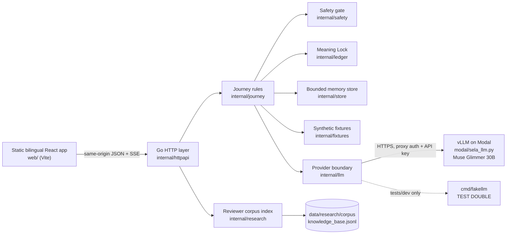

# Sela v2 architecture

Status: **implemented** on branch `feat/v2-go-meta-runtime` (Go API, static frontend, Modal serving code); live Modal inference not yet verified ([B-1](BLOCKERS.md)). Authority: [SPEC](../SPEC.md) C1, C4–C8, C11, I.api/I.meta/I.data/I.research, V3–V19.

## Runtime

One Go binary (`cmd/sela`) serves `/api/v2` and the built frontend (`SELA_WEB_DIR`). There is no Node server, database or Redis. The model server is a separate Modal app; the Go app talks to it with an OpenAI-compatible client.

## Package boundaries

| Package | Owns | Does not |
| --- | --- | --- |
| `internal/httpapi` | Routing, same-origin guard (`X-Sela-Request`, `Origin`, Fetch Metadata), JSON strictness and size limits, cookies, rate limits, SSE, static files, security headers, localized errors, metadata-only request logs | Product rules |
| `internal/journey` | Sessions, consent/retention, safety routing state, story segments, ledger versions and approval, Next Step, Opening Practice, share grants and recipient principals, handoff state machine, follow-up, AI operations and their commit rules, prompts | HTTP, model transport |
| `internal/safety` | Deterministic ID/EN/code-switched crisis lexicon (ported from Dengar.in) with clause-level denial, quotation and third-party handling | Logging, network |
| `internal/ledger` | Sentence segmentation, strict model-draft parsing, Meaning Lock (quote grounding, negation/subject/time/certainty, diagnosis/medication/number checks), opening-line validation and templates, practice coverage, JSON Schemas | Storage |
| `internal/llm` | Provider interface, OpenAI-compatible streaming client (retries before first token only, timeouts, cancellation, output bound, model-name check), admission semaphore, test-double handler | Any non-Meta provider, prompt content |
| `internal/store` | Per-session-locked memory store, share-token and recipient indexes, expiry and bounded eviction | Persistence |
| `internal/fixtures` | Embedded, validated synthetic catalogue (scenarios with gold annotations, fictional professionals/slots/plans, options, verified help resources, versioned policy texts) | Real data |
| `internal/research` | BM25 search over the exported research knowledge base | Session data, model calls |

## Request path of an AI draft

1. `POST /api/v2/ledger/draft` with `expectedVersion`. The HTTP layer checks origin, content type, size and the per-address rate.
2. Journey checks the session version, the story exists, **no crisis interruption**, **AI consent granted**, the provider is enabled, no draft is running, and the per-session operation limit. It records an operation with the story version, ledger version and consent revision it was started from, and returns 202.
3. A goroutine waits for an admission slot, reports `warming` when the Modal model is probably cold, and streams the completion with a JSON-schema constraint. Each completed array element is parsed incrementally and validated; only validated claims are sent to the browser as `item` previews.
4. The full output is parsed strictly and validated (Meaning Lock). The commit happens only if the session still exists and the story version, ledger version and consent revision are unchanged and no crisis occurred; otherwise the result is discarded (`stale_result` or `canceled`). Items are stored unreviewed with `live_meta` (configured Modal provider and matching served model name) or `test_double` provenance.
5. Reasoning tokens produced by the model are never stored or shown.

## Sessions, sharing and isolation

- Owner session: 256-bit random id in an HttpOnly, SameSite=Strict cookie scoped to `/api/v2`. Optimistic concurrency on a per-session version. Idle expiry 30 minutes (2 hours maximum) without storage consent, 24 hours with it; a sweeper runs every minute.
- Share grant: 256-bit token (only its SHA-256 is indexed) plus an 8-character access code; the recipient principal is a separate cookie scoped to `/api/v2/recipient` and bound to one handoff. The projection is computed once from the approved snapshot and the selected fields; the preview endpoint returns the same projection.
- Revocation, expiry, lockout, supersession and owner deletion remove the token index entry and every recipient principal for that handoff.
- One visitor's operations, handoffs and recipient principals are unreachable from another visitor; tests cover the cross-session paths.

## Migration and coexistence

The inherited v1 (`apps/web` Next.js, `packages/*`, `services/*`, Supabase/PostgreSQL/Redis tooling) is untouched and still tested by `quality.yml`. v2 lives in `cmd/`, `internal/`, `web/`, `modal/`, `e2e/`, `eval/` and is tested by `v2.yml`. v1 removal (T9) waits for v2 acceptance including live Meta evidence; no AMD code exists in v2.
