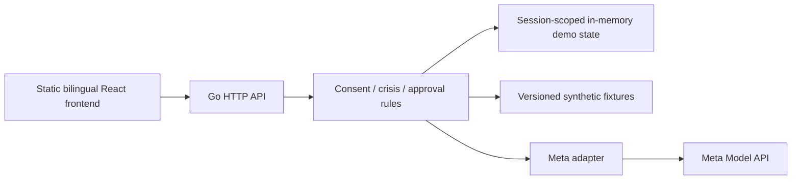

# Sela v2 architecture

Status: target architecture. No Go code or static-web bundle exists yet. Authority: [SPEC](../SPEC.md) C1, C5–C8, C11, I.api/I.meta/I.data, V3–V12.

## Runtime

Go is user-confirmed. React/TypeScript + Vite and single-process static serving are engineering defaults. The target uses Node only to build frontend assets; no Node server, PostgreSQL or Redis is required for the new demo runtime. Do not claim lower memory until equivalent workloads are measured.

## Boundaries

- HTTP layer validates bounds/content type/session/origin/version/idempotency before invoking application operations.
- Application layer owns crisis gates, consent, matching, approval, sharing and transition rules. These rules are not delegated to the model.
- Provider adapter accepts a bounded seeded request and returns untrusted structured content plus provenance. Application validators decide what may be stored/displayed.
- Store holds immutable fixture references and versioned session records. It provides atomic updates and snapshot access; no shared global patient record.
- Professional view reads a projection of the explicitly shared snapshot, never the original session's private story/history. Demo role switching conveys no clinical identity verification.
- Static frontend presents server state; browser flags cannot grant consent, approval or recipient access by themselves.

## Session defaults

Use an unpredictable opaque session cookie, HttpOnly and SameSite, Secure on HTTPS. Check same-origin mutations, bound body sizes and rate limits, and do not put session/brief tokens in URLs. IDs alone never authorize access. Use idle expiry, maximum lifetime and maximum active-session limits with bounded eviction; exact values are pinned during T2/T3. Restart resets demo state and says so explicitly.

Protect atomic transitions with optimistic versions and concurrency-safe store operations. Reset/revoke/expiry changes session/share generations so in-flight model results cannot resurrect access or overwrite newer state. Cancellation and cleanup release concurrency slots.

## Migration

Current runtime: `apps/web` Next.js and TypeScript `packages`/`services`, v1 database/Redis tooling. It still runs and its current CI still applies. The source baseline before documentation refactor is `d5da323` (Git history and earlier bundle available).

Planned layout is decided in T3: Go application/domain/provider/store packages, a separate static frontend, synthetic fixtures and contract/e2e tests. Avoid inventing executable commands or paths before creating them.

Migrate a complete synthetic vertical slice first. Verify behavioral contracts and the manual/error paths before route cutover. Remove v1 API/runtime and AMD-specific code only after T8 acceptance, then update environment templates, npm/Go tooling, CI and deployment atomically. Retain original notices and archived technical evidence.
