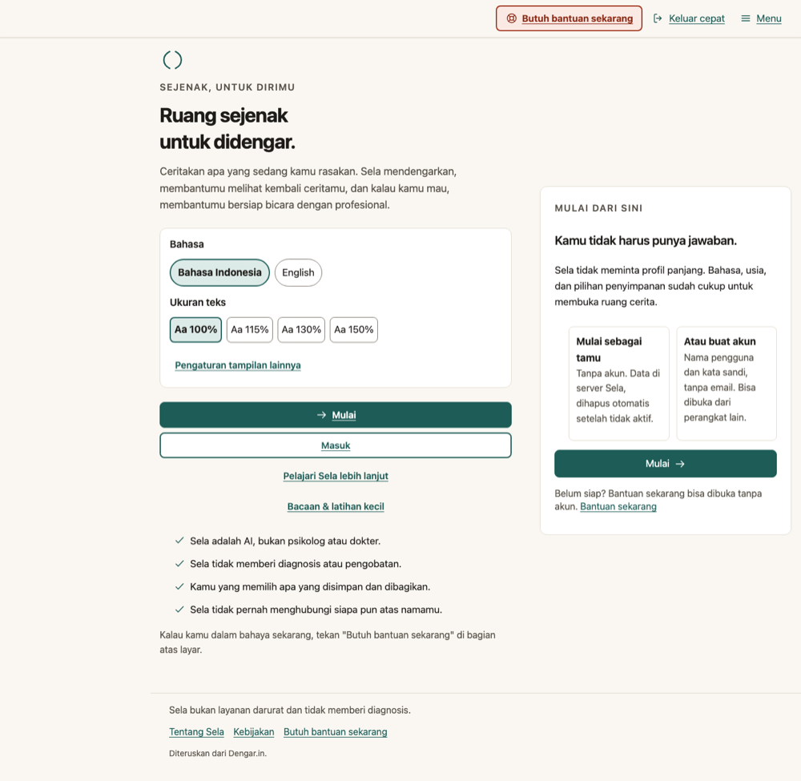
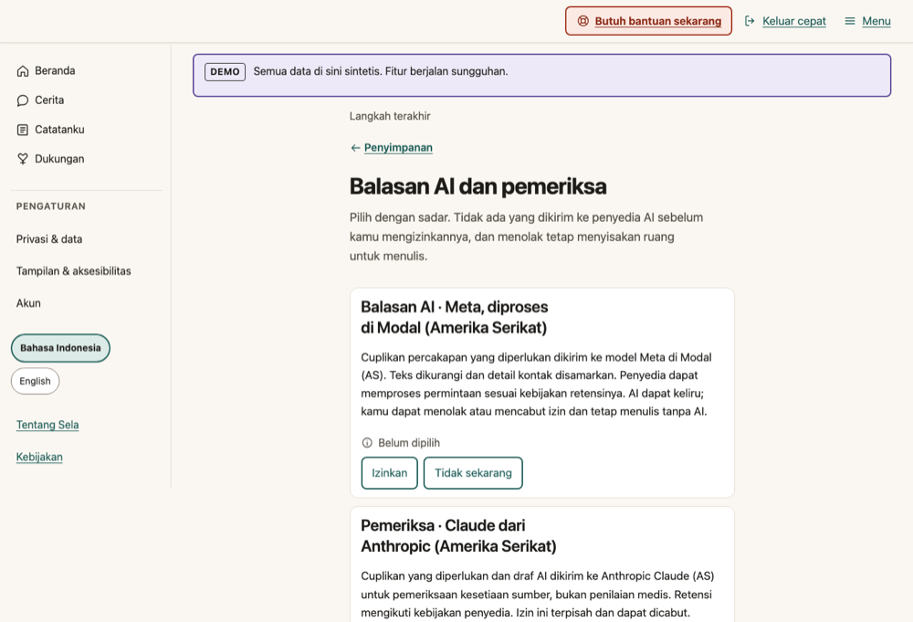
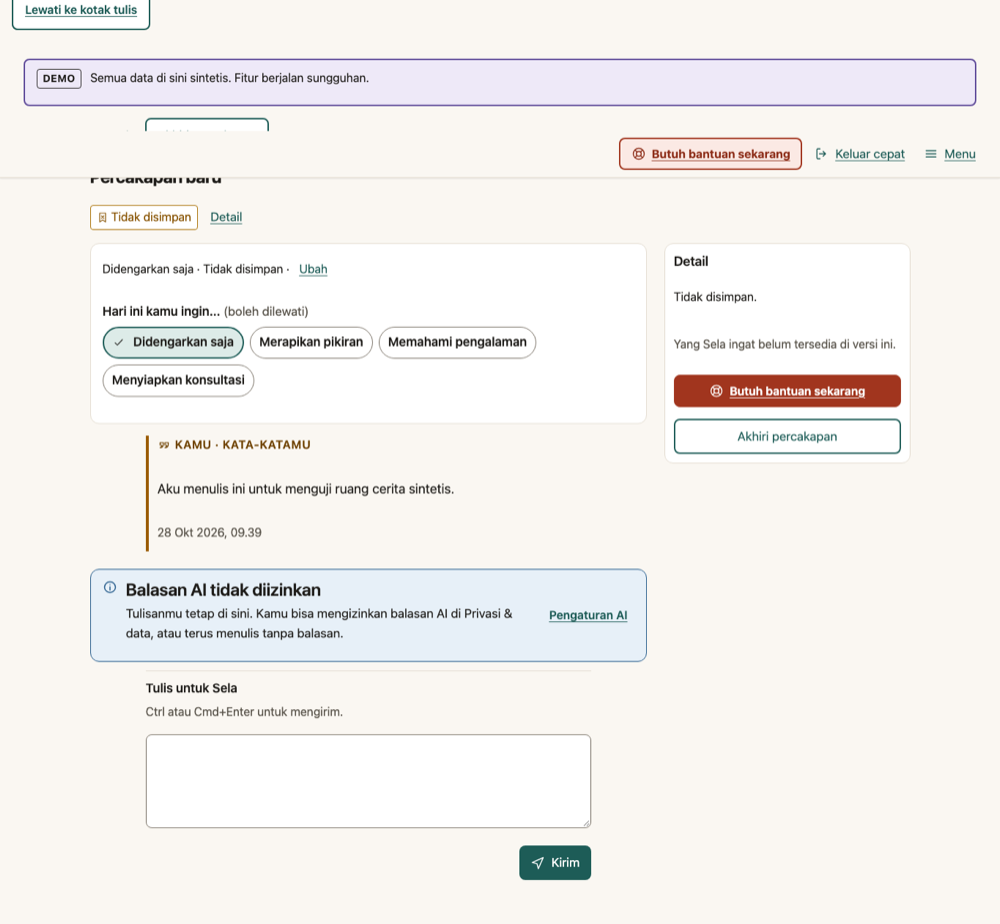
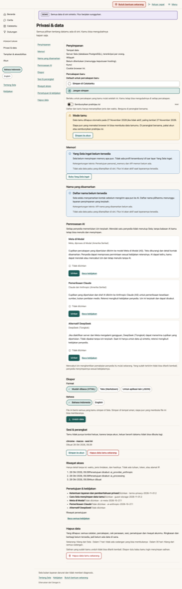
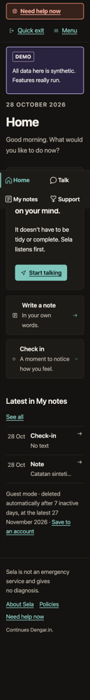

# Sela v3 frontend delivery — local validation

Date: 2026-10-28. Branch: `feat/v3-experience`, stacked on the in-progress
`feat/v3-core-journey` (base `e62506a`). Environment: Docker image `sela:v3-core`
built from this tree, local PostgreSQL 16, `SELA_ENV=development`, synthetic data
only. **Status: implemented and verified locally.** Not deployed, not verified
live, not ready for a controlled pilot, and not a clinical or usability claim.

The v2 synthetic demo stays at `/demo`; its fictional recipient entry stays at
`/r`. The legacy Next.js app in `apps/web/` is untouched and is not a delivery
target.

## What was delivered

The default `web/` entry now uses the v3 app: a single React 19 + TypeScript +
Vite frontend with the design tokens from `docs/design/tokens.css`, one shell,
one component set, and `/api/v3` only. No UI framework was added. The local
Deliverables are:

- the app shell: top bar with "Butuh bantuan sekarang" and "Keluar cepat",
  four-place navigation, full-height menu sheet, notices, footer, three live
  announcement regions at the end of `<body>`, route titles and route focus;
- display preferences applied before paint by `web/public/boot.js`: text size,
  theme, high contrast, relaxed spacing, reduced motion, Enter-to-send,
  screen-reader reply announcements, read-aloud, dictation disclosure, Quick
  exit shortcut and sign-out policy, hidden previews and neutral tab titles;
- bilingual ID/EN copy in the v3 `w(id, en)` pattern; `/html lang` follows the
  language and account locale when signed in;
- the real v3 journeys listed below, plus truthful unavailable states for
  screens whose APIs do not exist.

## Screen matrix (28 groups)

Status here is deliberately narrower than "verified locally" in SPEC §G:
"implemented" means the screen exists and its available path was exercised;
"verified locally" means the automated and browser checks in this document
passed for that screen. A screen with a missing backend dependency is
implemented as an honest, non-interactive state.

| # | Screen | Route(s) | Status | API / dependency |
| --- | --- | --- | --- | --- |
| S01 | Introduction, About | `/`, `/about` | verified locally | `GET /api/v3/auth/options`, `/policies`; provider facts are static and current |
| S02 | Onboarding (age, teen notice, storage, account, codes, guardian, AI consent) | `/start/*` | verified locally for 18+ guest/account and 16–17 guest + guardian; 15 and under-15 blocked | auth, consents, guardian; limits below |
| S03 | Sign in | `/signin` | verified locally | `POST /api/v3/auth/login` |
| S04 | Create account and recovery codes | `/start/account`, `/start/codes` | verified locally | register, acknowledge codes |
| S05 | Recovery | `/recover` | verified locally | `POST /api/v3/auth/recovery` |
| S06 | Guest upgrade | `/settings/account/upgrade` | verified locally | `POST /api/v3/auth/guest/upgrade` |
| S07 | Home | `/home` | verified locally; no shares card because there is no shares API | `/me`, `/records`, `/conversations` |
| S08 | Conversation list | `/talk` | verified locally | `/records` (`conversation`), `/conversations` |
| S09 | Conversation room | `/talk/new`, `/talk/:id`, `/talk?record=` | verified locally for the core; see gaps | `/conversations`, turns, stop, end, storage, resume |
| S10 | Note and reflection | `/notes/write`, `/notes/:id` | verified locally for write/edit/versions/delete; reflection is blocked | `/records`, `/records/{id}/versions` |
| S11 | Check-in and detail | `/notes/check-in`, `/notes/:id` | verified locally | `/records` with mood, energy, tags, note |
| S12 | Timeline and patterns | `/notes`, `/notes/patterns` | verified locally for conversation/note/check-in; summary/share entries absent | `/records`; pattern view is a local opt-in count |
| S13 | What Sela remembers | `/notes/memory` | blocked by API | no memory API or `personal_memory` consent |
| S14 | Support hub | `/support` | verified locally | static sections; summaries and reading report their blockers |
| S15 | Summary build/review/approve/view | `/support/summaries/*` | blocked by API | no `/consultation-summaries` |
| S16 | Preparation | `/support/summaries/:id/prepare` | blocked by API | no opening/preparation routes |
| S17 | Sharing | `/support/summaries/:id/share` | blocked by API | no `/shares` |
| S18 | Share status, audit, revoke | `/support/shares/:id` | blocked by API | no share audit/revoke routes |
| S19 | After the consultation | `/support/summaries/:id/after` | blocked by API | no follow-up route; a normal note remains available |
| S20 | Reading and small exercises | `/reading`, `/reading/:slug` | blocked by editorial gate | 38 machine-drafted items await human editor sign-off; no unreviewed text is shown |
| S21 | Immediate help | `/help`, `/help#layanan` | verified locally | bundled verified directory; works offline |
| S22 | Privacy and data | `/settings/privacy` | verified locally; memory and names sections blocked | consents, sessions, audit, history, export, reauth, delete |
| S23 | Display and accessibility | `/settings/display` | verified locally | local preferences only |
| S24 | Account | `/settings/account` | verified locally | `/me`, password, recovery codes, guardian consent, logout |
| S25 | Recipient page (v3) | `/recipient`, `/r` | blocked by API in v3; v2 demo at `/r` is retained | no recipient principal/share API |
| S26 | Minors (15–17) | `/start/teen`, `/start/guardian`, system blocks | partial, verified locally in development | guardian consent API exists; legal gate and 15 block remain |
| S27 | System screens | not found, session ended, under 15/15/band, guardian gate, policy gate, deleted | verified locally | v3 routes; yearly age-band confirmation |
| S28 | Policies | `/policies`, `/policies/:purpose` | verified locally for current versions | `/policies`, `/me/consents`; earlier versions have no route |

## API contracts integrated

Used as shipped on the branch, never mocked in the product:

| Area | Routes |
| --- | --- |
| Accounts | `POST /auth/register`, `/auth/login`, `/auth/logout`, `/auth/logout-all`, `/auth/guest`, `/auth/guest/upgrade`, `/auth/recovery`, `/auth/reauth`, `/auth/password`, `/auth/recovery-codes` |
| Public | `GET /policies`, `GET /auth/options` |
| Profile | `GET/PATCH /me`, `DELETE /me`, `POST /me/recovery-codes/acknowledge` |
| Consents | `GET /me/consents`, `PUT /me/consents/{purpose}`, `GET /me/consents/history` |
| Guardian | `GET/PUT/DELETE /me/guardian-consent` |
| Sessions and audit | `GET /me/sessions`, `DELETE /me/sessions/{id}`, `GET /me/audit` |
| Export | `GET /me/export?format=json\|html\|md&lang=id\|en` |
| Records | `GET/POST /records`, `GET/PATCH/DELETE /records/{id}`, `GET /records/{id}/versions` |
| Listening | `GET/POST /conversations`, `GET/DELETE /conversations/{id}`, `POST /conversations/{id}/turns`, `DELETE /conversations/{id}/operation`, `POST /conversations/{id}/resume`, `PATCH /conversations/{id}/storage` |

The only backend change in this increment is additive to the encrypted personal
record payload: `checkin` accepts and returns `energy` (`low|medium|high`),
`tags` (the ten approved tags) and mood `mixed`. It is covered by
`TestV27CheckInEnergyAndTags` in `internal/account/records_test.go`. No route,
authorization rule or storage boundary changed.

## Missing dependencies (truthful blockers)

| Surface | Missing dependency | What the UI does |
| --- | --- | --- |
| Memory and proposals | `personal_memory` consent, `/api/v3/memory`, derived-item queries | explains the missing service; shows no fake items or profile |
| Summary, approval, export | `/api/v3/consultation-summaries`, verifier-gated drafting | explains the missing service; keeps notes and help usable |
| Preparation and practice | summary/opening/preparation routes, destination checklists | explains the missing service |
| Sharing, recipient, revocation, follow-up | `/api/v3/shares`, `/api/v3/recipient`, share audit | explains the missing service; `/r` remains the v2 synthetic demo |
| Reading | human editorial review of content set `sela-reading-v1` | says that no reading is published yet |
| Timeline summary/share entries | share/summary read models | shows only the record types that exist |
| Conversation extras | correction messages, reflection cards, memory proposals, derived-item deletion, hold-timeout warning, streaming operation events | not shown; the room keeps the available send/stop/end/storage/crisis/resume path |
| Private names list | names API and masking preview | explains the missing service; contact masking for AI still applies server-side |
| Earlier policy versions | policy version history route | shows the current version and says earlier pages are not available |

These are recorded in the backlog and in `OWNER_TESTER.md`. No screen presents
a test double, placeholder record or invented API result as real.

## Automated evidence

Run on 2026-10-28 in this workspace.

| Check | Command | Result |
| --- | --- | --- |
| TypeScript | `cd web && npm run typecheck` | exit 0 |
| Unit/component/axe | `cd web && npm test` | **58 tests in 11 files passed**; v3 tests cover onboarding, under-15 block, guest creation, sign-in error, Home, note save, listening reply/provenance, consent toggle, display preference and an axe smoke test |
| Production build | `cd web && npm run build` | exit 0; see budget below |
| Go format/vet | `gofmt -l cmd internal`, `go vet ./...` | clean |
| Go unit + DB | `SELA_REQUIRE_DB_TESTS=1 go test -count=1 ./...` | every package `ok` (local PostgreSQL 16) |
| Go race (affected) | `SELA_REQUIRE_DB_TESTS=1 go test -race -count=1 ./internal/account ./internal/httpapi` | `ok` in both packages |
| Browser journey + axe | `node e2e/v3-frontend.e2e.mjs` | **44/44 checks passed**, no console/page errors; see below |
| v2 demo regression | `go build -o build/sela ./cmd/sela && go build -o build/fakellm ./cmd/fakellm && node e2e/journey.e2e.mjs` | **14/14 journeys passed**; test double only, no live provider |
| CI | PR #14, head `0c7cbd0`: `v2.yml` run **40622842591**, Quality gate run **40622842602** | All jobs pass: Go format/vet/race with PostgreSQL 16, frontend, research/Modal offline, container image, e2e journeys, and the quality gate |

### Browser checks

PR #14 re-verification (2026-10-28): `go vet ./...` and the full
`SELA_REQUIRE_DB_TESTS=1 go test -race -count=1 ./...` passed in Docker with
PostgreSQL 16. Frontend typecheck, all 58 tests and the production build passed.
The image built from `10b3ec6` served a current schema and healthy database.
The browser runner now exits nonzero for any failed check (SPEC BUG-3): an
injected journey exception returned 0 before the fix and 1 after it. The normal
44-check journey passed after the fix with exit status 0 and no browser errors. Docker browser checks use localhost
in the application's network namespace and the installed system Chromium;
HTTP container hostnames cause a browser secure-origin warning and are not
used as the acceptance origin. No paid provider call is needed for this run.

Runner: `npm install --no-save playwright && npx playwright install chromium`
(the repository does not add Playwright as a dependency), then
`E2E_BASE_URL=http://127.0.0.1:8080 node e2e/v3-frontend.e2e.mjs`. The script
drives Chromium against the rebuilt local Docker image.
It creates one synthetic guest, visits the Intro, age/storage/AI consent steps,
a room, a saved note, a check-in, the timeline, Privacy & data, Display (dark
130% and high contrast), Home/Talk/Help at 320 CSS px in English, Account,
Support, the blocked summary and reading states, Policies, and deletes the guest
through the API at the end.

- 18 axe scans with WCAG 2.0/2.1/2.2 A/AA tags: **zero serious or critical
  findings** (colour contrast included; the earlier contrast regression from the
  v2 stylesheet was fixed by scoping the v3 base styles).
- No horizontal overflow at 320 CSS px on any checked view.
- The first Tab stop on the Introduction is "Lewati ke konten"; route changes
  move focus to `<main>`; dialogs restore focus.
- The synthetic guest deletion returns 200; a subsequent `/me` returns 401.
- Evidence screenshots (development Demo banner visible; synthetic data only):
  [`docs/evidence/v3-frontend`](evidence/v3-frontend/).

Selected evidence:

## Performance budget

| Item | Budget | Measured |
| --- | --- | --- |
| Initial JavaScript, gzip | ≤ 120 KB | 117.0 KB (`index-*.js`); shell/Home chunk 17.8 KB |
| Route chunks, gzip | ≤ 40 KB each | Settings 11.4 KB; Onboarding 8.2 KB; Auth 3.6 KB; Support 2.6 KB; Help 2.2 KB; Policies 1.4 KB; Reading 1.3 KB |
| CSS, gzip | ≤ 25 KB | 11.5 KB |
| Fonts and raster images | 0 bytes | system fonts; inline SVG only |

No external requests, fonts or analytics were added; the CSP remains
`default-src 'self'` with `script-src 'self'`, met by `web/public/boot.js`.

## Accessibility

Engineering evidence:

- semantic landmarks, one `h1` per view, labelled navigation, definition lists
  for check-in facts, a real table for the pattern view, fieldsets/legends for
  radio groups, native dialogs with focus return;
- three announcement regions created once at the end of `<body>`; transcript
  log is `aria-live="off"`; released replies are announced only when the
  preference is on; crisis support uses the alert region once;
- visible focus ring (3px, 2px offset), route titles, skip links, route focus,
  44px targets, text size 100–150%, 320px reflow, 400% zoom path via CSS,
  reduced motion tokens, high-contrast schemes, relaxed spacing, system fonts;
- ID/EN labels and messages; `lang` on language buttons and preference-driven
  content.

Manual checks performed in Chromium: keyboard order and skip link, menu sheet
focus/escape, route focus, dialog focus return, 320px layout and 130%/high
contrast. **Not performed:** a human screen-reader session with NVDA, JAWS,
VoiceOver or TalkBack; a human usability study; a formal WCAG audit. Those are
not claimed. The automated axe result is necessary but not sufficient.

## Safety and privacy regression

- "Butuh bantuan sekarang" and "Keluar cepat" are in the same order on every
  shell and are the first two controls of the menu sheet; Help works from the
  bundled verified directory without the network.
- No crisis path calls a model: the backend pauses the room; the UI retains the
  person's words, shows static verified services, and offers explicit resume or
  end. Closing the panel leaves a persistent pause line.
- No sensitive content is written to localStorage/sessionStorage. Only display
  preferences live there; drafts live in component memory; Quick exit discards
  them. The only sessionStorage values are the non-content flags
  `sela.trusted`, `sela.userKind` and `sela.crisis`.
- Export, deletion, sessions and consents remain server-authorized; recipient
  and sharing principals are not imitated.
- No engagement counts, streaks, scores or notifications were added.

## Known gaps and owner decisions

1. Legal review (B-10), hosting/region (B-3, B-15), live provider access and
   evaluation (B-1, B-8, B-9) and the restore announcement remain release gates.
2. The summary/sharing/recipient/memory/reading APIs are not implemented; the
   screens are honest blocked states, not completed features.
3. The conversation room does not yet implement correction messages, reflection
   cards, memory proposals, streaming events, the hold-timeout warning or
   derived-item deletion.
4. The 15-year-old block is enforced in the UI only; the server has one `15_17`
   age band. Production still enables only `18_plus` until the legal review.
   Age remains self-declared, and the guardian/policy interlocks are currently
   UI gates over the owner-authenticated routes, not separate server guards.
   That is recorded as a release blocker, not claimed as enforced.
5. Earlier policy versions and a screen-reader manual audit are outstanding.
6. No live AI call was made in this validation. The room was exercised with AI
   consent declined, exercising the no-AI path; provider success and verifier
   behaviour are backend evidence, not this frontend run.
7. The room composer is in the page flow, not sticky, so it cannot cover the
   transcript or the pause/help line on short viewports. The design asks for a
   sticky composer; that remains a deliberate local deviation to be revisited
   with a measured `--composer-h` layout.
8. The "new conversation" and end-of-unsaved copy now name the server hold, and
   an authenticated `pagehide` purge is attempted. If the browser fails to send
   it, the backend's 30-minute inactivity/2-hour hold still applies; this is
   not presented as instant deletion.
9. The automated browser checks are Chromium-only. Safari, Firefox, Android and
   iOS keyboard/zoom checks remain owner/manual work.
