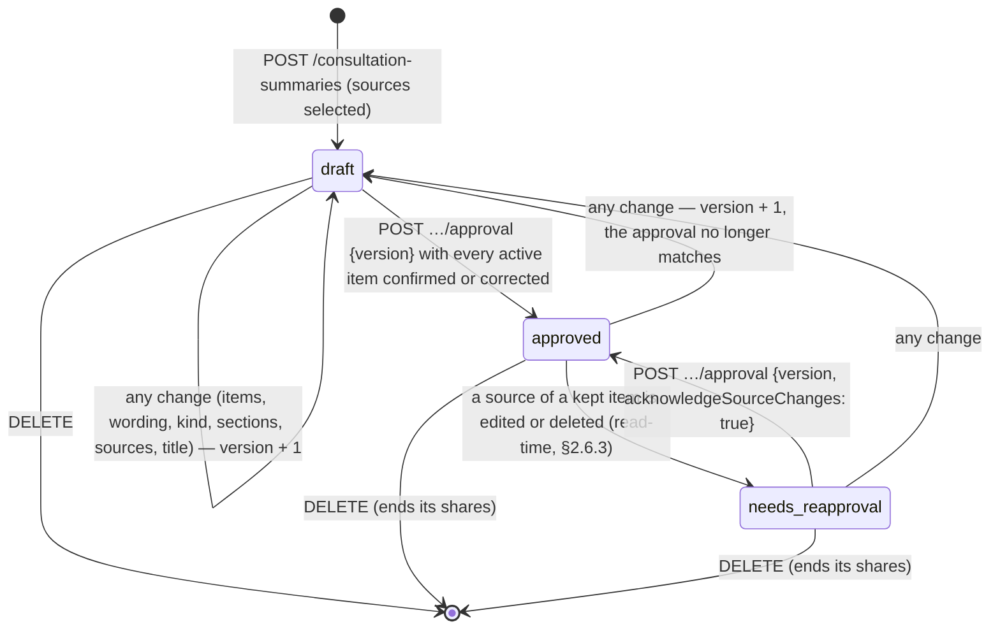

# Sela v3 API — consultation summary, sharing, recipient and follow-up (P4)

Status: **planned** (SPEC §G). Specified 2026-10-26 on branch `feat/sela-v3-sharing` (based on `origin/feat/sela-v3-pilot` `59dba14`), uncommitted; revised the same day after review round 1 (§15). No code, no test and no screen exists for anything in this contract; nothing here is implemented, verified locally or verified live. It builds on the v3 foundation (`0ff3341`, verified locally; [SPEC §G foundation status note](../../SPEC.md#foundation-status-note-2026-10-26)), on the P3 listening contract (`docs/api/V3_LISTENING_AND_NOTES.md` on branch `feat/sela-v3-listening`, uncommitted, not merged) and on ADR-0003 (AI routing; the router is in progress on `feat/sela-v3-ai`, draft PR #10, not merged). Where this contract depends on work that is not merged, it says so.

Owner packages (proposed, §14.3): `internal/summary` (summaries, items, approvals, preparation and opening lines, the AI drafting port, the derived-items handler, exporters), `internal/share` (shares, projections, link tokens and access codes, recipient principals, share events, sweepers), `internal/followup` (after-consultation notes, own next steps), `internal/names` (the "names kept private" list and the masking applied to projections and provider requests), plus routes in `internal/httpapi` (`v3_summary_*.go`, `v3_share_*.go`, `v3_recipient.go`, `v3_followup.go`) and migrations 0400–0499 in `internal/db/migrations`.

Authority: owner brief v3 (2026-10-26) → [SPEC](../../SPEC.md) (C16–C26, V26–V42; SPEC stays authoritative) → the decisions it cites ([decision log](../DECISION_LOG.md) D-026 to D-056) → [ADR-0002](../adr/ADR-0002-persistence-accounts-and-encryption.md), [ADR-0003](../adr/ADR-0003-ai-routing-verifier-fallback.md) → the [backlog](../BACKLOG.md) and the [design documents](../design/SCREENS.md) → this contract. This contract specifies; it decides nothing that SPEC or a decision already settles. Where it chooses between readings of the sources, §14 names the choice and why, and §13 lists what the PM must confirm.

**Relationship to [API_SPEC_V3](../API_SPEC_V3.md).** This is the P4 content of the sections that API_SPEC_V3 §9 reserves ("P4 Consultation summary and sharing", `/api/v3/consultation-summaries`, `/api/v3/shares`; "P4 Recipient", `/api/v3/recipient`; migration range 0400–0499). API_SPEC_V3.md is not edited here; the documentation owner merges or links it. API_SPEC_V3 §1–§8 and the P3 conventions (P3 contract §2) apply unchanged unless §3.1 below adds to them.

**Labels** ([FORMAT.md](../../FORMAT.md)): *PM decision* and *user-confirmed* items are cited by their ID; everything else in this contract is an **engineering default** (revisable with a recorded reason), marked as such where it matters. IDs local to this contract carry the prefix `CS-` (deviations `CS-DV-n`, open points `CS-OP-n`); they are not SPEC, decision or blocker IDs.

## 1. Scope and non-goals

### 1.1 Backlog items this contract targets

| Item | Part covered here | Milestone |
| --- | --- | --- |
| S-090 Build a "Ringkasan untuk konsultasi" | Whole item: sources, items, manual path, approval by version and hash, stale marker | P4 |
| S-091 AI wording for summary items, checked before release | Data model, provenance, release rules (VC-8) and the drafting port; the provider calls arrive with P5's router | P5 (port here) |
| S-092 Print or download one summary | Server-rendered HTML and Markdown of one approved version; audit | P4 |
| S-100 Preview and consent before sharing | Whole item | P4 |
| S-101 Share link, access code, expiry, revocation and status | Whole item | P4 |
| S-102 Opening lines for a consultation | Template path, AT-5 path (Meta only until P5), practice | P4 |
| S-103 What to bring and what to expect, per destination | The checklist route and the person's saved preparation; content re-verification is B-5 / S-154 | P4 |
| S-104 Mark names as private and preview what is removed | The names list, masking in projections and provider requests, the redaction preview | P4 |
| S-120 What the recipient sees | Whole item | P4 |
| S-121 Acknowledgement and consultation status | Whole item | P4 |
| S-130 Reflect after a consultation | Whole item | P4 |
| S-131 My own next steps | Whole item | P4 |
| S-171 Consent records per purpose and per provider | P4 part: the `sharing` policy text and the per-share consent record (§5) | P4 |
| S-174 Delete … one record and what came from it | P4 part: deletion of summaries, shares, follow-ups and steps; the derived-items handler for P3 sources | P4 |
| S-175 Export my data | P4 sections | P4 |
| S-176 Access audit I can read | Recipient events and the per-share access history | P4 |
| S-040 Personal home | Server side of "active shares" (`GET /api/v3/shares?state=active`) | P3/P4 |
| S-195 Browser review | Not an API matter; the P4 screens (S15–S19, S25, parts of S22, and the standalone follow-up and next-steps screens of §14.3) need it before "verified locally" | P4 |

### 1.2 Decisions applied

| Meaning | Source |
| --- | --- |
| Honest terms: "Ringkasan untuk konsultasi", "Catatan pribadiku"; never "rekam medis", "diagnosis", "hasil pemeriksaan", "assessment result"; the summary says it is the person's own notes, prepared with AI help where applicable | D-039, C22 |
| Provenance classes and review statuses; originals never overwritten; reserved classes never assigned | D-040, V28 |
| Handoff statuses `prepared → shared → opened → acknowledged → consultation_in_progress`, plus `revoked`, `expired`, `ended`; no status implies care | D-041, V30 |
| Recipients are people the person invites, through a link plus a separate access code; identity not verified and labelled so; no directory, booking or partnership | D-042, V30, C22 |
| Sharing consent by content, recipient and purpose, with the exact immutable projection previewed | V30, V5 |
| Revocation, expiry, replacement, account deletion and the deletion of a quoted source end future access at once; copies already seen cannot be recalled | V31, V6, S-101 AC2 |
| Every recipient access and every privacy-relevant action is audited, content-free | V32, D-052 |
| Owner only from the cookie; owner and recipient principals never cross | V33, ADR-0002 §10 |
| Deletion with derivatives; deleting a summary ends its shares; crypto-shredding on account deletion | D-028, V34 |
| Crisis screening of every person-written text; never erased, never refused; Sela never contacts anyone | D-036, V3, V38, C23 |
| No engagement pressure | D-037, C20 |
| Ages 15–17 built but gated; no guardian access; no DeepSeek for minors | D-031, C19, V37 |
| Multi-provider AI with consent per provider; Meta generates, Claude verifies, DeepSeek only as the availability fallback; every output names its provider | D-030, D-049, D-050, C18, C13, V19–V21, V35, V36 |
| Minimised data to providers; private names and contact details replaced | V41, ADR-0003 §9 |
| Export of everything the person owns, with provenance | V40 |
| Environment separation; the demo runs every feature on synthetic data | D-046, V42 |

### 1.3 Non-goals

- **S-122 (later):** verified professionals, a professional directory, booking, partnerships, professional accounts and professional-written notes. The reserved class `verified_professional_note` is refused by a `CHECK` constraint in every P4 class column; no recipient can write text into Sela (clarification reasons are a fixed list); nothing in P4 claims that a recipient is a professional. The docs confirm that no verified professionals exist in the pilot (D-042; S-122 is post-pilot).
- Recipient accounts, recipient messaging, uploads by anyone (D-043, S-182), recipient downloads (S25: "Sela tidak menyediakan unduhan").
- Recalling copies already viewed, downloaded, printed or photographed (V31).
- Any automatic contact: no e-mail, SMS, push or call to the recipient, a guardian, a helpline or the person (C23, V38). "The sender will see it" means an in-app status the person reads in Sela, never a notification.
- Server-side PDF generation (S-092 non-goal), server-side search indexes over content (ADR-0002 §5).
- Fixture plans, the v2 fictional professionals and slots outside the demo (C24, D-042).
- AT-4 provider calls before P5's router is wired: AT-4 is verifier-gated, so P4 ships its drafting port (§6.7) with the no-AI implementation and AT-4 abstains until P5 (§6.3). AT-5 runs on Meta through the shared provider, as P3's replies do, with flagged lines withheld until the verifier exists (§6.4).
- More than one app instance (S-268): the per-instance rate limiter and the operation runtime limit P4 as they limit P3.
- Identity verification of recipients or senders.

### 1.4 Dependencies

| Dependency | State | What P4 needs from it |
| --- | --- | --- |
| Foundation (`0ff3341`) | verified locally | Accounts, guest mode, sessions, reauth, consents, audit, export registry, vault, migrator |
| P3 listening contract and code (`feat/sela-v3-listening`) | in progress, not merged | Conversations, turns, journal entries, check-ins, memory items (summary sources); `internal/records` (derived-items registry, redactor, text rules, sealer, cursors, per-user buckets); `internal/operation` (operation runtime and SSE); `internal/crisis` (screening and support payload); `internal/timeline` (read model) |
| P5 router (`internal/ai`, draft PR #10) | in progress, not merged | Implements the P4 drafting ports with Meta, the Claude verifier and the DeepSeek fallback. Without it AT-4 abstains and AT-5 runs Meta-only with flagged lines withheld |
| P6 reading content | in progress, separate branch | Owns `/api/v3/reading`; P4 registers one public route under it (§3.6.1) |
| B-5 / S-154 | blocked externally | Re-verified checklist sources before real users see S-103 content |
| B-10 | blocked externally | Legal review of the `sharing` policy text and of minors' sharing before real users |

## 2. Data model

### 2.1 Record types

| Record | Table | Class of its content (D-040) | Review statuses | History |
| --- | --- | --- | --- | --- |
| Consultation summary (container: title, selection, version, approval pointer) | `consultation_summaries`, `summary_sources` | title `user_original` | — (the summary has a state, §2.6) | `version` counter; every change is a new summary version |
| Summary item, quote | `summary_items`, `summary_item_versions` (`quote_ct`) | `user_original` copy of the source passage at its version (or `user_correction` when the source passage was a correction or a corrected memory item) | fixed with the item | copied once; refreshed only by `refresh_quote` (a new item version) |
| Summary item, wording, manual path | same (`wording_ct`) | `user_original` | `confirmed`; an edit makes a new version `user_correction`, `corrected` | append-only versions |
| Summary item, wording, AI path (AT-4) | same | `ai_summary` | `unreviewed` → `confirmed` · `corrected` (edit, class `user_correction`) · `rejected`; "use my words" makes a version `user_original`, `confirmed` | append-only versions |
| Summary item from a memory item Sela proposed | same | `unconfirmed_interpretation`, copied at the memory item's version together with that version's AI provenance (generator, verifier, test double); no quote; its `source` is the memory item, and `source.memorySource` the memory item's own source (§3.4.3) | starts `unreviewed` in the summary whatever its status in memory | append-only versions |
| Summary item from a memory item the person wrote or corrected | same | `user_original` or `user_correction`, copied; the quote is the wording | `confirmed` | append-only versions |
| Own section item ("Yang belum kuketahui", "Pertanyaan yang ingin kutanyakan", "Hal praktis"), typed, or copied on the person's request from a follow-up note's "Apa yang ingin kamu tanyakan lain kali?" (§3.5) | same, `section ≠ points` | `user_original` | `confirmed`; edit → `user_correction`, `corrected` | append-only versions |
| Approval | `summary_approvals`, `summary_approval_items` | frozen snapshot of one summary version | — | append-only; deleted only with derivatives (§2.4) |
| Preparation (destination, checklist ticks) | `consultation_preparations` | `user_original` | — | `version` counter |
| Opening line | `opening_lines`, `opening_line_versions`, `opening_line_sources` | template: the class of the content it quotes; AI (AT-5): `ai_summary`; own: `user_original` | AI: `unreviewed` → `confirmed` · `corrected`; template and own: `confirmed` → `corrected` after an edit | append-only versions |
| Share | `shares`, `share_items` | the frozen projection inherits the classes and statuses of the approved snapshot | — (the share has an access state and a flow status, §2.7) | immutable projection; events append-only |
| Share event | `share_events` | no content | — | append-only |
| Recipient principal | `recipient_sessions` | no content | — | rows end, then are deleted (§2.5) |
| After-consultation note (S-130) | `follow_ups`, `follow_up_versions` | `user_original`; an edit makes a version `user_correction` | `confirmed` → `corrected` | append-only versions |
| Own next step (S-131) | `next_steps`, `next_step_versions` | `user_original`; edit → `user_correction` | `confirmed` → `corrected` | append-only versions |
| Name kept private (S-104) | `private_names` | `user_original` (not shown with a badge) | — | none (add or remove) |

Rules (as P3 §3.2): every item has exactly one class; `uploaded_document` and `verified_professional_note` are refused by `CHECK` constraints; the review status is on the record and the class is on the version; version tables are append-only (`sela_reject_update()`); AI-written items stay `unreviewed` until the person acts; unreviewed or rejected items never enter an approval, a projection or an export of an approved version.

### 2.2 Encryption (ADR-0002 §5; D-028)

Every content field is sealed with the owner's data key through `vault.Seal(ctx, q, userID, vault.Ref{Kind, RecordID, Field}, plaintext)`. Each version row has its own id, so a ciphertext cannot move between versions, records, fields or users undetected.

| `Ref.Kind` | Fields (`*_ct`) | Sealed plaintext |
| --- | --- | --- |
| `consultation_summary` | `meta` | `{title, titleSafety: {level}, lang}` |
| `summary_item` | `kind` | the group, one of the v2 `ledger.AllKinds`: `feeling \| experience \| impact \| duration \| context \| worry \| goal \| preference \| question` (shown as the nine S15 groups Perasaan, Pengalaman, Dampak sehari-hari, Sudah berapa lama, Konteks, Kekhawatiran, Harapan, "Preferensi" / "Preferences" for `preference` and "Yang kutanyakan di catatanku" / "Questions in my notes" for `question`; the last two are renamed from S15's "Hal praktis" and "Pertanyaan" so they cannot be confused with the optional own sections of the same names, §14.2 item 20; points only) |
| `summary_item_version` | `quote`, `wording`, `meta` | `quote`, `wording`: text (unmasked; masking happens at projection and provider time); `meta`: `{lang, quoteLang, quoteClass, qualifiers, sourceRef: {kind, version, at, start, end}, memorySourceRef: {kind, id, at}, ai, check, safety: {level}}` (`memorySourceRef` only on `memory` items: the memory item's own source; their `ai` is the memory item version's provenance, copied) |
| `summary_approval` | `snapshot` | the canonical snapshot JSON of §2.6.2 and its SHA-256 (`hash`) |
| `consultation_preparation` | `data` | `{destination, checklistVersion, checked: [checklistItemId]}` |
| `opening_line_version` | `text`, `meta` | `meta`: `{lang, recipientKind, quotedClasses, quotedProvenance, ai, check, safety}` |
| `share` | `label`, `consent`, `projection`, `secrets` | `label`: the recipient label; `consent`: the consent record of §5.1; `projection`: the frozen projection of §3.4.6; `secrets`: `{token, code}` for the replay window only (§4.2) |
| `follow_up_version` | `sections`, `meta` | `sections`: `{feeling, remember, agreed, askNext}` (each nullable); `meta`: `{lang per section, safety: {level}}` |
| `next_step_version` | `text`, `meta` | `meta`: `{lang, readingRef, safety}` (the reading item a step links to is sealed: it can reveal a topic) |
| `private_name` | `text` | the name or word |

The access code is never sealed and never stored in clear; only a keyed tag is stored (§4.1). The link token is stored only as SHA-256.

**Plaintext columns, each with its reason** (ADR-0002 §5 allows authorization, ordering, expiry, retention or a state machine; review rejects any other):

| Columns | Reason |
| --- | --- |
| `id`, `user_id`, every foreign key between the owner's own records (`summary_id`, `item_id`, `share_id`, `approval_id`, `follow_up_id`, the `source_*_id` columns) | authorization, cascade, derived-items deletion |
| `created_at`, `updated_at`, `approved_at`, `ended_at`, `last_seen_at`, `at` | ordering, idle and retention timers |
| `expires_at`, `secrets_until`, `idle_timeout_seconds` | expiry |
| `version`, `position`, `seq`, `summary_version`, `approved_version`, `source_version`, `source_ack_version` | concurrency, ordering, staleness |
| `state`, `flow_status`, `end_reason`, `review_status`, `prior_review_status`, `provenance_class`, `origin`, `section`, `source_kind`, `type`, `actor`, `reason_id`, `linked_to`, `source_gone_ack` | state machines; the class column also carries the reserved-class `CHECK` |
| `token_hash`, `code_tag`, `idem_key_hash` | lookup and comparison of secrets that are never stored in clear |
| `code_failures`, `clarifications`, `views`, `count`, `recipient_seq` | brute-force bound, action bounds, the access audit |
| `sharing_policy_version`, `safety_ruleset`, `title_ruleset` | consent version; the lexicon version that screened a text (V38; holds no result) |

**Encrypted although it is metadata:** the item group (`kind`), the share purpose, the recipient label, the fields chosen, the names shown or hidden, the safety levels, the destination and checklist ticks, every AI provenance object and verdict, the reading item a step links to. Residuals stated plainly: the existence of a summary and of a share, the share's access state and flow status (for example `consultation_in_progress`), its expiry, the number of recipient browsers and views, and the clarification reason ids are visible to anyone with database access, because the access checks, the expiry sweeper and the access audit need them; none of them reveals what the person wrote or to whom they wrote it.

### 2.3 Migrations

ADR-0002 §3 conventions apply: ids generated in Go, times from the Go clock, enums as `text` with `CHECK`, every table with `user_id uuid NOT NULL REFERENCES users(id) ON DELETE CASCADE`, `REVOKE ALL … FROM PUBLIC`, encrypted columns `bytea` named `*_ct`, no extensions. All five migrations are `-- sela:kind schema`; each has a down file that drops its objects in reverse order. Every bound and state rule that a request can reach is checked in Go before the statement that would break it (§3.3), so no `CHECK`, unique or deferred constraint fails in normal operation and the database server logs no row (ADR-0002 §13); the constraints are defence in depth. `SAFETY_RULESET` below stands for the check `~ '^[a-z0-9][a-z0-9._-]{0,63}$'`.

#### 2.3.1 `0400_consultation_summaries.up.sql`

```sql
-- sela:kind schema
-- sela:requires 0001,0100,0200,0300
CREATE TABLE consultation_summaries (
  id               uuid PRIMARY KEY,
  user_id          uuid NOT NULL REFERENCES users(id) ON DELETE CASCADE,
  version          integer NOT NULL DEFAULT 1 CHECK (version BETWEEN 1 AND 2000),
  approved_version integer NULL CHECK (approved_version > 0),
  meta_ct          bytea NOT NULL,
  title_ruleset    text NULL CHECK (title_ruleset ~ '^[a-z0-9][a-z0-9._-]{0,63}$'),
  idem_key_hash    bytea NULL CHECK (octet_length(idem_key_hash) = 32),
  created_at       timestamptz NOT NULL,
  updated_at       timestamptz NOT NULL,
  CHECK (approved_version IS NULL OR approved_version <= version)
);
CREATE INDEX consultation_summaries_user ON consultation_summaries (user_id, updated_at DESC, id DESC);
CREATE UNIQUE INDEX consultation_summaries_idem ON consultation_summaries (user_id, idem_key_hash) WHERE idem_key_hash IS NOT NULL;

-- The selection of step 1 (S15): which saved records the summary may draw on.
CREATE TABLE summary_sources (
  summary_id              uuid NOT NULL REFERENCES consultation_summaries(id) ON DELETE CASCADE,
  user_id                 uuid NOT NULL REFERENCES users(id) ON DELETE CASCADE,
  position                smallint NOT NULL CHECK (position BETWEEN 1 AND 30),
  source_kind             text NOT NULL CHECK (source_kind IN ('conversation','journal','check_in','memory')),
  source_conversation_id  uuid NULL REFERENCES conversations(id)   ON DELETE SET NULL,
  source_journal_entry_id uuid NULL REFERENCES journal_entries(id) ON DELETE SET NULL,
  source_check_in_id      uuid NULL REFERENCES check_ins(id)       ON DELETE SET NULL,
  source_memory_item_id   uuid NULL REFERENCES memory_items(id)    ON DELETE SET NULL,
  selected_at             timestamptz NOT NULL,
  PRIMARY KEY (summary_id, position),
  CHECK (num_nonnulls(source_conversation_id, source_journal_entry_id, source_check_in_id, source_memory_item_id) <= 1),
  CHECK ((source_kind = 'conversation' OR source_conversation_id IS NULL)
     AND (source_kind = 'journal'      OR source_journal_entry_id IS NULL)
     AND (source_kind = 'check_in'     OR source_check_in_id IS NULL)
     AND (source_kind = 'memory'       OR source_memory_item_id IS NULL))
);

CREATE TABLE summary_items (
  id                      uuid PRIMARY KEY,
  user_id                 uuid NOT NULL REFERENCES users(id) ON DELETE CASCADE,
  summary_id              uuid NOT NULL REFERENCES consultation_summaries(id) ON DELETE CASCADE,
  position                smallint NOT NULL CHECK (position BETWEEN 1 AND 200),
  section                 text NOT NULL CHECK (section IN ('points','unknowns','questions','practical')),
  origin                  text NOT NULL CHECK (origin IN ('quote','ai','memory','own')),
  kind_ct                 bytea NULL,
  review_status           text NOT NULL CHECK (review_status IN ('unreviewed','confirmed','corrected','rejected')),
  prior_review_status     text NULL CHECK (prior_review_status IN ('unreviewed','confirmed','corrected')),
  source_kind             text NULL CHECK (source_kind IN ('conversation','journal','check_in','memory')),
  source_conversation_id  uuid NULL REFERENCES conversations(id)      ON DELETE SET NULL,
  source_turn_id          uuid NULL REFERENCES conversation_turns(id) ON DELETE SET NULL,
  source_journal_entry_id uuid NULL REFERENCES journal_entries(id)    ON DELETE SET NULL,
  source_check_in_id      uuid NULL REFERENCES check_ins(id)          ON DELETE SET NULL,
  source_memory_item_id   uuid NULL REFERENCES memory_items(id)       ON DELETE SET NULL,
  source_version          integer NULL CHECK (source_version > 0),
  source_ack_version      integer NULL CHECK (source_ack_version > 0),
  source_gone_ack         boolean NOT NULL DEFAULT false,
  idem_key_hash           bytea NULL CHECK (octet_length(idem_key_hash) = 32),
  created_at              timestamptz NOT NULL,
  updated_at              timestamptz NOT NULL,
  version                 integer NOT NULL DEFAULT 1 CHECK (version BETWEEN 1 AND 50),
  UNIQUE (summary_id, position),
  CHECK ((origin = 'own') = (source_kind IS NULL)),
  CHECK ((origin = 'own') = (source_version IS NULL)),
  CHECK (section = 'points' OR origin = 'own'),
  CHECK ((section = 'points') = (kind_ct IS NOT NULL)),
  CHECK (origin IN ('ai','memory') OR review_status <> 'unreviewed'),
  CHECK (source_kind <> 'memory' OR origin = 'memory'),
  CHECK (origin <> 'memory' OR source_kind = 'memory'),
  CHECK (num_nonnulls(source_conversation_id, source_journal_entry_id, source_check_in_id, source_memory_item_id) <= 1),
  CHECK (source_turn_id IS NULL OR source_kind = 'conversation')
);
CREATE INDEX summary_items_summary ON summary_items (summary_id, position);
CREATE INDEX summary_items_conversation ON summary_items (source_conversation_id) WHERE source_conversation_id IS NOT NULL;
CREATE INDEX summary_items_journal ON summary_items (source_journal_entry_id) WHERE source_journal_entry_id IS NOT NULL;
CREATE INDEX summary_items_check_in ON summary_items (source_check_in_id) WHERE source_check_in_id IS NOT NULL;
CREATE INDEX summary_items_memory ON summary_items (source_memory_item_id) WHERE source_memory_item_id IS NOT NULL;
CREATE UNIQUE INDEX summary_items_idem ON summary_items (summary_id, idem_key_hash) WHERE idem_key_hash IS NOT NULL;

-- A conversation quote always names the saved, person-written turn it copies (§3.5). A BEFORE INSERT trigger,
-- not a CHECK: one cascade runs the conversation's and the turn's ON DELETE SET NULL actions in no defined order.
CREATE FUNCTION summary_items_conversation_turn() RETURNS trigger LANGUAGE plpgsql AS $$
BEGIN
  IF NEW.source_kind = 'conversation' AND NEW.source_conversation_id IS NOT NULL AND NEW.source_turn_id IS NULL THEN
    RAISE EXCEPTION 'summary_items: a conversation quote needs its turn';
  END IF;
  RETURN NEW;
END $$;
CREATE TRIGGER summary_items_conversation_turn BEFORE INSERT ON summary_items
  FOR EACH ROW EXECUTE FUNCTION summary_items_conversation_turn();

CREATE TABLE summary_item_versions (
  id               uuid PRIMARY KEY,
  user_id          uuid NOT NULL REFERENCES users(id) ON DELETE CASCADE,
  item_id          uuid NOT NULL REFERENCES summary_items(id) ON DELETE CASCADE,
  version          integer NOT NULL CHECK (version > 0),
  provenance_class text NOT NULL CHECK (provenance_class IN ('user_original','ai_summary','user_correction','unconfirmed_interpretation')),
  quote_ct         bytea NULL,
  wording_ct       bytea NOT NULL,
  meta_ct          bytea NOT NULL,
  safety_ruleset   text NULL CHECK (safety_ruleset ~ '^[a-z0-9][a-z0-9._-]{0,63}$'),   -- set when the person wrote this wording
  created_at       timestamptz NOT NULL,
  UNIQUE (item_id, version)
);
CREATE TRIGGER summary_item_versions_append_only BEFORE UPDATE ON summary_item_versions
  FOR EACH ROW EXECUTE FUNCTION sela_reject_update();

CREATE TABLE summary_approvals (
  id              uuid PRIMARY KEY,
  user_id         uuid NOT NULL REFERENCES users(id) ON DELETE CASCADE,
  summary_id      uuid NOT NULL REFERENCES consultation_summaries(id) ON DELETE CASCADE,
  summary_version integer NOT NULL CHECK (summary_version > 0),
  snapshot_ct     bytea NOT NULL,
  approved_at     timestamptz NOT NULL
);
CREATE INDEX summary_approvals_summary ON summary_approvals (summary_id, approved_at DESC, id DESC);
CREATE TRIGGER summary_approvals_append_only BEFORE UPDATE ON summary_approvals
  FOR EACH ROW EXECUTE FUNCTION sela_reject_update();

-- Which item versions an approval froze (for derived-items deletion without decrypting).
CREATE TABLE summary_approval_items (
  approval_id  uuid NOT NULL REFERENCES summary_approvals(id) ON DELETE CASCADE,
  item_id      uuid NOT NULL REFERENCES summary_items(id) ON DELETE CASCADE,
  item_version integer NOT NULL CHECK (item_version > 0),
  user_id      uuid NOT NULL REFERENCES users(id) ON DELETE CASCADE,
  PRIMARY KEY (approval_id, item_id)
);
CREATE INDEX summary_approval_items_item ON summary_approval_items (item_id);

REVOKE ALL ON consultation_summaries, summary_sources, summary_items, summary_item_versions,
  summary_approvals, summary_approval_items FROM PUBLIC;
```

#### 2.3.2 `0410_shares.up.sql`

```sql
-- sela:kind schema
-- sela:requires 0001,0400
CREATE TABLE shares (
  id                     uuid PRIMARY KEY,
  user_id                uuid NOT NULL REFERENCES users(id) ON DELETE CASCADE,
  summary_id             uuid NOT NULL REFERENCES consultation_summaries(id) ON DELETE CASCADE,
  approval_id            uuid NULL REFERENCES summary_approvals(id) ON DELETE SET NULL,
  summary_version        integer NOT NULL CHECK (summary_version > 0),
  state                  text NOT NULL CHECK (state IN ('active','revoked','expired','ended')),
  flow_status            text NOT NULL CHECK (flow_status IN ('shared','opened','acknowledged','consultation_in_progress')),
  end_reason             text NULL CHECK (end_reason IN ('owner_revoked','replaced','code_attempts','source_deleted',
                                                         'guardian_consent_withdrawn','restored','expired',
                                                         'owner_finished','recipient_declined')),
  token_hash             bytea NOT NULL UNIQUE CHECK (octet_length(token_hash) = 32),
  code_tag               bytea NOT NULL CHECK (octet_length(code_tag) = 32),
  code_failures          smallint NOT NULL DEFAULT 0 CHECK (code_failures BETWEEN 0 AND 10),
  clarifications         smallint NOT NULL DEFAULT 0 CHECK (clarifications BETWEEN 0 AND 3),
  recipient_seq          smallint NOT NULL DEFAULT 0 CHECK (recipient_seq BETWEEN 0 AND 1000),
  label_ct               bytea NOT NULL,
  consent_ct             bytea NOT NULL,
  projection_ct          bytea NULL,            -- NULL only after derived-items deletion wiped it
  secrets_ct             bytea NULL,
  secrets_until          timestamptz NULL,
  sharing_policy_version text NOT NULL CHECK (sharing_policy_version ~ '^[a-z0-9][a-z0-9._-]{0,63}$'),
  replaces_share_id      uuid NULL REFERENCES shares(id) ON DELETE SET NULL,
  idem_key_hash          bytea NOT NULL CHECK (octet_length(idem_key_hash) = 32),
  created_at             timestamptz NOT NULL,
  expires_at             timestamptz NOT NULL,
  ended_at               timestamptz NULL,
  version                integer NOT NULL DEFAULT 1 CHECK (version > 0),
  CHECK (expires_at >= created_at + interval '20 hours' AND expires_at <= created_at + interval '14 days'),
  CHECK ((state = 'active') = (ended_at IS NULL)),
  CHECK ((state = 'active') = (end_reason IS NULL)),
  CHECK (state <> 'expired' OR end_reason = 'expired'),
  CHECK (end_reason IS DISTINCT FROM 'expired' OR state = 'expired'),
  CHECK (state <> 'ended'   OR end_reason IN ('owner_finished','recipient_declined')),
  CHECK (state <> 'revoked' OR end_reason IN ('owner_revoked','replaced','code_attempts','source_deleted',
                                              'guardian_consent_withdrawn','restored')),
  CHECK ((secrets_ct IS NULL) = (secrets_until IS NULL)),
  CHECK (state = 'active' OR secrets_ct IS NULL),
  CHECK (projection_ct IS NOT NULL OR state <> 'active')
);
CREATE UNIQUE INDEX shares_idem ON shares (user_id, idem_key_hash);
CREATE INDEX shares_user ON shares (user_id, created_at DESC, id DESC);
CREATE INDEX shares_summary ON shares (summary_id);
CREATE INDEX shares_active_expiry ON shares (expires_at) WHERE state = 'active';
CREATE INDEX shares_secrets ON shares (secrets_until) WHERE secrets_ct IS NOT NULL;

-- Which summary items a share's projection contains (derived-items deletion).
CREATE TABLE share_items (
  share_id uuid NOT NULL REFERENCES shares(id) ON DELETE CASCADE,
  item_id  uuid NOT NULL REFERENCES summary_items(id) ON DELETE CASCADE,
  user_id  uuid NOT NULL REFERENCES users(id) ON DELETE CASCADE,
  PRIMARY KEY (share_id, item_id)
);
CREATE INDEX share_items_item ON share_items (item_id);

CREATE TABLE share_events (
  id            uuid PRIMARY KEY,
  user_id       uuid NOT NULL REFERENCES users(id) ON DELETE CASCADE,
  share_id      uuid NOT NULL REFERENCES shares(id) ON DELETE CASCADE,
  at            timestamptz NOT NULL,
  type          text NOT NULL CHECK (type IN ('shared','opened','viewed','code_failed','locked','acknowledged',
                                              'clarification_requested','recipient_declined','consultation_marked',
                                              'finished','revoked','replaced','source_deleted','expired','secrets_cleared')),
  actor         text NOT NULL CHECK (actor IN ('user','recipient','system')),
  recipient_seq smallint NULL CHECK (recipient_seq > 0),
  count         integer NULL CHECK (count > 0),
  reason_id     text NULL CHECK (reason_id IN ('unclear_parts','other_language','include_questions','longer_access')),
  CHECK ((type = 'clarification_requested') = (reason_id IS NOT NULL)),
  CHECK (type NOT IN ('opened','viewed','acknowledged','clarification_requested','recipient_declined') OR recipient_seq IS NOT NULL)
);
CREATE INDEX share_events_share ON share_events (share_id, at DESC, id DESC);
CREATE TRIGGER share_events_append_only BEFORE UPDATE ON share_events
  FOR EACH ROW EXECUTE FUNCTION sela_reject_update();

-- Recipient principals (ADR-0002 §10): separate table, separate cookie, one share each.
-- user_id is the share owner's id and exists only for the cascade.
CREATE TABLE recipient_sessions (
  id                   uuid PRIMARY KEY,
  user_id              uuid NOT NULL REFERENCES users(id) ON DELETE CASCADE,
  share_id             uuid NOT NULL REFERENCES shares(id) ON DELETE CASCADE,
  token_hash           bytea NOT NULL UNIQUE CHECK (octet_length(token_hash) = 32),
  seq                  smallint NOT NULL CHECK (seq > 0),
  created_at           timestamptz NOT NULL,
  last_seen_at         timestamptz NOT NULL,
  idle_timeout_seconds integer NOT NULL CHECK (idle_timeout_seconds BETWEEN 900 AND 14400),
  views                integer NOT NULL DEFAULT 0 CHECK (views >= 0),
  last_audit_view_at   timestamptz NULL,
  ended_at             timestamptz NULL,
  end_reason           text NULL CHECK (end_reason IN ('share_ended','idle','signed_out','replaced_by_newer')),
  UNIQUE (share_id, seq),
  CHECK ((ended_at IS NULL) = (end_reason IS NULL))
);
CREATE INDEX recipient_sessions_share_live ON recipient_sessions (share_id, created_at) WHERE ended_at IS NULL;
CREATE INDEX recipient_sessions_ended ON recipient_sessions (ended_at) WHERE ended_at IS NOT NULL;

REVOKE ALL ON shares, share_items, share_events, recipient_sessions FROM PUBLIC;
```

#### 2.3.3 `0420_preparation.up.sql`

```sql
-- sela:kind schema
-- sela:requires 0001,0400
CREATE TABLE consultation_preparations (
  summary_id uuid PRIMARY KEY REFERENCES consultation_summaries(id) ON DELETE CASCADE,
  user_id    uuid NOT NULL REFERENCES users(id) ON DELETE CASCADE,
  data_ct    bytea NOT NULL,
  updated_at timestamptz NOT NULL,
  version    integer NOT NULL DEFAULT 1 CHECK (version > 0)
);

CREATE TABLE opening_lines (
  id               uuid PRIMARY KEY,
  user_id          uuid NOT NULL REFERENCES users(id) ON DELETE CASCADE,
  summary_id       uuid NOT NULL REFERENCES consultation_summaries(id) ON DELETE CASCADE,
  position         smallint NOT NULL CHECK (position BETWEEN 1 AND 3),
  origin           text NOT NULL CHECK (origin IN ('template','ai','own')),
  review_status    text NOT NULL CHECK (review_status IN ('unreviewed','confirmed','corrected')),
  based_on_version integer NOT NULL CHECK (based_on_version > 0),
  created_at       timestamptz NOT NULL,
  updated_at       timestamptz NOT NULL,
  version          integer NOT NULL DEFAULT 1 CHECK (version BETWEEN 1 AND 50),
  UNIQUE (summary_id, position),
  CHECK (origin = 'ai' OR review_status <> 'unreviewed')
);

CREATE TABLE opening_line_versions (
  id               uuid PRIMARY KEY,
  user_id          uuid NOT NULL REFERENCES users(id) ON DELETE CASCADE,
  line_id          uuid NOT NULL REFERENCES opening_lines(id) ON DELETE CASCADE,
  version          integer NOT NULL CHECK (version > 0),
  provenance_class text NOT NULL CHECK (provenance_class IN ('user_original','ai_summary','user_correction')),
  text_ct          bytea NOT NULL,
  meta_ct          bytea NOT NULL,
  safety_ruleset   text NULL CHECK (safety_ruleset ~ '^[a-z0-9][a-z0-9._-]{0,63}$'),
  created_at       timestamptz NOT NULL,
  UNIQUE (line_id, version)
);
CREATE TRIGGER opening_line_versions_append_only BEFORE UPDATE ON opening_line_versions
  FOR EACH ROW EXECUTE FUNCTION sela_reject_update();

-- The summary items a line quotes or was written from (derived-items deletion).
CREATE TABLE opening_line_sources (
  line_id uuid NOT NULL REFERENCES opening_lines(id) ON DELETE CASCADE,
  item_id uuid NOT NULL REFERENCES summary_items(id) ON DELETE CASCADE,
  user_id uuid NOT NULL REFERENCES users(id) ON DELETE CASCADE,
  PRIMARY KEY (line_id, item_id)
);
CREATE INDEX opening_line_sources_item ON opening_line_sources (item_id);

REVOKE ALL ON consultation_preparations, opening_lines, opening_line_versions, opening_line_sources FROM PUBLIC;
```

#### 2.3.4 `0430_follow_up.up.sql`

```sql
-- sela:kind schema
-- sela:requires 0001,0400,0410
CREATE TABLE follow_ups (
  id            uuid PRIMARY KEY,
  user_id       uuid NOT NULL REFERENCES users(id) ON DELETE CASCADE,
  summary_id    uuid NULL REFERENCES consultation_summaries(id) ON DELETE SET NULL,
  share_id      uuid NULL REFERENCES shares(id) ON DELETE SET NULL,
  linked_to     text NULL CHECK (linked_to IN ('summary','share')),   -- kept after the link target is deleted
  review_status text NOT NULL CHECK (review_status IN ('confirmed','corrected')),
  idem_key_hash bytea NULL CHECK (octet_length(idem_key_hash) = 32),
  created_at    timestamptz NOT NULL,
  updated_at    timestamptz NOT NULL,
  version       integer NOT NULL DEFAULT 1 CHECK (version BETWEEN 1 AND 200),
  CHECK ((version = 1) = (review_status = 'confirmed')),
  CHECK (share_id IS NULL OR linked_to = 'share'),
  CHECK (summary_id IS NULL OR linked_to IS NOT NULL)
);
CREATE INDEX follow_ups_user ON follow_ups (user_id, created_at DESC, id DESC);
CREATE INDEX follow_ups_summary ON follow_ups (summary_id) WHERE summary_id IS NOT NULL;
CREATE UNIQUE INDEX follow_ups_idem ON follow_ups (user_id, idem_key_hash) WHERE idem_key_hash IS NOT NULL;

CREATE TABLE follow_up_versions (
  id               uuid PRIMARY KEY,
  user_id          uuid NOT NULL REFERENCES users(id) ON DELETE CASCADE,
  follow_up_id     uuid NOT NULL REFERENCES follow_ups(id) ON DELETE CASCADE,
  version          integer NOT NULL CHECK (version > 0),
  provenance_class text NOT NULL CHECK (provenance_class IN ('user_original','user_correction')),
  sections_ct      bytea NOT NULL,
  meta_ct          bytea NOT NULL,
  safety_ruleset   text NOT NULL CHECK (safety_ruleset ~ '^[a-z0-9][a-z0-9._-]{0,63}$'),
  created_at       timestamptz NOT NULL,
  UNIQUE (follow_up_id, version),
  CHECK ((version = 1) = (provenance_class = 'user_original'))
);

CREATE TABLE next_steps (
  id            uuid PRIMARY KEY,
  user_id       uuid NOT NULL REFERENCES users(id) ON DELETE CASCADE,
  follow_up_id  uuid NULL REFERENCES follow_ups(id) ON DELETE SET NULL,
  position      smallint NOT NULL CHECK (position BETWEEN 1 AND 50),
  state         text NOT NULL CHECK (state IN ('open','done')),
  review_status text NOT NULL CHECK (review_status IN ('confirmed','corrected')),
  idem_key_hash bytea NULL CHECK (octet_length(idem_key_hash) = 32),
  created_at    timestamptz NOT NULL,
  updated_at    timestamptz NOT NULL,
  version       integer NOT NULL DEFAULT 1 CHECK (version BETWEEN 1 AND 200),   -- = current text version
  CHECK ((version = 1) = (review_status = 'confirmed')),
  CONSTRAINT next_steps_position UNIQUE (user_id, position) DEFERRABLE INITIALLY DEFERRED   -- reordering in one transaction
);
CREATE UNIQUE INDEX next_steps_idem ON next_steps (user_id, idem_key_hash) WHERE idem_key_hash IS NOT NULL;

CREATE TABLE next_step_versions (
  id               uuid PRIMARY KEY,
  user_id          uuid NOT NULL REFERENCES users(id) ON DELETE CASCADE,
  step_id          uuid NOT NULL REFERENCES next_steps(id) ON DELETE CASCADE,
  version          integer NOT NULL CHECK (version > 0),
  provenance_class text NOT NULL CHECK (provenance_class IN ('user_original','user_correction')),
  text_ct          bytea NOT NULL,
  meta_ct          bytea NOT NULL,
  safety_ruleset   text NOT NULL CHECK (safety_ruleset ~ '^[a-z0-9][a-z0-9._-]{0,63}$'),
  created_at       timestamptz NOT NULL,
  UNIQUE (step_id, version),
  CHECK ((version = 1) = (provenance_class = 'user_original'))
);

CREATE TRIGGER follow_up_versions_append_only BEFORE UPDATE ON follow_up_versions
  FOR EACH ROW EXECUTE FUNCTION sela_reject_update();
CREATE TRIGGER next_step_versions_append_only BEFORE UPDATE ON next_step_versions
  FOR EACH ROW EXECUTE FUNCTION sela_reject_update();

REVOKE ALL ON follow_ups, follow_up_versions, next_steps, next_step_versions FROM PUBLIC;
```

#### 2.3.5 `0440_private_names.up.sql`

```sql
-- sela:kind schema
-- sela:requires 0001
CREATE TABLE private_names (
  id         uuid PRIMARY KEY,
  user_id    uuid NOT NULL REFERENCES users(id) ON DELETE CASCADE,
  text_ct    bytea NOT NULL,
  created_at timestamptz NOT NULL
);
CREATE INDEX private_names_user ON private_names (user_id, created_at, id);
REVOKE ALL ON private_names FROM PUBLIC;
```

The schema test of the foundation (F-08, `TestSchemaOwnedTablesCascade`) must find every one of these tables cascading from `users`; the exporter registry test (F-39) must find each claimed by a P4 exporter (§10.1).

### 2.4 Foreign keys and deletion, with derivatives (D-028, V34)

| What is deleted | Effect, in one transaction | Shares |
| --- | --- | --- |
| A P3 source (conversation, journal entry, check-in, memory item; every memory item at "Lupakan semuanya" or at a `personal_memory` withdrawal, where P3's consent hook calls the registry with `memory:*` and `keep` inside the consent transaction, §10.3) with `derived=keep` (the P3 default, and the only mode of the withdrawal) | The P4 derived-items handler (§10.3) runs first, in the deleting transaction. Of the items drawn from the source it deletes (a) every item the person never confirmed, that is `unreviewed`, or `rejected` with `prior_review_status = 'unreviewed'`, whatever the class of its wording (an AI draft's choice of quote and group is AI output too), and (b) in the items that remain, each version of class `ai_summary` or `unconfirmed_interpretation` that is neither the item's current version nor frozen in an approval (the AI wording an edit replaced). AI output the person never confirmed, or replaced, is a derivative (V34). When an active item goes, its summary gets version + 1 (only a draft can hold an unreviewed item). Then the source goes and the foreign keys set `summary_sources.source_*_id` and `summary_items.source_*_id` to `NULL`: what remains stays as the person's own copies and the summaries become **stale** (`source_deleted`, §2.6.3) | Every active share whose `share_items` include an item drawn from the source is **revoked** (`end_reason = source_deleted`; recipient principals ended and secrets wiped in the same transaction; audit `share.revoked`, reason `source_deleted`), because deleting a source ends recipient access (S-101 AC2, S-174, S-090 AC6). The ended share's projection stays as the owner's copy, like the summary's items (CS-OP-26) |
| The same with `derived=delete` | The handler deletes every item drawn from the source (rows and versions), the opening lines that quote those items, and every approval that froze one of them; each affected summary gets version + 1 and loses its approval (state `draft`) | Every active share whose projection contains one of those items is revoked (`end_reason = source_deleted`), its recipient sessions end, and its `projection_ct` and `secrets_ct` are set to `NULL` (the copy is a derivative). Ended shares that contain them are wiped the same way |
| A summary (`DELETE /api/v3/consultation-summaries/{id}`) | Items, versions, approvals, preparation, opening lines and shares go by cascade; follow-ups linked to it keep their text and get `summary_id = NULL` ("Ringkasan terkait sudah dihapus") | The share rows are locked first (`SELECT … FOR UPDATE`, which waits for a recipient request in flight), one `share.revoked` audit event (reason `summary_deleted`) is written per active share, and the cascade then deletes the shares, their events and their recipient principals in the same transaction. No share row is updated first: `summary_deleted` is an audit reason, not an `end_reason`. The next recipient request fails (§4.5) |
| An ended share (`DELETE /api/v3/shares/{id}`) | The share, its events, its `share_items` rows and its ended recipient principal rows; follow-ups linked to it get `share_id = NULL` | An active share cannot be deleted (`409 invalid_transition`; revoke first) |
| A follow-up note | Its versions; next steps linked to it get `follow_up_id = NULL` (they are the person's own list, not derivatives); questions the person copied into a summary stay there (§3.5) | — |
| A next step, a private name | The row (and its versions) | Existing projections are frozen and keep their masking; a removed name is no longer masked in new previews |
| The account or the guest (`DELETE /api/v3/me`, the guest purge) | Every row of this contract by the `users` cascade, in the transaction that destroys the data key (ADR-0002 §10) | All shares and recipient sessions are gone at once; no tombstone remains (§4.5) |

"Drawn from the source" includes the items drawn from the memory items that the deletion takes with it (P3 §13: a conversation or a journal entry takes the memory items derived from it), so the rules above apply to them in the same transaction.

P5's AI provenance and verifier records (range 0500–0599) of `summary_draft` and `opening_lines` operations must reference the summary (`consultation_summaries(id) ON DELETE CASCADE`), so deleting a summary takes every one of them, including those of drafts that released nothing; records of a released item or line version must also reference that version (`summary_item_versions(id)` or `opening_line_versions(id)`, `ON DELETE CASCADE`), so they go with it and with every deletion of the handler above (V34 "verifier records"). Records of outputs that were not released (withheld, crisis, stale, stopped, and the sentences of a released draft that were not used) store no content-bearing field: status, verdict and issue enums, counts and claim or segment ids only, never a claim, reason or span text, so a deleted source leaves none of its content in them (§14.3).

**Not a deletion, but it ends shares:** withdrawing a `15_17` person's guardian consent (by the person or an operator) revokes their active shares in the withdrawal transaction (§8, CS-OP-27).

### 2.5 Retention

| Data | Kept until |
| --- | --- |
| Summaries, items, approvals, preparation, opening lines | The person deletes them, deletes a source they come from (with `derived=delete` every item from it; with `keep` the AI output never confirmed or replaced, §2.4), deletes the account, or the guest is purged |
| Shares and their projections, after the share ends | The person deletes the share record or the summary, or deletes a source of the share with `derived=delete`, which wipes its projection (CS-OP-7; with `derived=keep` the ended share's projection stays, CS-OP-26) |
| `share_events` | With their share |
| `secrets_ct` (link token and code, sealed) | At most `SELA_SHARE_SECRETS_REPLAY` (10 minutes) after creation, or the owner's "Aku sudah menyalin keduanya" (`POST …/secrets/clear`), or the share's end, whichever is first; the sweeper sets it to `NULL` every minute |
| Recipient sessions | Ended at the share's end, at idle expiry, at sign-out or when replaced; ended rows are deleted 24 hours after `ended_at` by the hourly sweeper (they exist only to tell "session ended" from "access ended", §4.4) |
| Follow-ups, next steps, private names | The person deletes them, or the account / guest goes |
| `audit_events` written by P4 | As the foundation: until the account is deleted |
| Backups | ADR-0002 §11: content dumps 30 days, key dumps 7 days. Deleting one record (a summary, a share, a note) removes it from the live database at once, and its ciphertext ages out of the content backups within 30 days; the data key still exists, so until then a restored backup could decrypt it, and a restore honours only account deletions (reconcile). Deleting the account destroys the key, so within 7 days no backup can decrypt any of it. The delete confirmations say this (S-174 AC3) |

Expiry is enforced at request time (`expires_at > $now` in the access statement, with `$now` from the Go clock, as `internal/account` passes it to its session checks) and recorded by the expiry sweeper (every 60 s: `state = 'expired'`, `ended_at = expires_at`, the `expired` event, `share.expired` in the audit, recipient sessions ended). A request that finds an active share past its expiry performs the same transition itself, guarded by `WHERE state = 'active'`, so the event is written exactly once. Every time comparison of this contract (expiry, the idle limit, the replay window, the 24-hour principal rows, the 30-day share bound) takes the injected Go clock as a parameter and never calls `now()` (ADR-0002 §3), so the sweeper, the transition and the access statement agree at the boundary and the fake-clock tests exercise request-time enforcement.

### 2.6 Summary state machine



- `state` is derived on read: `approved` when `approved_version = version` and no active item is stale; `needs_reapproval` when `approved_version = version` and an active item is stale; `draft` otherwise. Only `approved` can be shared, printed or downloaded (`409 approval_required`). "Disiapkan · versi 3" (D-041 `prepared`) is the label of an `approved` summary that has no share yet.
- **Every** mutation (including confirming an item) increments `version` and requires `expectedVersion` (`409 stale_version`, no side effect). The approval of the earlier version stays as history and as the snapshot existing shares were made from; it no longer authorises a new share (S-090 AC4, the v2 `TestAIDraftNeedsReviewEditInvalidatesApproval` rule).

#### 2.6.1 Item state machine

| From | Action (`PATCH …/items/{itemId}`) | To | Version effect | Allowed for |
| --- | --- | --- | --- | --- |
| `unreviewed` | `confirm` | `confirmed` | none (class unchanged) | `ai`, `memory` |
| `unreviewed`, `confirmed`, `corrected` | `edit` (`text` 1–600) | `corrected` | new item version, class `user_correction`, text screened (§7) | all |
| `unreviewed`, `confirmed`, `corrected` | `use_quote` | `confirmed` | new item version, class `user_original`, wording = the quote | `ai` (and `quote` items whose wording was edited) |
| any but `rejected` | `set_kind` (`kind`) | unchanged | `kind_ct` updated; no item version | `points` items |
| any but `rejected` | `remove` | `rejected` (`prior_review_status` kept) | none; the item leaves the summary and stays in its history | all |
| `rejected` | `restore` | the prior status | none | all, until another action on the item |
| any, source edited | `refresh_quote` (`start?`, `end?`) | `confirmed` | new item version: quote and wording copied from the source's current version (class `user_original`); `source_version` = current | items whose source still exists |

`memory` items whose class is `unconfirmed_interpretation` have no quote and no `use_quote` (S15). An `unconfirmed_interpretation` item that is confirmed keeps its class ("Tafsiran Sela · Dikonfirmasi"); the recipient sees "Tafsiran Sela · dikonfirmasi pengirim", never the sender's words.

#### 2.6.2 Approval

`POST …/approval {"version", "acknowledgeSourceChanges"?}` succeeds only when `version` equals the current version, at least one `points` item is active (not `rejected`), every active item is `confirmed` or `corrected` (else `409 review_incomplete`), and no active item is stale unless `acknowledgeSourceChanges: true` (else `409 review_incomplete`, `field: "acknowledgeSourceChanges"`). It writes one `summary_approvals` row with the sealed snapshot (below) and its `summary_approval_items`, sets `approved_version`, and on acknowledgement sets each stale item's `source_ack_version` to the source's current version or `source_gone_ack = true`. The same version approved again without changes answers `200` with `"changed": false` and writes nothing. Audit `summary.approved` (`summary`, `version`).

**The snapshot** freezes what was approved; shares, prints and downloads are made from it, never from the live items:

```json
{ "format": "sela-summary-snapshot/1", "summaryId": "5d1e…", "version": 7, "approvedAt": "2026-10-26T19:40:00Z",
  "lang": "id", "title": null,
  "items": [ { "itemId": "41b…", "itemVersion": 2, "section": "points", "kind": "feeling", "position": 3, "origin": "ai",
               "class": "ai_summary", "reviewStatus": "confirmed", "wording": "…", "lang": "id",
               "quote": { "text": "…", "class": "user_original", "lang": "id", "date": "2026-10-24" },
               "qualifiers": { "negated": false, "subject": "self", "time": "current", "certainty": "stated" },
               "ai": { "…": "the §3.4.1 object" }, "check": { "verdict": "supported", "explanation": "supported" } } ],
  "aiUse": { "…": "§3.4.2" } }
```

Only active items (`confirmed` or `corrected`) are included, ordered by section, group and position; quotes and wording are unmasked (masking is applied per share, §5.4). The canonical form is UTF-8 NFC JSON with sorted keys and no insignificant white space; `hash` is the SHA-256 of those bytes, kept inside the sealed snapshot and returned to the owner, never stored in clear. Opening lines are not part of the snapshot: a share that includes them takes the lines based on the version it shares (§3.6).

#### 2.6.3 Staleness (S-090 AC6)

Computed on read; nothing writes a stale flag. An active item with a source is stale when either its source foreign key is `NULL` and `source_gone_ack = false` (`source_deleted`), or the source's current version (`journal_entries.version`, `check_ins.version`, `memory_items.version`) differs from `coalesce(source_ack_version, source_version)` (`source_edited`). Conversation turns are never edited (P3 §7.1), so only deletion makes them stale. A stale approved summary is `needs_reapproval`: a new share, a print and a download need the re-approval first. A source **edit** leaves existing shares running (each share is a frozen copy the person consented to, and editing a note withdraws nothing); a source **deletion** revokes the shares that contain its items, in the deleting transaction and with either `derived` mode (§2.4). So a changed or deleted source marks the summary stale, and its shares end (deletion) or the summary needs re-approval before it is shared again (edit) (S-090 AC6).

### 2.7 Share state machine (D-041)

A share has an **access state** (`active`, then exactly one end state) and a **flow status**: the furthest step, in D-041 order, that has a recorded event. Only recorded events count; a step is never inferred from a later one (DESIGN_DIRECTION §6.8), and a step recorded after a further one (the recipient opens or acknowledges after the person marked the consultation) is listed with its own time but never moves the status back.

```mermaid
stateDiagram-v2
    state active {
        shared --> opened: first successful code entry (system)
        shared --> consultation_in_progress: owner marks (in-person use)
        opened --> acknowledged: recipient "Konfirmasi sudah diterima"
        opened --> consultation_in_progress: owner marks
        acknowledged --> consultation_in_progress: owner marks
        consultation_in_progress --> consultation_in_progress: a first code entry or an acknowledgement after the mark (recorded with its time; the status stays)
    }
    [*] --> active: POST /shares (approved version, consent)
    active --> revoked: owner revokes · replaced by a new link · 5 wrong codes · source deleted · guardian consent withdrawn · restore
    active --> expired: expires_at reached (system)
    active --> ended: owner "Tandai selesai dan hentikan akses" · recipient "Tidak dapat menerima"
    revoked --> [*]
    expired --> [*]
    ended --> [*]
```



| Event | Who records it | Effect | `share_events.type` | Audit type |
| --- | --- | --- | --- | --- |
| Summary version approved | the person | `prepared` (on the summary; shown first in the event list) | — | `summary.approved` |
| Share created | the person | state `active`, flow `shared` | `shared` | `share.created` |
| First successful code entry of the share | system | flow `opened` (recorded once per share) | `opened` (every recipient browser's first entry is an `opened` row with its `recipient_seq`) | `share.opened` |
| Each later delivery of the projection | system | access history only | `viewed` (one row per delivery) | `share.viewed` (coalesced, §11.2) |
| Wrong well-formed code | system | `code_failures + 1` | `code_failed` | `share.code_failed` (coalesced) |
| Fifth wrong code | system | state `revoked`, `end_reason = code_attempts` | `locked` | `share.locked` |
| Acknowledgement | recipient | flow `acknowledged` (recorded once) | `acknowledged` | `share.acknowledged` |
| Clarification request (fixed reason) | recipient | `clarifications + 1` (at most 3); flow unchanged | `clarification_requested` | `share.clarification_requested` |
| "Tidak dapat menerima" | recipient | state `ended`, `end_reason = recipient_declined` | `recipient_declined` | `share.declined` |
| "Aku sudah mulai konsultasi" | the person | flow `consultation_in_progress` (recorded once) | `consultation_marked` | `share.consultation_marked` |
| "Tandai selesai dan hentikan akses" | the person | state `ended`, `end_reason = owner_finished` | `finished` | `share.finished` |
| "Cabut akses sekarang" | the person | state `revoked`, `end_reason = owner_revoked` | `revoked` | `share.revoked` (`reason: owner_revoked`) |
| New link or new version shared to replace it | the person (in the creating transaction) | old share `revoked`, `end_reason = replaced` | `replaced` | `share.revoked` (`reason: replaced`) |
| Source of a shared item deleted (either `derived` mode, §2.4) | the person (in the deleting transaction) | `revoked`, `end_reason = source_deleted`; the projection is wiped only with `derived=delete` | `source_deleted` | `share.revoked` (`reason: source_deleted`) |
| Guardian consent withdrawn for a `15_17` person (CS-OP-27) | the person or an operator (in the withdrawal transaction) | every active share `revoked`, `end_reason = guardian_consent_withdrawn` | `revoked` (actor `user` or `system`) | `share.revoked` (`reason: guardian_consent_withdrawn`) |
| Summary deleted | the person (in the deleting transaction) | the share rows are deleted with the summary (§2.4) | — (deleted) | `share.revoked` (`reason: summary_deleted`) |
| Expiry | system | state `expired` | `expired` | `share.expired` |
| Database restored from a backup (`sela restore reconcile`, §4.5) | system | every active share `revoked`, `end_reason = restored` | `revoked` (actor `system`) | `share.revoked` (`reason: restored`) |
| Secrets wiped by the owner or by time | the person / system | `secrets_ct = NULL` | `secrets_cleared` | — |

- `flow_status` holds the furthest D-041 step with a recorded event (`shared` < `opened` < `acknowledged` < `consultation_in_progress`); a flow event sets it only when its step is further (`… WHERE <step index of flow_status> < <step index of the event>`), never by time. The status chip shows it (the "latest recorded step" of DESIGN_DIRECTION §6.8's ordered list, which carries `aria-current="step"`), and the event list shows each of the five steps with its own time or `null` (the client renders "belum" or "tidak tercatat"). An acknowledgement needs a signed-in recipient, so `opened` is always recorded before it.
- Every end state is terminal; every action on an ended share answers `409 invalid_transition`, except revoke and `secrets/clear` (idempotent), the owner's reads, and deleting the share record (only possible once it has ended).
- No status, field or event says or implies that care was given (V30, D-041): there is no `completed`, `treated`, `care_received` or similar value anywhere in this contract.

### 2.8 Access audit records

Two records, both append-only and content-free:

1. **`share_events`** (per share; S18 "Riwayat akses" and the event list): every recipient access and action, every status change, with `at`, `actor`, `recipient_seq` (which browser: the n-th recipient principal of this share), `count` (for `viewed`: that browser's view number) and, for clarifications, the fixed `reason_id`. One row per projection delivery; volume is bounded by the recipient read limit (§3.3) and the share's lifetime.
2. **`audit_events`** (the foundation's account-wide trail, S22 "Riwayat akses"): the P4 types below, with allow-listed detail keys only. The foundation helper refuses any key outside the allow-list and any string that is not an identifier, so no label, purpose, name or text can be written.

| Audit type | Actor | Detail keys |
| --- | --- | --- |
| `summary.approved` | user | `summary`, `version` |
| `summary.downloaded` | user | `summary`, `version`, `format` |
| `summary.deleted` | user | `count` (shares ended) |
| `share.created` | user | `share`, `summary`, `version`, `durationHours`, `policyVersion`, `from` (the replaced share's id, when any) |
| `share.opened` | recipient | `share`, `recipient` |
| `share.viewed` | recipient | `share`, `recipient`, `count` |
| `share.code_failed` | system | `share`, `count` |
| `share.locked` | system | `share` |
| `share.acknowledged` | recipient | `share`, `recipient` |
| `share.clarification_requested` | recipient | `share`, `reason` (the reason id) |
| `share.declined` | recipient | `share` |
| `share.consultation_marked` | user | `share` |
| `share.finished` | user | `share` |
| `share.revoked` | user or system | `share`, `reason` (`owner_revoked`, `replaced`, `source_deleted`, `summary_deleted`, `guardian_consent_withdrawn`, `restored`) |
| `share.expired` | system | `share` |
| `share.deleted` | user | `share` |
| `follow_up.deleted` | user | `count` (versions) |
| `next_step.deleted` | user | — |
| `private_names.changed` | user | `count` (names in the list afterwards) |

New detail keys for the foundation allow-list: `share`, `summary`, `version`, `recipient`, `durationHours` (identifiers and integers only; ids are lowercase UUIDs, which the identifier pattern accepts). Recipient events carry `session_id = NULL` and `currentSession: null`. No event carries a token, code, tag, label, purpose, name, field list, IP address, user agent or device.

## 3. Routes

### 3.1 Conventions added to API_SPEC_V3 §1 and the P3 contract §2

- **Principals.** Owner routes (`/api/v3/consultation-summaries`, `/api/v3/shares`, `/api/v3/follow-ups`, `/api/v3/next-steps`, `/api/v3/me/private-names`) resolve the owner only from `__Host-sela_auth` (guest or account; `401 not_signed_in` otherwise) and never read a user id from the client. Recipient routes (`/api/v3/recipient/*`) resolve only the recipient principal from `__Secure-sela_recipient` and **never read the owner cookie**, even when the browser sends one (§4.4). Another user's id, an unknown id and an id of the wrong kind all answer `404 not_found` and change nothing (V33), whether the id is in the path, in the query (`showNames` of the download) or in a body field that names a record (`sources[].id`, `addSources`, `removeSources`, item `source.id` and `source.turnId`, `itemIds`, `followUpId`, `showNames`, `replacesShareId`, `summaryId`, `shareId`): no row, no foreign-key link and no derived-handler effect is written, and `field` names the field. A record that is the owner's but breaks a rule (a source outside the selection, a Sela reply as a quote, a name that does not occur in the chosen parts) answers that rule's own code. Only the `ids` filter of `GET /api/v3/shares` differs: it simply leaves such ids out. Every store method binds each id it receives to the owner (`WHERE id = $n AND user_id = $owner`), because the foreign keys do not make two linked rows share an owner (H-23, DB-24).
- **Reauthentication.** Accounts need a password proof within `SELA_REAUTH_WINDOW` (10 minutes, `POST /api/v3/auth/reauth`) for `POST /api/v3/shares` (creating or replacing a share sends content to someone else, as an export does; CS-OP-3), else `403 reauth_required`. Guests are exempt (the cookie is their only credential, ADR-0002 §8). Revoking, ending, deleting and reading never need it.
- **Mutation guard and CSRF.** Every `POST`, `PUT`, `PATCH` and `DELETE` of this contract, recipient routes included, goes through the foundation `mutation` wrapper: `X-Sela-Request: 1`, same `Origin` (or `SELA_PUBLIC_ORIGIN`), no cross-site `Sec-Fetch-Site` (`403 cross_origin`), JSON content type (`415 unsupported_media`), body limit (`413 too_large`). With `SameSite=Strict` cookies no CSRF token is needed; the recipient sign-in is protected like a login (login CSRF). No CORS.
- **Body limits:** 16 KiB on every route except `POST /api/v3/follow-ups` and `PATCH /api/v3/follow-ups/{id}` (32 KiB: four sections of up to 1,500 code points; CS-DV-6).
- **Text fields:** the P3 rules (NFC, CR LF → LF, trailing white space trimmed, empty → `400 invalid_input`, control characters refused, limits in code points). Every text a person writes is screened before it is stored (§7). One-line fields (title, recipient label, display name, private name) refuse line breaks.
- **Contact details** in a recipient label or display name → `422 contact_details_detected` (`field` names the field), because those strings are shown to the recipient as written. In every other text, contact details are kept for the owner and masked in projections and provider requests (§5.4).
- **Versions:** every mutation of a summary carries `expectedVersion` = `summary.version` (`409 stale_version`, no side effect); preparation, each opening line, follow-ups and next steps carry their own `expectedVersion`; the opening-line set routes carry the `summaryVersion` they build on (§3.6). Revoke and the owner's status changes on a share take no version (privacy actions never fail on a concurrent change; v2 `TestRevokeIsVersionIndependent`).
- **`Idempotency-Key`** (16–64 characters `[A-Za-z0-9_-]`; the server stores only its SHA-256): **required** on `POST /api/v3/shares` (`400 idempotency_key_required`), optional on `POST /api/v3/consultation-summaries`, `POST …/items`, `POST …/items/from-follow-up`, `POST /api/v3/follow-ups` and `POST /api/v3/next-steps`. The same key and request → the original result with `"replay": true` (status 200); the same key with a different request → `409 idempotency_conflict`. The request comparison decrypts the stored record; no content hash is stored (P3 §2).
- **Operations.** AI drafting (AT-4, AT-5) runs on P3's operation runtime (`internal/operation`): the creating response carries `{"operation": {"id", "kind": "summary_draft" | "opening_draft", "state": "pending"}}`; events arrive on `GET /api/v3/operations/{id}/events` and `DELETE /api/v3/operations/{id}` stops it (P3 §7.4). An operation belongs to the user and the session that started it.
- **Guardian gate (D-031, ADR-0002 §3).** For a profile with `ageBand: "15_17"` whose `guardianConsent.required` is true and `status` is not `active`, the routes marked "gated" in §3.11 (those that create or change content, start an AI draft or practice, or create a share) answer `403 consent_required` with `field: "guardian_consent"`. Never gated, because they read, stop, protect or remove: every read, the export and the download; revoking, `PATCH /api/v3/shares/{id}` (either status), `POST …/secrets/clear` and deleting a share; every other delete; `POST` and `DELETE /api/v3/me/private-names` (the list also masks P3's provider requests, which P3 does not gate, CS-DV-14); stopping an operation; and every recipient route (the recipient is not the person the gate protects). Withdrawing the consent revokes the person's active shares (§8, CS-OP-27).
- **`lang`:** nullable BCP 47 tag set by the server (P3 §2 rule) on every text a person writes and on AI text; carried into projections, export and print.
- **Help on refusals.** When a text that screening matched (crisis or elevated) is refused for another reason, the error also carries `safety` and `support` (P3 §17, its DV-16).
- **No pressure fields:** no response of this contract counts days, streaks, points, levels, scores, completion ratios or "days since" anything (D-037; a schema scan, §12).
- **Caching:** every response, recipient responses included, is `Cache-Control: no-store`. Recipient responses also carry `X-Robots-Tag: noindex, nofollow, noarchive, nosnippet` (§4.6).

### 3.2 Error codes

Shared codes keep their messages: foundation `invalid_input` 400, `not_found` 404, `method_not_allowed` 405, `stale_version` 409, `invalid_transition` 409, `policy_outdated` 409, `too_large` 413, `unsupported_media` 415, `cross_origin` 403, `rate_limited` 429, `internal` 500, `not_signed_in` 401, `reauth_required` 403, `store_unavailable` 503, `server_busy` 503; v2 codes that the v3 table gains (as P3 adds five of them): `consent_required` 403, `access_ended` 403, `approval_required` 409, `review_incomplete` 409, `idempotency_key_required` 400, `idempotency_conflict` 409, `operation_in_progress` 409, `contact_details_detected` 422, `ai_disabled` 503; P3 codes: `record_limit_reached` 409, `unsaved_source` 409.

| Code (reused) | Where P4 uses it |
| --- | --- |
| `access_ended` 403 | **Every** recipient sign-in failure and every recipient request on an ended share: wrong or unknown token, wrong or malformed code, locked, revoked, expired, ended, deleted. Identical status, body and headers (§4.4) |
| `approval_required` 409 | Sharing, printing, downloading or drafting opening lines from a summary whose current version is not `approved` (`field: "summaryVersion"`) |
| `review_incomplete` 409 | Approving with an active item that is `unreviewed`, with no active `points` item, or with a stale item not acknowledged (`field: "items"` or `"acknowledgeSourceChanges"`) |
| `consent_required` 403 | `consent: true` missing on a share (`field: "consent"`); the guardian gate (`field: "guardian_consent"`) |
| `policy_outdated` 409 | `sharingPolicyVersion` is not the current `sharing` version |
| `stale_version` 409 | `expectedVersion` mismatch; `previewHash` no longer matches the preview record the server builds again at creation (`field: "previewHash"`, §5.2) |
| `invalid_transition` 409 | An action the state machine does not allow (§2.6, §2.7) |
| `record_limit_reached` 409 | A bound of §3.3 (`field` names it) |
| `unsaved_source` 409 | Unsaved content of the caller's own session named as a source or a quote: a conversation this session holds unsaved, or a held or excluded turn of its mixed conversation (P3 §4.3, §4.4). Any other id without a row answers `404 not_found` (§3.1) |
| `contact_details_detected` 422 | §3.1 |

**New code** (both languages, added to `v3Messages` and `v3Status`):

| Code | Status | When | Indonesian | English |
| --- | --- | --- | --- | --- |
| `recipient_session_ended` | 401 | A recipient request without a recipient cookie, with an unknown one, or with one whose principal ended by idle time, sign-out or replacement by a newer sign-in, or whose row went with a deleted summary or account (CS-DV-15); never when the share itself ended, which is `access_ended`. The cookie is cleared; the page shows this text for every `401` (§3.8) | Sesi halaman ini sudah berakhir. Untuk membuka lagi, masukkan kode akses yang sama. | This page's session has ended. To open it again, enter the same access code. |

No error carries content; errors carry `code`, `message`, `field` and, for screened texts, `safety` and `support`.

### 3.3 Rate limits and bounds (engineering defaults)

Per-user buckets use P3's hashed per-user key; recipient buckets are keyed by the SHA-256 of the recipient cookie; the client-key buckets of API_SPEC_V3 §1 still apply. Every refusal is `429 rate_limited` with `Retry-After`.

| Bucket | Key | Limit |
| --- | --- | --- |
| Summary, item, approval, preparation and opening-line writes | user | 120/hour, burst 20 |
| AT-4 summary drafts | user | 6/hour, burst 2; 20/day. Each draft makes at most 3 verifier calls, so it stays inside ADR-0003 §11's 40 verifier calls per user per day together with other tasks |
| AT-5 opening-line drafts | user | 10/hour, burst 3; 30/day |
| Opening practice | user | 30/hour, burst 10 |
| Share previews | user | 60/hour, burst 10 |
| Share creation | user | 10/hour, burst 3; 30/day |
| Revoke, end, mark, share deletion, secrets clear | — | only the general mutation bucket: stopping access is never limited by a feature bucket |
| Single-summary download | user | 20/hour |
| Follow-up, next-step and private-name writes | user | 120/hour, burst 20 |
| Recipient sign-in | client key | 10/min, burst 5; 60/hour (plus the per-share lock of §4.3) |
| Recipient projection reads (`GET /recipient/share`) | recipient session | 30/hour, burst 10 |
| Recipient status and extend | recipient session | 120/hour |
| Recipient actions | recipient session | 20/hour; clarifications at most 3 per share |

| Bound | Value |
| --- | --- |
| Summaries per user | 200 |
| Sources per summary | 1–30 |
| Items per summary | 60 active, 200 in total (rejected ones included); 50 versions per item |
| Quote | 3–600 code points; `start`/`end` within the source text |
| Wording, own section item | 1–600 code points |
| Title | ≤ 80, one line |
| AT-4 per draft | `sources`: ≤ 16 segments per source and ≤ 48 in total, in source order (the redaction preview shows which, CS-OP-25); ≤ 36 items out (3 verifier calls × 12 claims, ADR-0003 VC-1) |
| Opening lines | ≤ 3 per summary, ≤ 300 each; practice attempt ≤ 2,000 (not stored) |
| Shares | ≤ 5 active per summary and ≤ 50 active per user, not counting an active share the request replaces; ≤ 20 per summary counting the active ones and those that ended in the last 30 days; ≤ 1,000 share records per user (an ended record counts until the person deletes it) |
| Recipient label | 1–80, one line |
| Recipient sign-ins per share | 1,000 over its life (`recipient_seq`); the next correct sign-in answers the uniform `403 access_ended` and changes nothing |
| Display name shown to the recipient | 1–40, one line |
| Durations | `SELA_SHARE_DURATIONS_HOURS`, default `24,72,168,336`; each 20–336 (the 20-hour floor keeps the WCAG 2.2.1 exception, ACCESSIBILITY_CRITERIA 2.2.1 (d)) |
| Code attempts | `SELA_SHARE_MAX_CODE_ATTEMPTS` 5 (1–10), per share, counted over its life |
| Live recipient sessions per share | `SELA_RECIPIENT_MAX_LIVE` 3 (1–5); a newer sign-in ends the oldest (`replaced_by_newer`) |
| Recipient idle limit | `SELA_RECIPIENT_IDLE` 2 h (15 min–4 h); no absolute limit shorter than the share |
| Secrets replay window | `SELA_SHARE_SECRETS_REPLAY` 10 min (0–30 min) |
| Follow-up sections | 4, each ≤ 1,500, at least one non-empty; 200 versions; 2,000 follow-ups per user |
| Next steps | ≤ 50 per user, text 1–300; 200 versions each |
| Private names | ≤ 50 per user, each 1–60 code points |

**Every bound is checked in Go before the statement** (ADR-0002 §13). Counts, version caps (50 per item and per line, 200 per follow-up and step, 2,000 per summary), positions, `clarifications`, `code_failures`, `recipient_seq` and the share expiry window are read under the lock the request already holds, and a request at a bound gets its defined answer (`409 record_limit_reached` with `field`, or the uniform `403 access_ended` for a recipient sign-in) without running a statement that would break a constraint. The locks: summary, item, approval and opening-line writes and share creation lock the summary row (`SELECT … FOR UPDATE`); recipient sign-ins and actions lock the share row; next-step appends, moves and deletes take a transaction-scoped advisory lock keyed by the user (`pg_advisory_xact_lock(hashtextextended('sela.next_steps:' || current_schema() || ':' || $user, 0))`, as `internal/account`'s guest-cap lock; a hash collision only serialises two people), so the deferred `next_steps_position` unique never fails; expected duplicates (idempotency keys, a repeated private name) use `INSERT … ON CONFLICT DO NOTHING`. DB-25 and H-12 assert it.

### 3.4 Shared objects

#### 3.4.1 Provenance and AI objects

Every item, line, note and step carries `provenance: {"class", "reviewStatus", "createdAt", "updatedAt", "version"}` (P3 §3.2). AI-written versions carry `ai`, the P3 §3.4 object with `task: "summary_draft"` or `"opening_lines"`, plus a `check` object built from the verifier report:

```json
{
  "ai": { "task": "summary_draft",
          "generator": { "provider": "meta_modal", "modelId": "meta-models/Muse-Glimmer-30B", "served": "sela-glimmer-cec94fc",
                         "revision": "cec94fcfd6512f2cfe708138c32533b346ea4f69", "route": "primary", "fallbackReason": null,
                         "draft": "live_meta", "promptVersion": "summary-draft-2026-11-01.1" },
          "verification": { "status": "checked", "provenance": "live_anthropic", "provider": "anthropic",
                            "model": "claude-sonnet-5-5", "anthropicVersion": "2026-10-21" },
          "latencyMs": 41800 },
  "check": { "verdict": "supported", "issues": [], "explanation": "supported",
             "reason": "Kalimat ini sesuai dengan kutipan.", "spanChecked": true }
}
```

- `generator.provider`: `meta_modal | deepseek | test_double | none`; `draft`: `live_meta | live_deepseek_fallback | test_double | recorded_demo | manual` (V35). `verification.status` and `provenance` take ADR-0003 §10.1 values (`checked` with `live_anthropic`, `live_deepseek_alternative` or `test_double`; `verification_unavailable` and `abstained` with `unavailable`; `not_required`; `not_requested`).
- `check.explanation` is the id of Sela's fixed bilingual explanation (`supported | unsupported | contradicted | insufficient_evidence`); `check.reason` is the verifier's short reason (≤ 300 characters, text only), stored only for released AI wording, returned to the owner only and shown only under "Detail pemeriksaan / Check details" labelled as an automated check by the named provider (VC-9). It never enters a projection. A sentence that was not used keeps only `check.verdict` and `check.explanation`, because its reason could repeat the unused text (§6.3). The explanation texts are in §6.6.
- Labels are built from these stored values, never from configuration (D-050; CONTENT_STYLE §7.9).

#### 3.4.2 Summary

```json
{
  "id": "5d1e…", "title": null, "version": 7, "state": "approved",
  "approval": { "id": "a07f…", "version": 7, "approvedAt": "2026-10-26T19:40:00Z", "hash": "q3kV…", "current": true },
  "stale": null,
  "aiUse": { "aiWording": true, "interpretations": false, "generators": ["meta_modal"], "verifiers": ["anthropic"],
             "fallbackUsed": false, "testDouble": false },
  "sources": [ { "kind": "journal", "id": "7c1…", "at": "2026-10-24T20:10:00Z", "available": true, "changed": false } ],
  "items": [ "Item…" ],
  "shares": [ { "id": "9e2…", "state": "active", "status": "opened", "endReason": null, "endedAt": null,
                "recipientLabel": "Psikolog di Puskesmas Kecamatan", "createdAt": "2026-10-26T14:00:00Z",
                "expiresAt": "2026-11-02T14:00:00Z" } ],
  "preparation": { "destination": "puskesmas", "openingLines": 2 },
  "drafting": { "summary": { "available": false, "reason": "checker_off", "generators": ["meta_modal"], "verifiers": [],
                             "fallbackGranted": false, "testDouble": false },
                "opening": { "available": true, "reason": null, "generators": ["meta_modal"], "verifiers": [],
                             "fallbackGranted": false, "testDouble": false } },
  "followUps": 1,
  "createdAt": "…", "updatedAt": "…"
}
```

- `state`: `draft | approved | needs_reapproval` (§2.6). `approval` is the newest approval of any version (`current: true` when it is of the current version and nothing is stale), or `null`. `hash` is the base64url SHA-256 of the canonical snapshot, computed for the owner and never stored in clear.
- `stale`: `null` or `{"items": 2, "reasons": ["source_deleted", "source_edited"]}`.
- `aiUse` is derived from the stored provenance of the **active** items of the current version, so the header line of S15 ("Sebagian kalimatnya ditulis dengan bantuan AI (Meta) dan diperiksa oleh Claude." or "Disusun sendiri, tanpa AI.") is never built from configuration; with a test-double generator or verifier `testDouble` is true and the words "Meta", "Claude" and "DeepSeek" are not used for those parts.
- `shares`: every share of the summary, newest first, with what the end-state reason line needs wherever it appears (DESIGN_DIRECTION §6.8: S14, S15, S18, the timeline).
- `drafting` (detail form only) says what *would* happen if the person asked for a draft now, as CONTENT_STYLE §7.9 wants for a description of what will happen: it is built from `Drafter.Status()`, `Opener.Status()` and the preflight of §6.3, calls no provider and changes nothing. `reason` is a route reason of §6.6 (`null` when available); `generators` and `verifiers` are the provider enums the configuration and the person's consents would use (`test_double` where a test program stands in); `fallbackGranted` is true when the DeepSeek fallback is enabled and consented for this person. S15 step 2 and S16 read it instead of the v2 `/api/v2/ai/status`.
- The list form (`GET /api/v3/consultation-summaries`) omits `items`, `sources` and `drafting` and adds `itemCount` and `activeShares`.

#### 3.4.3 Summary item

```json
{
  "id": "41b…", "position": 3, "section": "points", "kind": "feeling", "origin": "ai",
  "source": { "kind": "conversation", "id": "2b0…", "turnId": "88a…", "version": 1, "at": "2026-10-24T20:01:00Z",
              "available": true, "changed": false, "memorySource": null },
  "quote": { "text": "aku capek banget sama kerjaan, tiap malem kepikiran terus", "lang": "id", "class": "user_original" },
  "wording": { "text": "Kamu merasa capek karena pikiran tentang kerja terbawa sampai malam.", "lang": "id" },
  "masked": [ { "in": "quote", "start": 31, "end": 35, "kind": "name", "nameId": "c9d…" } ],
  "qualifiers": { "negated": false, "subject": "self", "time": "current", "certainty": "stated" },
  "provenance": { "class": "ai_summary", "reviewStatus": "unreviewed", "createdAt": "…", "updatedAt": "…", "version": 1 },
  "ai": { "…": "§3.4.1" }, "check": { "…": "§3.4.1" },
  "stale": null,
  "safety": { "level": "none", "ruleset": "sela-safety-2026.10.26-4" },
  "history": [], "undoAvailable": false
}
```

- `section`: `points | unknowns | questions | practical` (the S15 extra sections "Yang belum kuketahui", "Pertanyaan yang ingin kutanyakan", "Hal praktis" are own items in `unknowns`, `questions` and `practical`; the point group `question` is something the person's own notes asked); `kind` (points only): the groups of §2.2. `origin`: `quote` (manual path from a source), `ai` (AT-4), `memory` (copied memory item), `own` (written in the summary).
- `source` is set on every item that is not `own`: `{kind, id, turnId?, version, at, available, changed, memorySource}`; after the source is deleted, `id` is `null` and `available` is false. `memorySource` is set only on a `memory` item: the memory item's own source, `{kind: "conversation" | "journal" | "manual", id, at, available}`, from the sealed `memorySourceRef` (S15 "Dari Yang Sela ingat · asalnya percakapan 24 Okt" with [Lihat asalnya]; the date in text of S-090 AC2). A `memory` item returns the memory item version's provenance, copied at creation, as `ai`; it counts in `aiUse` and gives the projection item its `ai`, so a Sela interpretation always carries its generator line (CONTENT_STYLE §7.9).
- `quote` is `null` for `own` items and for Sela interpretations. `quote.class` is `user_original` or `user_correction`. `masked` lists, for the owner's view only, where a listed private name (and a contact detail) sits in the quote or wording, so the UI can underline it and add "(disamarkan)"; the recipient never receives the name (§5.4).
- `qualifiers` is the v2 `ledger.Qualifiers` object that Meaning Lock protects (`negated`; `subject` `self | other`; `time` `current | past | future | unspecified`; `certainty` `stated | uncertain | hypothetical`), shown as chips in text ("tidak terjadi", "tentang orang lain", "dulu", "belum pasti").
- `stale`: `null | "source_deleted" | "source_edited"`. `safety` is present when the person wrote the current wording.
- `history`: earlier versions `{version, class, wording, quote?, createdAt}`, newest first.

#### 3.4.4 Share (owner view)

```json
{
  "id": "9e2…", "summaryId": "5d1e…", "summaryVersion": 7,
  "state": "active", "status": "opened", "endReason": null, "endedAt": null,
  "recipientLabel": "Psikolog di Puskesmas Kecamatan", "recipientIdentityVerified": false,
  "purpose": "first_consultation",
  "fields": ["points", "quotes", "questions"],
  "names": { "hidden": [{ "nameId": "c9d…", "text": "Rina", "occurrences": 2 }], "shown": [] },
  "displayName": null,
  "createdAt": "2026-10-26T19:45:00Z", "expiresAt": "2026-11-02T19:45:00Z",
  "flow": [ { "type": "prepared", "at": "2026-10-26T19:40:00Z" }, { "type": "shared", "at": "2026-10-26T19:45:00Z" },
            { "type": "opened", "at": "2026-10-26T21:03:00Z" }, { "type": "acknowledged", "at": null },
            { "type": "consultation_in_progress", "at": null } ],
  "clarifications": [ { "reasonId": "unclear_parts", "at": "2026-10-26T21:20:00Z" } ],
  "recipients": { "browsers": 1, "live": 1, "views": 3 },
  "codeFailures": 0,
  "projectionAvailable": true, "secretsAvailable": false,
  "replacesShareId": null, "replacedByShareId": null,
  "policyVersion": "sharing-2026-11-01.1", "version": 5
}
```

- `status` is `flow_status` while active, else the end state; `endReason`: `owner_revoked | replaced | code_attempts | source_deleted | guardian_consent_withdrawn | restored | expired | owner_finished | recipient_declined`. The UI adds the reason line of DESIGN_DIRECTION §6.8 (the lines for `replaced`, `code_attempts`, `guardian_consent_withdrawn` and `restored` are proposed in §14.3) and the fixed sentence "Dibagikan atau dibuka tidak berarti kamu sudah mendapat perawatan."
- `flow` always lists the five D-041 steps in order, each with its recorded time or `null`; the client shows "belum" when no later step is recorded and "tidak tercatat" when one is.
- `recipientIdentityVerified` is always `false` (D-042); the UI shows "identitas belum diverifikasi / identity not verified".
- The list form omits `names`, `flow` and `clarifications`.

#### 3.4.5 Share event (access history)

`{"id", "at", "type", "actor": "user" | "recipient" | "system", "recipient": 1 | null, "count": 3 | null, "reasonId": null}` with the types of §2.7. Paginated, newest first.

#### 3.4.6 Projection (what the recipient sees)

Frozen at share creation from the approval snapshot, the fields chosen and the masking choices; stored sealed; returned unchanged to the recipient, and to the owner in preview and in "Lihat yang dibagikan".

```json
{
  "format": "sela-share/1",
  "language": "id",
  "summaryVersion": 7,
  "approvedAt": "2026-10-26T19:40:00Z",
  "recipientLabel": "Psikolog di Puskesmas Kecamatan",
  "purpose": "first_consultation",
  "expiresAt": "2026-11-02T19:45:00Z",
  "ai": { "aiWording": true, "interpretations": false, "generators": ["meta_modal"], "verifiers": ["anthropic"],
          "fallbackUsed": false, "testDouble": false },
  "groups": [
    { "kind": "feeling",
      "items": [ { "class": "ai_summary", "reviewStatus": "confirmed", "lang": "id",
                   "wording": [ { "t": "Kamu merasa capek karena pikiran tentang kerja terbawa sampai malam." } ],
                   "quote": { "class": "user_original", "lang": "id", "date": "2026-10-24",
                              "text": [ { "t": "aku capek banget sama kerjaan, cerita ke " }, { "mask": "name" }, { "t": " juga" } ] },
                   "qualifiers": { "negated": false, "subject": "self", "time": "current", "certainty": "stated" },
                   "ai": { "generator": "meta_modal", "fallback": false, "verifier": "anthropic" } } ] } ],
  "unknowns": null, "questions": [ { "class": "user_original", "lang": "id", "text": [ { "t": "Apakah ini wajar?" } ] } ],
  "practical": null, "openingLines": null,
  "ageGroup": null, "preferredLanguage": null, "displayName": null,
  "environment": "production", "synthetic": false
}
```

- Text is a list of segments: `{"t": "…"}` or `{"mask": "name" | "contact"}`. The client renders a mask as "[nama disamarkan]" / "[name hidden]" or "[kontak disamarkan]" / "[contact hidden]" in the page language. **A masked name or contact detail is not in the projection at all.**
- `quote` is present only when the `quotes` field was chosen, with the date of the source record at day precision; a Sela interpretation (`unconfirmed_interpretation`) never has a quote and is labelled "Tafsiran Sela · dikonfirmasi pengirim".
- `expiresAt` is set once, at creation, from the Go clock (§3.7 rule 6). The preview returns the projection with `"expiresAt": null`; it is the only member in which the preview and the stored projection differ, and it is outside the hashed preview record (§5.2).
- `purpose` is one of the fixed ids `first_consultation | follow_up_consultation | other`; the page shows its fixed label ("Lainnya" / "Other" for `other`; no free text, CS-OP-28).
- `openingLines` (when `opening_lines` is chosen): `[{"class", "reviewStatus", "origin": "template" | "ai" | "own", "lang", "text": [segments], "ai"?: {"generator", "fallback", "verifier"}, "quoted"?: {"classes", "generators", "verifiers", "fallback"}}]`, only confirmed or corrected lines based on the shared version, in position order (§3.4.8). `quoted` (template lines) carries the classes and provider enums of the AI wording the line quotes, so S25 can say "Tulisan AI · dari templat Sela, memakai kalimat AI (Meta · diperiksa oleh Claude) · dikonfirmasi pengirim".
- Item `ai` holds only the provider enums and the fallback flag (for a Sela interpretation, those of the memory item version it was copied from), enough for the generator line ("Ditulis dengan bantuan AI (Meta) · diperiksa oleh Claude · dikonfirmasi pengirim"; "(DeepSeek, cadangan)"; "program uji (bukan AI)" when a test double wrote or checked it). No model id, version, latency, verdict reason or span is included.
- `ageGroup`: `18_plus | 16_17 | not_stated` (from the band `18_plus`, `15_17` or `unknown`) when `age_group` is chosen; `preferredLanguage`: `id | en` (the profile locale) when `language` is chosen; `displayName` as typed when `display_name` is chosen.
- Never included: any id (share, summary, item, source, user), username, account kind, guest status, the age band unless chosen, the source kinds, unchosen fields, rejected or unreviewed items, earlier versions, masked names, safety levels, verifier reasons, the share's status and history, other shares, follow-ups, next steps, preparation ticks, secrets.

#### 3.4.7 Follow-up and next step

```json
{ "id": "f13…", "summaryId": "5d1e…", "shareId": "9e2…", "linkedTo": "share", "linkAvailable": true,
  "sections": { "feeling": { "text": "Lega, tapi masih bingung.", "lang": "id" }, "remember": null,
                "agreed": { "text": "Coba jalan sore tiga kali seminggu.", "lang": "id" }, "askNext": null },
  "provenance": { "class": "user_original", "reviewStatus": "confirmed", "createdAt": "…", "updatedAt": "…", "version": 1 },
  "safety": { "level": "none", "ruleset": "sela-safety-2026.10.26-4" } }
```

`{"id", "position", "text", "lang", "state": "open" | "done", "followUpId", "readingRef": null | {"id"}, "provenance"}` for a next step.

#### 3.4.8 Opening line (owner view)

```json
{ "id": "6a1…", "position": 1, "origin": "template", "generator": "manual", "lang": "id",
  "text": "Saya ingin membicarakan rasa capek yang terbawa sampai malam.",
  "provenance": { "class": "ai_summary", "reviewStatus": "confirmed", "createdAt": "…", "updatedAt": "…", "version": 1 },
  "quoted": { "classes": ["ai_summary"], "generators": ["meta_modal"], "verifiers": ["anthropic"], "fallbackUsed": false,
              "testDouble": false },
  "ai": null, "check": null, "basedOnVersion": 7, "stale": false, "masked": [], "safety": null }
```

- `origin`: `template` (generator `manual`), `ai` (AT-5: `ai` and, when the line was flagged and checked, `check`, §3.4.1) or `own`. A template line takes the class of what it quotes, `ai_summary` before `user_correction` before `user_original` when it quotes several, so the badge never contradicts the generator line (S16). `quoted` lists the classes it quotes and the provider enums of the AI wording among them, from the provenance sealed when the line was made (v2 `TestTemplateOpeningKeepsAIProvenanceOfItsWording`); it is `null` for AI and own lines. The labels are the template rows of CONTENT_STYLE §7.9, built from `quoted`.
- `basedOnVersion` is the approved summary version the line was made from; `stale` is true when one of its items is not active in the current approved version (§3.6). `masked` as for items; `safety` when the person wrote the current text.

### 3.5 Consultation summaries (owner; S-090, S-091, S-092)

| Method and route | Body | Result and rules |
| --- | --- | --- |
| `POST /api/v3/consultation-summaries` | `{"sources": [{"kind": "conversation" \| "journal" \| "check_in" \| "memory", "id"}], "title"?}` | **201** `{summary}`. `Idempotency-Key` optional. 1–30 sources, no duplicates; each must be the owner's saved record (`404 not_found`, `field: "sources"`, nothing created); a conversation the caller's own session holds unsaved → `409 unsaved_source` (any other id without a row → `404`); a mixed conversation is accepted for its saved part; a memory item with status `proposed` → `409 invalid_transition`. Creates version 1 in state `draft`. Each memory source creates its item at once (origin `memory`, copied with its class and version; a Sela interpretation starts `unreviewed`, a person-written item `confirmed`); each check-in source creates one `quote` item (the labels and the note, as written; kind `feeling`). Conversations and journal entries create no items until the person picks quotes or asks for a draft. Of a conversation, only the saved, person-written turns (`conversation_turns` rows with `author = 'user'`) are ever quoted, sent to AT-4 or shown in the redaction preview; its held turns and the turns the person excluded never are, for anything (P3 §4.3, §4.4). Title screened (§7). Errors also `409 record_limit_reached`, `403 consent_required` (guardian gate) |
| `GET /api/v3/consultation-summaries?limit=&cursor=` | — | **200** `{"summaries": [summary, list form], "nextCursor"}`, newest `updatedAt` first |
| `GET /api/v3/consultation-summaries/{id}` | — | **200** `{summary}` with `sources`, every item (rejected ones with `reviewStatus: "rejected"`), `stale`, `aiUse`, `drafting` and every share (§3.4.2) |
| `PATCH /api/v3/consultation-summaries/{id}` | `{"expectedVersion", "title"?, "addSources"?: [{kind, id}], "removeSources"?: [{kind, id}]}` | **200** `{summary}` (version + 1). Removing a source rejects every active item drawn from it (they stay in history); adding follows the `POST` rules |
| `DELETE /api/v3/consultation-summaries/{id}` | — | **200** `{"deleted": true, "removed": {"items", "versions", "approvals", "openingLines", "shares"}, "sharesEnded": n, "followUpsUnlinked": n}` (§2.4). Ends every active share in the same transaction (§2.4; V34). No reauth. A second delete → `404` (the client treats it as done). Audit `summary.deleted` |
| `POST /api/v3/consultation-summaries/{id}/items` | `{"expectedVersion", "section": "points" \| "unknowns" \| "questions" \| "practical", "kind"?, "source"?: {"kind", "id", "turnId"?, "version", "start"?, "end"?}, "wording"?}` | **201** `{item, "summary": {"version", "state"}, "safety", "support"}`. `Idempotency-Key` optional (scoped to the summary). **Manual path:** with `source` (points only): the source must be in the selection (`400 invalid_input`, `field: "source"`); a conversation quote names a saved, person-written turn of that conversation (`turnId`; a Sela reply → `400 invalid_input`, because it can never be quoted as the person's words, D-040; a held or excluded turn of the caller's session → `409 unsaved_source`; any other id → `404`); `version` must equal the source's current version (`409 stale_version`, `field: "source.version"`); `start`/`end` are code-point offsets into that version's text (a journal entry's text, a turn's text, a memory item's text), omitted for the whole text; the server copies the passage (3–600 code points, else `400 invalid_input`, `field: "end"`). `wording` omitted → the quote is the wording (class `user_original`, `confirmed`); given → the person's own wording (class `user_original`, `confirmed`), screened. **Own section item:** no `source`, `wording` required (class `user_original`). `kind` is required for points |
| `PATCH /api/v3/consultation-summaries/{id}/items/{itemId}` | `{"expectedVersion", "action": "confirm" \| "edit" \| "use_quote" \| "set_kind" \| "remove" \| "restore" \| "refresh_quote", "text"?, "kind"?, "start"?, "end"?}` | **200** `{item, "summary": {"version", "state"}, "safety"?, "support"?}`. Transitions of §2.6.1; anything else `409 invalid_transition`. Every action bumps the summary version and clears its approval for new shares |
| `POST /api/v3/consultation-summaries/{id}/items/from-follow-up` | `{"expectedVersion", "followUpId"}` | **201** `{"items": [item], "summary": {"version", "state"}, "safety", "support"}`. S19 "Siapkan ringkasan berikutnya": each non-empty line of the follow-up note's `askNext` section ("Apa yang ingin kamu tanyakan lain kali?") becomes one own `questions` item (`user_original`, `confirmed`, screened again with the current ruleset); a line already present as an active `questions` item with the same text is skipped; version + 1. `followUpId` must be the owner's note (`404`, nothing linked); a note without `askNext` text → `409 invalid_transition` (`field: "followUpId"`); a line over 600 code points → `409 invalid_transition` (`field: "askNext"`; the person shortens it in S19); the 60-item bound applies. `Idempotency-Key` optional. The copies are the person's own items, made on their request from their own words: they are not AI output, memory or verifier records (V34), keep no link to the note, and stay when the note is deleted (its delete confirmation says so, §10.2). Gated |
| `POST /api/v3/consultation-summaries/{id}/draft` | `{"expectedVersion", "mode": "sources" \| "wording", "sources"?: [{kind, id}], "itemIds"?: [id], "purpose"?: "first_consultation" \| "follow_up_consultation"}` | AT-4 (§6). **202** `{"operation"}`, or **200** `{"operation": null, "draft": {"state": "none", "reason"}}` when no provider may be called, with a route reason of §6.6 (`no_consent`, `checker_not_allowed`, `checker_never_answered`, `checker_off`, `checker_unavailable`, `ai_off`, `not_offered_yet`, `user_limit`, `nothing_to_draft`). `mode: "sources"` drafts items from the saved segments (§6.2) of the selected conversations, journal entries and check-ins that have no item yet (or the subset `sources`, each in the selection, else `400 invalid_input`); `mode: "wording"` suggests wording for the listed `quote` items (`itemIds` of this summary, else `404`) whose wording is still the quote. Never changes or removes an existing item (the v2 "draft never overwrites user actions" rule, `TestLedgerDraftNeverOverwritesUserActions`). One draft per summary at a time (`409 operation_in_progress`). `purpose` is sent to the generator only (ADR-0003 §3.1) and not stored |
| `GET /api/v3/consultation-summaries/{id}/redaction-preview` | — | **200** `{"segments": [{"source": {kind, id}, "text": [segments]}], "notSent": [{"source": {kind, id}, "segments": n}], "replaced": {"names": n, "contacts": n}}`: exactly the segments AT-4 would send for `mode: "sources"` (saved, person-written turns only; at most 16 per source and 48 in total, the rest counted under `notSent`), with private names and contact details as masks (S-104 "before AI processing"). The client shows it before the first `sources` draft of a summary (CS-OP-25). Changes nothing; H-25 asserts it equals the drafter's captured input |
| `POST /api/v3/consultation-summaries/{id}/approval` | `{"version", "acknowledgeSourceChanges"?: false}` | **200** `{summary, "approval": {"id", "version", "approvedAt", "hash"}, "changed"}` (§2.6.2). Errors `409 stale_version` (version), `409 review_incomplete`, `403 consent_required` (guardian gate) |
| `GET /api/v3/consultation-summaries/{id}/approvals` | — | **200** `{"approvals": [{"id", "version", "approvedAt", "shares": n}]}`, newest first |
| `GET /api/v3/consultation-summaries/{id}/export?format=html\|md&lang=id\|en&showNames=` | — | S-092. **200** file download of the newest approval of the current version (`409 approval_required` when the summary is not `approved`). Headers as the account export (API_SPEC_V3 §6: `Content-Disposition: attachment; filename="ringkasan-konsultasi-YYYYMMDD.<html\|md>"`, the HTML `Content-Security-Policy: default-src 'none'; style-src 'unsafe-inline'; img-src data:; sandbox`, `no-store`). Content: the header line and footer of CONTENT_STYLE §7.9 built from stored provenance ("Catatan pribadi, … Bukan rekam medis. Dicetak 26 Okt 2026."), every item with its class, status, generator line and `lang`, user text escaped (FM-29 injection fix), and the sentence "Salinan yang sudah diunduh tidak dapat ditarik kembali oleh Sela." / "Sela cannot recall a copy you have downloaded." No ids, no URLs. **Masked like a projection by default**, because people hand this copy to someone else (S-092): every listed private name becomes "[nama disamarkan]" unless its id is in `showNames` (comma-separated, the S17 per-name choice; an id that is not the owner's → `404`), and contact details always become "[kontak disamarkan]" (§5.4 item 4). Before the download, the UI lists the private names that occur, with one "Tampilkan" checkbox each. No reauth (CS-OP-14). Audit `summary.downloaded` (`format`). Printing and "Tunjukkan di layar" use the view in the browser with the same masking, from `masked`; no server route |

### 3.6 Preparation and opening lines (owner; S-102, S-103)

| Method and route | Body | Result and rules |
| --- | --- | --- |
| `GET /api/v3/consultation-summaries/{id}/preparation` | — | **200** `{"preparation": {"destination", "checklistVersion", "checked": [id], "version"}, "openingLines": [line]}`; an empty preparation when none was saved |
| `PUT /api/v3/consultation-summaries/{id}/preparation` | `{"expectedVersion", "destination": "puskesmas" \| "psikolog" \| "healing119" \| "campus_school" \| "trusted_person" \| "own_professional" \| "not_sure" \| null, "checklistVersion", "checked": [id]}` | **200** `{preparation}`. `own_professional` is "Profesional pilihanku" / "My own professional" (S-103). `checked` ids must exist in that checklist version (`400 invalid_input`). Sealed (§2.2). `expectedVersion` 0 creates |
| `POST /api/v3/consultation-summaries/{id}/opening/template` | `{"summaryVersion", "recipient": "professional" \| "trusted_person"}` | **200** `{"openingLines": [line]}` (§3.4.8). Deterministic lines from the approved items (the v2 template, `/api/v2/opening/template`), generator `manual`; each line takes the class of the content it quotes and records the provenance of quoted AI wording in `quoted` (v2 `TestTemplateOpeningKeepsAIProvenanceOfItsWording`); `confirmed`. Replaces earlier template lines, never own or confirmed AI lines. `summaryVersion` must be the current, `approved` version (`409 approval_required`). Gated |
| `POST /api/v3/consultation-summaries/{id}/opening/draft` | `{"summaryVersion", "recipient"}` | AT-5 (§6.4). **202** `{"operation"}` or **200** `{"operation": null, "draft": {"state": "none", "reason"}}` with a route reason of §6.6 (`no_consent`, `ai_off`, `not_offered_yet`, `user_limit`). One draft per summary at a time (`409 operation_in_progress`). Released lines are `ai_summary`, `unreviewed`, at most 3 in total with the existing ones; lines are checked by `ledger.ValidateOpening` (only approved items, no pressure, no new numbers or identifiers; v2 `TestValidateOpening`). `summaryVersion` as for the template. Gated |
| `POST /api/v3/consultation-summaries/{id}/opening/lines` | `{"summaryVersion", "text"}` | **201** `{line, "safety", "support"}`: an own line (`user_original`, `confirmed`), screened, ≤ 300; at most 3 lines (`409 record_limit_reached`); `summaryVersion` as for the template. Gated |
| `PATCH /api/v3/consultation-summaries/{id}/opening/lines/{lineId}` | `{"expectedVersion", "action": "confirm" \| "edit" \| "remove", "text"?}` | **200** `{line}` or `{"removed": true}`. `confirm` ("Pakai kalimat ini") only for `unreviewed` AI lines; `edit` → new version `user_correction`, `corrected` |
| `POST /api/v3/consultation-summaries/{id}/opening/practice` | `{"attempt"}` | **200** `{"coverage": {"mentioned": [itemId], "notMentioned": [itemId]}, "safety", "support"}`. Screened, **never stored, never scored**, never sent to a provider (the v2 Opening Practice coverage, `TestOpeningPracticeTemplateAndCoverage`) |

The set routes (`…/opening/template`, `…/opening/draft`, `POST …/opening/lines`) carry `summaryVersion`, the approved version they build on, and lock the summary row; they have no version of their own. Each line has its own version, which `PATCH …/opening/lines/{lineId}` takes as `expectedVersion`. Opening lines record `based_on_version` and their quoted items (`opening_line_sources`). A line whose items are no longer in the current approved version is returned with `"stale": true`; it is never put into a projection (sharing `opening_lines` takes only confirmed or corrected lines based on the version being shared; unreviewed AI lines are never shared).

#### 3.6.1 Destination checklists (public content; S-103)

`GET /api/v3/reading/destinations` (no session; read bucket) → **200** `{"version": "destinations-2026-11-01.1", "destinations": [{"id", "name": {"id", "en"}, "checklist": [{"id", "text": {"id", "en"}, "source": {"label", "url", "kind": "official" | "media" | "non_indonesian"}, "verifiedAt", "reverifyBy", "status": "verified" | "unverified", "stale"}]}]}`.

- The data is a versioned fixture (`internal/fixtures/v3/destinations.json`), ported from the in-repo v1 checklists (`packages/config/src/helpDestinations.ts`, CA-03) and re-verified before real users (B-5, S-154). `stale` is computed by the server from `reverifyBy` (the S-152 rule); an unverified item is labelled "belum diverifikasi", never shown as verified; media and non-Indonesian sources are labelled as such. It is public content (C21): it holds nothing about any person.
- **Production serves only verified, current items** until B-5 and S-154 clear (S-103 AC1): with `SELA_ENV=production`, an item whose `status` is `unverified` or whose `reverifyBy` has passed is left out of the response, and for a destination with nothing left S16 shows "Belum ada daftar yang sudah diverifikasi untuk tujuan ini. Tanyakan langsung ke tempat tujuanmu." / "There's no verified list for this place yet. Ask the place itself." (proposed, §14.3). Other environments serve every item with its label. `own_professional` holds only items that apply to any professional, such as bringing this summary and the questions (S-103 "plus 'my own professional'"). H-27 tests it.
- The `/api/v3/reading` prefix belongs to P6; P4 registers this one route and P6 takes over its data source without changing the response (CS-DV-8).

### 3.7 Shares (owner; S-100, S-101, S-104, S-121)

| Method and route | Body | Result and rules |
| --- | --- | --- |
| `POST /api/v3/shares/preview` | `{"summaryId", "summaryVersion", "fields": [field], "showNames": [nameId], "displayName"?, "recipientLabel", "purpose", "durationHours"}` | **200** `{"projection", "previewHash", "estimatedExpiresAt", "consent": {"summaryVersion", "itemCount", "fields", "hiddenNames": [{"nameId", "text", "occurrences"}], "shownNames": [...], "recipientLabel", "purpose", "durationHours", "estimatedExpiresAt", "policyVersion"}, "warnings": ["expiry_limited_by_guest_data"], "safety", "support"}`. **Creates nothing.** The same validation as creation (below) except consent, key and reauth. The projection has `"expiresAt": null`; `estimatedExpiresAt` is the expiry a share created now would get (the real one is computed at creation, rule 6). `previewHash` is the base64url SHA-256 of the canonical preview record (§5.2), which holds no clock value; it is returned to the owner, kept only inside the sealed consent record for the idempotent-replay comparison, and never stored in clear, logged or exported |
| `POST /api/v3/shares` | preview body + `{"previewHash", "consent": true, "sharingPolicyVersion", "replacesShareId"?}`; header `Idempotency-Key` | **201** `{share, "secrets": {"link": "https://<SELA_PUBLIC_ORIGIN>/r#t=<token>", "token", "code": "K7Q2-M9XD", "shownUntil"}, "replay": false}`. Rules below. A replay (same key and body) → **200** the same share with `replay: true` and `secrets` while the replay window lasts, `secrets: null` after it (§4.2); another body → `409 idempotency_conflict` |
| `GET /api/v3/shares?summaryId=&state=active\|inactive\|revoked\|expired\|ended&ids=&limit=&cursor=` | — | **200** `{"shares": [share, list form], "nextCursor"}`, newest first. `inactive` is any end state; `revoked`, `expired` and `ended` are exact states. `ids` (at most 50, comma-separated) is a filter for the account audit's label lookup (§11.2): ids that are not the owner's are simply absent. Home uses `?state=active&limit=3` (S-040) |
| `GET /api/v3/shares/{id}` | — | **200** `{share}` (§3.4.4) |
| `GET /api/v3/shares/{id}/projection` | — | **200** `{"projection"}` exactly as stored ("Lihat yang dibagikan"), or `{"projection": null, "wiped": "source_deleted"}`. Owner read; not an access event |
| `GET /api/v3/shares/{id}/events?limit=&cursor=` | — | **200** `{"events": [share event], "nextCursor"}` ("Riwayat akses", S18) |
| `DELETE /api/v3/shares/{id}/access` | none or `{}` | **200** `{share}`. Revoke ("Cabut akses sekarang"): §4.5. Idempotent and version-independent: an already ended share answers 200 with its current view |
| `PATCH /api/v3/shares/{id}` | `{"status": "consultation_in_progress" \| "ended"}` | **200** `{share, "changed"}`. `consultation_in_progress` ("Aku sudah mulai konsultasi") records the flow event once (a repeat → `changed: false`); `ended` ("Tandai selesai dan hentikan akses") ends access (`owner_finished`, §4.5). Only while `active` (`409 invalid_transition`). Who may set them: CS-OP-5 |
| `POST /api/v3/shares/{id}/secrets/clear` | `{}` | **200** `{"cleared": true}` ("Aku sudah menyalin keduanya"): wipes the sealed replay copy now. Idempotent |
| `GET /api/v3/shares/{id}/reshare-draft?for=same_recipient\|other_recipient` | — | **200** `{"draft": {"summaryId", "summaryVersion", "fields", "showNames", "displayName", "recipientLabel", "purpose", "durationHours", "replacesShareId"}, "dropped": [{"kind": "name" \| "field", "text"}]}`: the old share's choices adapted to the summary's current approved version, for "Buat tautan baru" and "Buat versi baru dan bagikan ulang" (the default `same_recipient`: `replacesShareId` is this share) and for "Bagikan ke penerima lain" (`other_recipient`: `recipientLabel` and `replacesShareId` are `null`) (WCAG 3.3.7). The consent is never pre-filled. A summary whose current version is not `approved` → `409 approval_required` (`field: "summaryVersion"`; S18 opens S15 to approve first). A read, so `GET` where S18 names `POST` (CS-DV-17) |
| `DELETE /api/v3/shares/{id}` | — | **200** `{"deleted": true}`. Only an ended share (`409 invalid_transition` while active). Deletes the record, its projection and its history (§2.4); audit `share.deleted` |

**Share creation rules**, checked in this order inside one transaction that locks the summary row:

1. Guards, key (`400 idempotency_key_required`), idempotency (replay or `409 idempotency_conflict`), the share-creation bucket, reauth for accounts (`403 reauth_required`), the guardian gate.
2. `consent` is `true` (`403 consent_required`, `field: "consent"`) and `sharingPolicyVersion` is the current `sharing` version (`409 policy_outdated`).
3. The summary is the owner's (`404`), its current version equals `summaryVersion` and is `approved` (`409 approval_required`; a `needs_reapproval` summary is refused too).
4. `fields` ⊆ `points, quotes, unknowns, questions, opening_lines, practical, age_group, language, display_name`, includes `points` (`400 invalid_input`, `field: "fields"`), and every chosen field has content in the approved version (`409 invalid_transition`, `field: "fields.<name>"`); `display_name` requires `displayName`.
5. `recipientLabel` 1–80, `purpose` ∈ `first_consultation | follow_up_consultation | other` (the fixed list of V30, with no free text; a `purposeText` field → `400 invalid_input`, CS-OP-28), `displayName` 1–40; screened; contact details → `422 contact_details_detected`.
6. `durationHours` ∈ `SELA_SHARE_DURATIONS_HOURS` (`400 invalid_input`); the client never sends an expiry. `expiresAt` is computed once, here, from the Go clock: `created_at + durationHours`, and for a guest never later than `user.guest.maxAgePurgeAt` (the warning `expiry_limited_by_guest_data`; the guest's inactivity purge can end it earlier, and S17's guest line says so, §14.3). If the clamp would leave less than 20 hours, the share is refused (`409 invalid_transition`, `field: "durationHours"`) and the UI offers "Simpan ke akun" first.
7. `showNames`: each id must be one of the owner's private names (`404`, `field: "showNames"`) and occur in the chosen parts (`400 invalid_input`).
8. `replacesShareId`, when given, is the owner's share of the same summary (`404` otherwise); if it is active it is revoked in this transaction (`end_reason = replaced`, §4.5).
9. Bounds (§3.3), counted with the replaced share already excluded: ≤ 5 active on the summary, ≤ 50 active for the user, ≤ 20 on the summary that are active or ended in the last 30 days, ≤ 1,000 share records for the user (`409 record_limit_reached`, `field` names the bound; S17 names the way out, §14.3). A refusal rolls the replacement back with everything else.
10. The server builds the preview record again (§5.2) from the approval snapshot, the fields, the current private-names list, `showNames`, the duration and the guest clamp; its hash must equal `previewHash` (`409 stale_version`, `field: "previewHash"`), so **what was previewed is exactly what is stored**, apart from `expiresAt`, which the server adds after hashing (S-100 AC1).
11. Generate the link token and the access code (§4.1), store `token_hash`, `code_tag`, the sealed label, the consent record (§5.1, with `durationHours` and the actual `expiresAt`), the projection with its `expiresAt`, the replay copy, the `share_items` rows, the `shared` event and `share.created` in the audit; commit; return the secrets.

### 3.8 Recipient (`/api/v3/recipient`; S-120, S-121)

| Method and route | Body | Result and rules |
| --- | --- | --- |
| `POST /api/v3/recipient/sessions` | `{"token", "code"}` | **201** `{"view"}` (§4.7) and sets `__Secure-sela_recipient`. Any failure → `403 access_ended` (uniform, §4.4), cookie cleared. Writes `opened` (and the flow event when it is the share's first) |
| `GET /api/v3/recipient/share` | — | **200** `{"view"}`. Every successful delivery is a view: one `viewed` share event and the coalesced `share.viewed` audit event (§11.2). Extends the idle timer |
| `GET /api/v3/recipient/session` | — | **200** `{"session": {"idleExpiresAt", "warnAt", "idleRemainingSeconds", "accessEndsAt"}}`. Status only: no projection, not a view, does not extend the idle timer. The page calls it every 60 s while visible and on `visibilitychange`, and removes the projection from the screen when it fails |
| `POST /api/v3/recipient/session/extend` | `{}` | **200** `{"session"}` ("Tetap buka"): restarts the idle timer, any number of times, never past the share's expiry |
| `POST /api/v3/recipient/share/actions` | `{"action": "acknowledge" \| "clarify" \| "cannot_accept", "reasonId"?, "confirm"?}` | **200** `{"access"}` (§4.7: `acknowledgedAt`, `clarificationsSent`, `clarificationsLeft`; no projection, so an action is not a view) for `acknowledge` (once; a repeat changes nothing) and `clarify` (`reasonId` ∈ `unclear_parts`, `other_language`, `include_questions`, `longer_access`, else `400 invalid_input`; at most 3 per share, `409 record_limit_reached`); **200** `{"ended": true}` for `cannot_accept`, which needs `confirm: true` (`400 invalid_input`) and ends the share (`recipient_declined`, §4.5) and clears the cookie. On an ended share → `403 access_ended` |
| `DELETE /api/v3/recipient/session` | — | **200** `{"signedOut": true}`: ends this principal (`signed_out`) and clears the cookie. Idempotent |

There is no recipient route that takes an id, lists anything, downloads anything or writes free text. Only `POST /recipient/sessions` and `GET /recipient/share` deliver the projection, and only they write `opened` or `viewed`. Every recipient route answers with `Cache-Control: no-store` and `X-Robots-Tag: noindex, nofollow, noarchive, nosnippet`.

**The page's load sequence (S25).** (1) With a fragment `#t=`, the page keeps the token in memory, scrubs the address bar (§4.6) and shows the code step. (2) Without one, it calls `GET /api/v3/recipient/session`: `200` means a principal of this browser is still live (a reload on a phone), so it loads the view with `GET /recipient/share`; `401` shows "Buka lagi tautan yang dikirim kepada Anda, lalu masukkan kode yang sama." (S25 "after a reload", which also serves its "no token" state, since the page cannot tell the two apart without storing anything); `403` shows the uniform text. (3) During the view, every `401` shows the server's neutral `recipient_session_ended` text with the code field, because the token is still in memory; the inactivity wording of CONTENT_STYLE §9 ("… berakhir karena tidak ada aktivitas") is used only when the page itself saw `warnAt` pass without activity, since a `401` also follows a sign-out in another tab, a newer browser replacing this one, a cleared cookie and the deletion of the summary or the account (CS-DV-15). Every `403` shows the uniform text and removes the projection.

### 3.9 Private names (owner; S-104)

| Method and route | Body | Result and rules |
| --- | --- | --- |
| `GET /api/v3/me/private-names` | — | **200** `{"names": [{"id", "text", "createdAt"}]}` |
| `POST /api/v3/me/private-names` | `{"text"}` | **201** `{"name"}`. 1–60 code points, one line, screened; a duplicate after case and accent folding → **200** the existing entry; contact details → `422 contact_details_detected` (contact details are always masked and need no list); ≤ 50 (`409 record_limit_reached`). Audit `private_names.changed`. Never gated (§3.1) |
| `DELETE /api/v3/me/private-names/{id}` | — | **200** `{"removed": true}`. Frozen projections keep their masking. Audit `private_names.changed`. Never gated |

Matching and masking rules: §5.4.

### 3.10 Follow-ups and next steps (owner; S-130, S-131)

Routes and rules in §9.3.

### 3.11 Route table

| Route | Principal | Reauth (accounts) | `Idempotency-Key` | Guardian gate (§3.1) | Bucket (§3.3) |
| --- | --- | --- | --- | --- | --- |
| `POST /api/v3/consultation-summaries`, `PATCH …/{id}` | owner | — | optional on `POST` | gated | summary writes |
| `GET /api/v3/consultation-summaries`, `GET …/{id}` | owner | — | — | no | read |
| `DELETE /api/v3/consultation-summaries/{id}` | owner | — | — | no | summary writes |
| `POST …/{id}/items`, `POST …/items/from-follow-up`, `PATCH …/items/{itemId}`, `POST …/approval` | owner | — | optional on both `POST …/items` routes | gated | summary writes |
| `POST …/{id}/draft` | owner | — | — | gated | AT-4 drafts |
| `GET …/redaction-preview`, `GET …/approvals`, `GET …/preparation` | owner | — | — | no | read |
| `GET …/{id}/export` | owner | — (CS-OP-14) | — | no | download |
| `PUT …/preparation`, `POST …/opening/template`, `POST …/opening/lines`, `PATCH …/opening/lines/{lineId}` | owner | — | — | gated | summary writes |
| `POST …/opening/draft` | owner | — | — | gated | AT-5 drafts |
| `POST …/opening/practice` | owner | — | — | gated | practice |
| `GET /api/v3/reading/destinations` | public | — | — | no | read |
| `POST /api/v3/shares/preview` | owner | — | — | gated | previews |
| `POST /api/v3/shares` | owner | **yes** | **required** | gated | share creation |
| `GET /api/v3/shares`, `GET …/{id}`, `…/projection`, `…/events`, `…/reshare-draft` | owner | — | — | no | read |
| `DELETE /api/v3/shares/{id}/access`, `PATCH /api/v3/shares/{id}`, `POST …/secrets/clear`, `DELETE /api/v3/shares/{id}` | owner | — | — (idempotent) | no | general mutation |
| `POST /api/v3/recipient/sessions` | none (token + code) | — | — | no | recipient sign-in |
| `GET /api/v3/recipient/share` | recipient | — | — | no | recipient reads |
| `GET /api/v3/recipient/session`, `POST …/session/extend` | recipient | — | — | no | recipient status |
| `POST /api/v3/recipient/share/actions` | recipient | — | — (idempotent by nature) | no | recipient actions |
| `DELETE /api/v3/recipient/session` | recipient | — | — | no | recipient status |
| `GET /api/v3/me/private-names` | owner | — | — | no | read |
| `POST /api/v3/me/private-names`, `DELETE …/{id}` | owner | — | — | no | names writes |
| `POST`, `PATCH /api/v3/follow-ups…`; `POST`, `PATCH /api/v3/next-steps…` (§9.3) | owner | — | optional on `POST` | gated | follow-up writes |
| `GET /api/v3/follow-ups…`, `GET /api/v3/next-steps…` | owner | — | — | no | read |
| `DELETE /api/v3/follow-ups/{id}`, `DELETE /api/v3/next-steps/{id}` | owner | — | — | no | follow-up writes |
| `GET /api/v3/operations/{id}/events`, `DELETE /api/v3/operations/{id}` (P3) | owner + session | — | — | no | P3 rules |

A route-table test (the F-45 pattern) registers exactly these routes and no other `/api/v3` route of P4.

## 4. Share links and access codes

### 4.1 Format, entropy and storage

| Secret | Format and entropy | Where it travels | Stored as |
| --- | --- | --- | --- |
| **Link token** | 32 bytes from `crypto/rand`, base64url without padding (43 characters): 256 bits | In the link `https://<SELA_PUBLIC_ORIGIN>/r#t=<token>`. The fragment is never sent by the browser, so it never reaches the server, a proxy log or a `Referer`; it reaches the server only in the JSON body of `POST /api/v3/recipient/sessions` | `shares.token_hash = SHA-256(token)` (unique index; a 256-bit random value needs no slow hash) |
| **Access code** | 8 symbols from `23456789ABCDEFGHJKMNPQRSTVWXYZ` (30 symbols; no 0, 1, O, I, L or U), drawn by rejection sampling (random bytes ≥ 240 are discarded, so every symbol is uniform; CS-DV-9): 8 × log₂30 ≈ 39.3 bits. Shown as `XXXX-XXXX` | By a second channel the person chooses (S17: the link by WhatsApp, the code by SMS or another messaging app; reading it out only as the fallback, WCAG 3.3.8) | `shares.code_tag = HMAC-SHA256(K_u, "sela.share-code.v1" ‖ share_id ‖ normalised code)` with `K_u = HKDF-SHA256(the owner's DEK, info "sela.share-code.v1")` (new `vault.Tag`, §14.3) |
| **Recipient session token** (cookie value) | 32 bytes from `crypto/rand`, base64url (43 characters) | `__Secure-sela_recipient` (§4.4) | `recipient_sessions.token_hash = SHA-256(token)` |

- **Normalisation of a typed code:** ASCII upper-casing, then every character other than `A–Z` and `2–9` is removed (spaces and hyphens do not matter, the v2 `normalizeCode` rule). A code is **well-formed** when exactly 8 characters of the alphabet remain.
- **Why a keyed tag for the code:** 39 bits can be searched offline in minutes if a plain hash leaked with a database dump. The tag needs the owner's DEK, which needs the KEK from the secret manager. The DEK never changes for the life of the user (a KEK rotation re-wraps it, ADR-0002 §5), so tags survive key rotation; account deletion destroys the DEK, so the tags become meaningless with everything else. The token needs no key: 256 random bits cannot be searched.
- **Constant-time comparison:** the presented code's tag and the stored tag are compared with `hmac.Equal`. The token is located by an index lookup on its hash; equality of a 256-bit hash leaks nothing an attacker can use.
- **Shown once.** The link and the code are returned only by `POST /api/v3/shares` (and by its idempotent replay, §4.2). They never appear in another response, the export, a log, an audit event, a metric or browser storage. A scan of every column finds neither the token nor the code in plaintext (S-101 AC6; the F-15 pattern). If either is lost, "Buat tautan baru" creates a new share that replaces the old one, with a new consent (S18).

### 4.2 The replay window

`POST /api/v3/shares` stores a sealed copy of the token and the code (`secrets_ct`, with `secrets_until = created_at + SELA_SHARE_SECRETS_REPLAY`, 10 minutes by default), so that a retry with the same `Idempotency-Key` after a lost response can show the same secrets instead of creating a second share (S-101 AC7; the v2 receipt replay; S17 "Ini permintaan yang sama; ini tanda terimanya."). The copy is wiped (`NULL`) at the end of the window by the minute sweeper, at once by `POST /api/v3/shares/{id}/secrets/clear` ("Aku sudah menyalin keduanya"), and with any end of the share. After that a replay answers `"secrets": null` and the UI offers "Buat tautan baru". This differs from the foundation rule that one-time secrets are never replayed (CS-DV-1).

### 4.3 Expiry bounds and brute-force limits

- **Durations:** the person chooses one of `SELA_SHARE_DURATIONS_HOURS` (24 hours, 3, 7 or 14 days by default; CS-OP-1). No option is under 20 hours and none over 14 days (the `CHECK` in §2.3.2). For a guest the expiry is clamped to `maxAgePurgeAt`. Nothing extends a share: a longer access needs a new share and a new consent (the recipient's "Mohon bagikan lagi dengan waktu akses lebih lama" only asks the sender).
- **Without the token** nothing can be guessed: 2²⁵⁶ tokens.
- **With the token:** each well-formed attempt locks the share row (`SELECT … FOR UPDATE`), so concurrent attempts are serialised; a wrong code adds 1 to `code_failures` in the same transaction and writes `code_failed`; the 5th wrong code over the share's life (`SELA_SHARE_MAX_CODE_ATTEMPTS`) revokes the share (`end_reason = code_attempts`, the `locked` event, `share.locked`), permanently: the person makes a new link (v2 `TestTokenAloneIsNotEnoughAndLockout`). A success does not reset the count (v2). The chance of guessing the code in 5 attempts is 5 / 30⁸ ≈ 7.6 × 10⁻¹².
- **Malformed codes** are refused before any lookup with the uniform error and are not counted; the recipient page checks the format first, so attempts are spent only on well-formed codes (DESIGN_DIRECTION §6.16).
- **Per client:** 10 sign-ins per minute (burst 5) and 60 per hour per client key (§3.3).
- **Visible to the owner:** every wrong code and the lock appear in the share's access history (S18 "Kode akses salah dimasukkan · 20.58 (2 kali)", "Akses dikunci …").

### 4.4 Uniform failures and principal separation

- **Every** failure of `POST /api/v3/recipient/sessions` and every recipient request on an ended share answers `403 access_ended` with the same body (the message in the requested language), the same headers and a cleared recipient cookie, whether the token is unknown, the code wrong or malformed, the share locked, revoked, expired, ended or deleted (v2 `TestRecipientSignInFailureIsUniform`). The handler sends the same statements for every well-formed request whose token finds a share row (lock, tag comparison, counter update only when active) and computes a tag with a random per-process key when the token finds nothing; latency comparisons are measurements, asserted only with `SELA_TIMING_TESTS=1` (the F-20 rule).
- **Recipient cookie:** `__Secure-sela_recipient` (`sela_v3_recipient` when `SELA_SECURE_COOKIES=false`, plain-HTTP development only), `HttpOnly; Secure; SameSite=Strict; Path=/api/v3/recipient`, no `Domain`, no `Max-Age` (it ends with the browser). It is set by the response to the same-origin sign-in request the page makes, so `SameSite=Strict` does not block it after the recipient arrived from another site. One principal is bound to exactly one share; at most 3 live principals per share, a newer sign-in ends the oldest (v2 `TestRecipientPrincipalsAreBoundedPerHandoff`).
- **Lifetimes:** idle limit `SELA_RECIPIENT_IDLE` (2 hours; `last_seen_at` is written at most once a minute and by "Tetap buka"); no absolute limit shorter than the share (v2's 2-hour `RecipientTTL` is not carried over; S25, ACCESSIBILITY_CRITERIA 2.2.1 (g)). The status route gives `warnAt` (2 minutes before the idle limit) and the remaining seconds, so the page can warn without trusting its own clock.
- **Session ended versus access ended.** An ended principal row stays for 24 hours with its `end_reason`. A request with a principal that ended because the share ended answers `403 access_ended` (the uniform ended text; the page removes the projection). A missing, unknown or idle-ended, signed-out or replaced principal answers `401 recipient_session_ended`, and so does one whose row went with a deleted summary or account (CS-DV-15); the page shows the neutral server text for every `401` and offers to enter the same code again with the token it still holds in memory (the load sequence is in §3.8). If the share ended meanwhile, that sign-in gives the uniform `access_ended`, so the page reveals nothing about the share that the recipient could not learn by entering the code.
- **No crossing (V33, ADR-0002 §10).** Recipient routes resolve only the recipient principal and ignore `__Host-sela_auth`; owner routes resolve only the owner session and never read the recipient cookie (which the browser does not send outside `/api/v3/recipient` anyway). A recipient principal calling an owner route is `401 not_signed_in`; an owner session calling a recipient route without a recipient cookie is `401 recipient_session_ended`. An owner who opens their own link in the same browser is, for these routes, a recipient like any other, and the open is recorded as one (CS-OP-10).

### 4.5 Revocation and ending: immediate

- **One transaction** for revoke, end, replacement, the 5th wrong code, source deletion (either mode), guardian-consent withdrawal and the expiry transition: lock the share row; set `state`, `end_reason`, `ended_at`; wipe `secrets_ct`; set every live recipient principal of the share to `ended_at = $now, end_reason = 'share_ended'`; write the share event and the audit event; commit.
- **Every recipient request** resolves its principal and the share in one statement, with no cache: the principal's `token_hash`, `ended_at IS NULL`, idle time not passed (`last_seen_at + idle_timeout_seconds > $now`), `shares.state = 'active'`, `shares.expires_at > $now`, with `$now` from the Go clock (§2.5). Under `READ COMMITTED` a statement that starts after the revoking commit cannot see the share as active, so **once the revoke response has been sent, no recipient request receives the projection** (the race test of §12). A response that a recipient request computed before the commit may still arrive; that is a view that started before the revocation and it is audited as such.
- **Summary deletion and account deletion** remove the share rows themselves (§2.4); the recipient's next request answers `401 recipient_session_ended` because no principal row is left, and entering the code again answers `403 access_ended` (CS-DV-15). No share, projection, principal or token hash remains; the account audit keeps its content-free events (`share.created`, `share.opened` and the others of §2.8) until the account is deleted (V32), and the delete confirmations say so (§10.2).
- **Expiry** has the same effect at `expires_at`, enforced by every request and recorded by the sweeper (§2.5).
- **Restore from a backup.** A content dump holds every share as it was when the dump was taken, including shares revoked or ended since. `sela restore reconcile` therefore revokes every active share (`end_reason = restored`) and ends every recipient principal, as it already revokes every owner session (ADR-0002 §11); people make new links after a restore, and the restore notice (S-262 criterion 3) says so (CS-DV-10, §14.3).
- **What cannot be recalled** (V31): anything the recipient already saw, copied, photographed or printed. S17, S18, the export and the `sharing` policy say so in both languages with the fixed sentence of CONTENT_STYLE §7.5; Sela never claims to have retracted a copy.
- Revocation is idempotent, takes no version and is limited only by the general mutation bucket; a revoked, expired or ended share can never become active again.

### 4.6 Headers and the recipient page

- **API responses** under `/api/v3/recipient`: the global headers of `internal/httpapi` (`Referrer-Policy: no-referrer`, `X-Frame-Options: DENY`, `X-Content-Type-Options: nosniff`, the strict CSP with `frame-ancestors 'none'`, `Cross-Origin-Opener-Policy: same-origin`, HSTS in production), plus `Cache-Control: no-store` and `X-Robots-Tag: noindex, nofollow, noarchive, nosnippet`. `Clear-Site-Data` is not sent: in a shared browser it would also clear the owner's own preferences.
- **The page `/r`** (served by the static handler): `Cache-Control: no-store`, the same `X-Robots-Tag`, `<meta name="robots" content="noindex, nofollow">` and `<meta name="referrer" content="no-referrer">`; the title "Halaman penerima – Sela" and generic metadata only, so a messaging app's link preview, which fetches `/r` without the fragment, shows nothing about the share.
- **Token handling in the page:** the first module script reads `location.hash`, keeps the token in a variable, and calls `history.replaceState(null, "", "/r")` before rendering or any request (the v2 behaviour). The token never enters the query string, browser storage or a log; the code field keeps a typed code after an error so a typo can be fixed.
- **No third parties:** no external script, font, image, analytics or tracker; every request the page makes is same-origin (S-120 AC4; checked by the e2e network log).

### 4.7 What the recipient view shows and never shows

```json
{ "view": {
    "projection": { "…": "§3.4.6, exactly as stored" },
    "access": { "endsAt": "2026-11-02T19:45:00Z", "acknowledgedAt": null, "clarificationsSent": ["unclear_parts"], "clarificationsLeft": 2 },
    "session": { "idleExpiresAt": "2026-10-26T23:03:00Z", "warnAt": "2026-10-26T23:01:00Z", "idleRemainingSeconds": 7140 },
    "environment": "production", "synthetic": false } }
```

The recipient actions answer with the `access` object alone (§3.8).

| Shown (S25, CONTENT_STYLE §9) | Never shown |
| --- | --- |
| The banner (static frontend text): the sender's personal notes, not a medical record, Sela does not verify the identity of either party; then the AI line built from `projection.ai` ("Sebagian kalimatnya ditulis dengan bantuan AI (Meta) dan diperiksa oleh Claude, lalu dikonfirmasi pengirim." or "Disusun sendiri oleh pengirim, tanpa AI."; "program uji (bukan AI)" and the "Mode uji" banner when a test double was involved) | Any account data: username, user id, account or guest kind, sessions, locale (unless "Bahasa pilihanku" was chosen), age band (unless "Kelompok usia" was chosen) |
| The points of the approved version, grouped, each with its provenance in text ("Kata-kata pengirim", "Tulisan AI · … · dikonfirmasi pengirim", "Koreksi pengirim", "Tafsiran Sela · dikonfirmasi pengirim") and its qualifiers | Any id; the summary's other versions, rejected or unreviewed items, unselected sources and their records |
| Only the parts chosen: original words, unknowns, questions, opening lines, practical things, age group, preferred language, display name | Masked names and contact details (they are not in the projection) |
| "[nama disamarkan]" and "[kontak disamarkan]" where masked | Safety levels, crisis support shown to the sender, verifier reasons, model ids, latency, spans |
| Purpose ("Tujuan: …"), recipient label ("Ditujukan untuk: …"), expiry as a date and time; the static near-expiry line when less than about 15 minutes remain | The share's status history, the sender's markings (consultation in progress, finished), other shares, other recipients' views, the audit |
| Whether receipt was confirmed, which clarifications were sent and how many remain | Follow-ups, next steps, preparation ticks, the access code, the link, a download or print button |

The recipient page never names a recipient as a professional, never implies that the recipient belongs to a Sela network or that Sela expects a clinical response (CONTENT_STYLE §9), and has no Quick exit or owner help control (INFORMATION_ARCHITECTURE §6: the recipient is not the person at risk; CS-DV-11).

## 5. Consent, preview and private names

### 5.1 Consent per content, recipient and purpose (V30, S-100)

A share is created only after the person has seen the exact projection and consented explicitly to all of:

| Element | How it is fixed | Stored |
| --- | --- | --- |
| **Content** | The approved summary version (`summaryVersion`, the approval id and hash), the active items of that version, the fields chosen, the names shown and hidden, the display name | Sealed consent record; `share_items`; the frozen projection |
| **Recipient** | The recipient label the person typed (1–80, unverified, labelled "identitas belum diverifikasi / identity not verified", D-042) | Sealed `label_ct` and consent record |
| **Purpose** | One of the fixed list (V30): `first_consultation` ("Bahan untuk konsultasi pertama"), `follow_up_consultation` ("Bahan untuk konsultasi lanjutan") or `other` ("Lainnya"), with no free text (CS-OP-28) | Sealed consent record and projection |
| **Duration** | One of the configured durations, and the `expiresAt` the server computed from it at creation (§3.7 rule 6) | `expires_at`; sealed consent record (both `durationHours` and `expiresAt`) |
| **Policy version** | The current `sharing` policy text | `sharing_policy_version` (plaintext) and the consent record |

```json
{ "summaryId": "5d1e…", "summaryVersion": 7, "approvalId": "a07f…", "approvalHash": "q3kV…",
  "itemIds": ["41b…", "…"], "fields": ["points", "quotes"], "names": { "hidden": ["c9d…"], "shown": [] },
  "displayName": null, "recipientLabel": "Psikolog di Puskesmas Kecamatan",
  "purpose": "first_consultation", "durationHours": 168,
  "expiresAt": "2026-11-02T19:45:00Z", "policyVersion": "sharing-2026-11-01.1",
  "previewHash": "…", "consentedAt": "2026-10-26T19:45:00Z" }
```

- `previewHash` exists only inside this sealed record, for the idempotent-replay comparison; the export drops it from the record (§10.1) and no log carries it.
- A request missing any element is refused (S-100 AC2): `consent` → `403 consent_required`; `sharingPolicyVersion` → `409 policy_outdated`; the others → `400 invalid_input` with their field.
- **A share is immutable.** No route changes its content, recipient, purpose or expiry. A changed selection, recipient, purpose, duration or summary version needs a new share and a new consent (V30); "Buat tautan baru" and "Buat versi baru dan bagikan ulang" pre-fill the choices (`reshare-draft`) and leave the consent unchecked.
- **The consent sentence** shown above the checkbox is built by the client from the preview's `consent` object (S17: "Aku mengizinkan Sela membagikan ringkasan versi 3, dengan bagian yang kupilih dan nama yang kusamarkan, kepada '…' untuk '…' selama 7 hari."), followed by the two fixed notes ("Mencabut akses menghentikan akses berikutnya. …"; "Dibagikan atau dibuka tidak berarti kamu sudah mendapat perawatan."). The checkbox resets whenever any choice changes (v2 rule).
- **The `sharing` policy text** (`sharing-2026-11-01.1`, in `internal/fixtures/v3/sharing_policy.json`, served by `GET /api/v3/policies` as `policies.sharing`) is, like `guardian_information`, a policy without a consent purpose: the per-share record is the consent (CS-OP-4). It states what a share contains, that the recipient is invited by the person and not verified, the link and the separate code, the durations, the access history, that revocation, and deleting a source the share quotes, stop future access and cannot recall copies, that nothing is sent to anyone automatically, where the data is kept, and the UU PDP Pasal 21 elements (S-177 AC1). It needs the legal review (B-10) before real users. A new version makes creation answer `policy_outdated`; existing shares keep the version they were consented under.
- **Minimum by default** (S-100 risk): the client pre-selects only "Poin ringkasan (wajib)"; no name is shown, no quote, no age group, no preferred language, no display name, and no duration is pre-selected (CS-OP-1).

### 5.2 The preview is the stored projection

`POST /api/v3/shares/preview` and `POST /api/v3/shares` call the same pure function, `share.Project(snapshot, choices, names, expiry) (Projection, hash)`. The hash is the SHA-256 of the canonical **preview record** `{"projection": <the projection without its expiresAt member>, "expiry": {"durationHours", "guestClamp": true | false}}` (UTF-8 NFC JSON, sorted keys, no insignificant white space), so no clock value is hashed: the same choices give the same hash at preview and at creation, and a guest whose clamp starts to apply in between gets `stale_version` and then sees the warning. Creation computes it again inside its transaction and refuses a different hash (`409 stale_version`, `field: "previewHash"`), for example when a private name was added in another tab between preview and consent; it then computes `expiresAt` once from the Go clock and adds it to the stored projection. The projection the recipient receives is byte-for-byte the stored one, and equal to the previewed one apart from `expiresAt` (`null` in the preview) (S-100 AC1; the v2 `TestFullJourneyOverHTTP` assertion, ported, H-9). The guest clamp is in the hashed record only: the projection never says whether the sender is a guest. The final step offers Back and Confirm (WCAG 3.3.4) and nothing is typed twice (3.3.7): both are frontend rules that the API supports through the preview and `reshare-draft`.

### 5.3 Separate channel for the code

The done step shows the link and the code in two copy fields and the advice of DESIGN_DIRECTION §6.16 (link and code by different channels). Sela sends neither: it never contacts the recipient (C23).

### 5.4 Names kept private and contact details (S-104; ADR-0003 DM-2)

**The list** (`/api/v3/me/private-names`, §3.9) holds names and words the person keeps private ("Rina", "Pak Budi", "SMA 3"), sealed, at most 50. It is used in four places, always by the same matcher (`internal/names`):

1. **Every provider request** of every task (AT-1 and AT-2 in P3, AT-3 in P5, AT-4 and AT-5 here): each listed name becomes a per-request placeholder (`[NAMA-1]`, `[NAMA-2]`, …) and each contact detail `[KONTAK-1]`, … before the call. Placeholders in a model's output are mapped back only for the owner's own view; the stored AI wording holds the names (the owner's data) and is masked again whenever it leaves Sela (DM-2).
2. **Every projection:** each listed name becomes a `name` mask unless the person chose to show that name **in that share** (one choice per name per share, also covering the quotes, because showing a name in one place and hiding it in another would still reveal it; S17). Contact details always become a `contact` mask; there is no option to show them (S-104 AC1).
3. **The owner's summary view:** `masked` positions let the UI underline a listed name with the eye-off icon and "(disamarkan)" (S15), so the person sees which names a recipient will not see.
4. **The copies the person hands over:** the single-summary download, the print view and "Tunjukkan di layar" mask listed names and contact details as a projection does, with the same per-name "Tampilkan" choice (§3.5 export; the print and show-on-screen views apply the `masked` positions in the client). People bring this copy to a consultation (S-092), so it leaves Sela like a share.

**Contact details** are found by the shared pattern set of the P3 redactor port (`records.FindContacts`: phone, email, NIK, card numbers, URLs, social handles), with its Indonesian false-positive corpus (times, money, dates, `@` in prose) as the acceptance test (S-226, P3 OP-7). In projections all six kinds are masked, not only the four that S-104 AC1 names (CS-OP-15).

**Matching (engineering default):** NFC, case- and accent-folded; whole tokens only (a boundary is the start or end of the text or a character that is not a letter or digit); also when one of the Indonesian clitics `-nya`, `-ku`, `-mu`, `-lah`, `-kah`, `-pun` is glued to the name ("Rinanya"); a multi-word name matches with any run of white space between its words; on overlap the longest name wins. No model detects names, and automatic detection is deferred until a deterministic heuristic has a measured false-positive rate (DESIGN_DIRECTION §6.9). The copy says that only listed names are masked and that matching can miss a spelling (S-104 risk).

**Previews of what is removed:** `GET …/redaction-preview` shows, segment by segment, what AT-4 would send (before AI processing); `POST /api/v3/shares/preview` lists each hidden name with its number of occurrences in the chosen parts and shows the masks in place (before sharing).

**The display name** for the recipient is typed for that purpose, is never masked, and is refused if it looks like contact details.

## 6. AI wording and provenance

### 6.1 Which tasks

| Task (ADR-0003 §3) | What it produces here | Verification before release | Without AI |
| --- | --- | --- | --- |
| **AT-4** consultation-summary draft | `mode: "sources"`: points (quote, kind, wording, qualifiers) from the saved segments of the selected conversations, journal entries and check-ins (§6.2, CS-OP-25); `mode: "wording"`: wording for chosen quote items | **Always** (Claude; RR-8) | The manual path: the person picks quotes and writes or keeps the wording; S15 step 2 says why |
| **AT-5** opening lines | Up to three lines grounded in the approved items | When the health-claim detector flags a line | Template lines ("Dari templat Sela, tanpa AI") and the person's own lines |
| AT-3 memory proposals (P5) | Nothing directly; a confirmed memory item can enter a summary as an `unconfirmed_interpretation` item and is reviewed again there | — | — |
| AT-0 crisis support | Static verified help on every screened text of this contract (§7) | — | Always deterministic |

No AI touches shares, the recipient view, follow-ups, next steps, names, preparation, checklists or practice. Memory items are never sent to AT-4 drafting (they enter as they are, S15 step 2).

### 6.2 What goes to which provider, under which consent

| Call | Provider and location | Consent and conditions (RR-2, RR-4, RR-9; §8.3 of ADR-0003) | Data sent (V41, DM-1 to DM-5) |
| --- | --- | --- | --- |
| AT-4 generation | Meta Muse Glimmer on Sela's Modal account (US) | `ai_processing` and, because AT-4 is verifier-gated, a permitted Claude route (`ai_provider_anthropic`, age band, verifier enabled, per-user verifier limit, `SELA_VERIFIER_DAILY_USD`); not under `SELA_AI_PROFILE=meta_only` | `mode: "sources"`: the segments of the selected sources, which are each saved, person-written turn of a conversation (never a held or excluded turn, never Sela's reply), each paragraph of a journal entry's current version, and each check-in's labels and note; at most 16 per source and 48 in total, in source order, exactly as the redaction preview shows them (CS-OP-25). `mode: "wording"`: only the chosen quotes. Always: crisis-level segments left out (P3 OP-6), private names and contact details replaced, per-request segment ids; the interface language; the audience class (`adult` or `young_person`); the optional purpose id. Never: memory items, unselected records, Sela's replies, titles, the recipient label, any id, username or absolute date |
| AT-4 verification | Anthropic Claude Sonnet 5.5 (US, `inference_geo: "us"`) | `ai_provider_anthropic` | VC-1: the same masked segments as spans (`s1` …) and each candidate wording as a claim (`c1` …) citing its segment; task, language, audience |
| AT-4 fallback generation | DeepSeek (PRC; or Modal us-west under B-9) | Only after an upstream Meta availability failure before any content, with `ai_provider_deepseek` and `ai_processing` current, band `18_plus`, `SELA_AI_FALLBACK=deepseek`, and the Claude route permitted (C13, V19–V21, RR-4) | As AT-4 generation |
| AT-4 alternative verifier | DeepSeek | Only when Claude has an availability failure, Meta generated the draft, `ai_provider_deepseek`, `18_plus`, `SELA_AI_ALT_VERIFIER=deepseek` (default off, S-225 later) | As AT-4 verification |
| AT-5 generation | Meta | `ai_processing` | The approved items' wording (masked), the language, the audience class, the recipient kind (`professional` or `trusted_person`) |
| AT-5 verification (flagged lines) | Claude | `ai_provider_anthropic` | The flagged lines as claims, the approved items as spans |
| AT-5 fallback | DeepSeek | As AT-4 fallback (adults only) | As AT-5 generation |
| Shares, recipient, follow-ups, steps, names, preparation, practice | none | — | Nothing is ever sent to a provider |

Sending whole selected sources (`mode: "sources"`) is wider than ADR-0003 §3.1, which lists only the selected items (quote, wording, segment id) and names "entries" among what is never sent, while S15 step 2 drafts points from the chosen notes; it reaches Meta and Claude in the US and, on fallback, DeepSeek in the PRC (D-049, V41). It is open point CS-OP-25 (legal, with CS-OP-13). This contract is written to its recommended default (the per-source cap, the redaction preview before the first draft, and consent texts that name "the whole notes and conversations you selected" as an AT-4 input); `mode: "wording"` alone stays inside ADR-0003 §3.1.

Withdrawing a consent stops future calls at once and cancels in-flight drafts, whose results are discarded (RR-13; S-171 AC2). Copies already sent stay with the provider under the retention disclosed before consent (ADR-0003 §8.1, §8.2).

### 6.3 The AT-4 flow and the verifier step

1. **Preflight** (Go, immediately before each call): the consents above on their current policy versions, the age band, per-user and daily limits, kill switches and the profile. If the Claude route is not permitted, **no provider is called** and the route answers `{"draft": {"state": "none", "reason"}}` with a route reason of §6.6 (RR-2: Sela does not generate what it could not release). Until P5's router is wired, the P4 drafter is the no-AI implementation and the reason is `checker_off` (zero calls).
2. **Generation** by Meta (or the DeepSeek fallback under RR-4), with every span wrapped as data (RR-16). The schema: `{"items": [{"segmentId", "quote", "kind", "wording", "subject", "time", "certainty", "negated"}], "risk": "none" | "elevated" | "crisis", "declined": bool}`.
3. **Deterministic checks**: schema validation; Meaning Lock (`ledger.ValidateDraft`: the quote is in its segment; negation, subject, time and certainty match); the hard guards of S-223 (diagnosis addressed to the person, medication or treatment directive, professional persona, exclusivity, dependency, guilt or pressure); `declined` and a raised `risk` are terminal (RR-5, RR-7).
4. **Verification** (VC-1 to VC-7): at most 12 claims and 16 spans per call and at most 3 calls per draft; VC-6 validation rejects the whole report on any violation; refusal, truncation or invalid output → `verification_unavailable`, no alternative verifier (RR-10).
5. **Release** (VC-8, applied in `summary.ApplyRelease`, a pure, table-tested function):
   - `supported` with no issue → the item is created with the AI wording (class `ai_summary`, `unreviewed`) next to the quote (`user_original`);
   - `unsupported`, `contradicted`, `insufficient_evidence` → the item is created with the person's quote as its wording (class `user_original`, `unreviewed`, origin `ai`), with `check.verdict` and `check.explanation` set and no `check.reason`; **the rejected AI text is neither stored nor shown** (S15 lists only how many sentences were not used and next to which quotes; CS-OP-9);
   - every candidate failing the deterministic checks of step 3, a `declined` draft or invalid output → nothing is released (`withheld`, `not_released`);
   - an output-level issue (`medical_language`, `manipulation`, `age_inappropriate`, `information_leak`) → nothing of the draft is released (`withheld`, `not_supported`);
   - `safety_signal`, or a generator risk `crisis` → nothing is released; the operation ends with `crisis` and the support payload (§7);
   - no permitted verifier produced a report → nothing is released (`withheld`, `checker_unavailable`; RR-11); the person's words stay and the manual path is offered.
6. **Commit re-check** (RR-13) under the summary row lock: the summary version, the selection, every source's version, the `ai_processing` and `ai_provider_anthropic` consent revisions (and `ai_provider_deepseek` when it was used) and the auth session are unchanged; otherwise nothing is stored (`withheld`, `stale`). The commit adds the items and bumps the summary version once.
7. **Never overwrites the person's work:** `mode: "sources"` only adds items; `mode: "wording"` applies only to quote items whose wording is still the unedited quote, and the re-check discards a suggestion for an item that changed meanwhile.

Operation events (P3 §7.4 shapes): `status` (`queued | warming | writing | checking`), `released` `{"kind": "summary_draft", "summary": {"version", "state"}, "added": n, "notUsed": [{"itemId", "explanation"}]}`, `withheld` `{"reason"}` and `no_ai` `{"reason"}` (the event reasons of §6.6), `crisis` `{"source": "generator_risk" | "verifier_signal", "support"}`, `stopped`. Exactly one terminal event; unreleased text never reaches the browser. Budget: `SELA_LLM_OP_TIMEOUT` (ADR-0003 §3.2, AT-3/AT-4 row).

### 6.4 The AT-5 flow

Meta writes up to three lines from the approved items; the deterministic checks are the v2 opening validator (`ledger.ValidateOpening`: only approved items, no pressure on the professional, no new numbers or identifiers) and the hard guards; a line flagged by the health-claim detector needs the verifier, and without a permitted verifier route it is withheld (the P3 `checker_unavailable` rule) while unflagged lines are released. Released lines are `ai_summary`, `unreviewed`; "Pakai kalimat ini" confirms. With AI off or no `ai_processing`, the template and own lines remain (S-102 AC2). The `released` event is `{"kind": "opening_lines", "lines": [line], "withheld": n, "withheldReason": null | "checker_unavailable" | "not_supported"}`; when nothing is released the terminal event is `withheld` or `no_ai` with a reason of §6.6.

### 6.5 Provenance labels

| Where | What is shown | Built from |
| --- | --- | --- |
| Summary builder and view (owner) | The header line (with or without AI); per group of AI items the generator line "Ditulis dengan bantuan AI (Meta) · diperiksa oleh Claude" (or "(DeepSeek, cadangan)", "pemeriksa alternatif (DeepSeek)", "program uji (bukan AI)"); per item the badge and status; "Detail pemeriksaan" with Sela's fixed explanation per verdict and the verifier's short reason labelled as an automated check by the named provider | The stored `ai` and `check` of each item version (§3.4.1); never the configuration (CONTENT_STYLE §7.9) |
| A fallback draft (owner) | The owner's wording "Meta tidak tersedia; draf ini dibuat DeepSeek Flash 1017" / "Meta was unavailable; this draft was generated by DeepSeek Flash 1017" (ADR-0003 §17 O-7) | `generator.provider = deepseek`, `route = fallback` |
| Share preview, "Lihat yang dibagikan", recipient page | The banner AI line and, per item, "Tulisan AI · Ditulis dengan bantuan AI (Meta) · diperiksa oleh Claude · dikonfirmasi pengirim"; "Tafsiran Sela · dikonfirmasi pengirim" | The provider enums frozen in the projection |
| Print and download | The footer and the generator lines | The approval snapshot |
| Export | Every field of `ai` and `check`, the verifier reason included | The item versions |

Claude or DeepSeek output is never shown or counted as Meta; test-double output is never shown as live (V35, D-050). The words "Claude" and "DeepSeek" do not appear in the provenance of an item a test program checked.

### 6.6 When AI is disabled or unavailable

The feature works completely without AI: sources are selected, quotes picked, wording written or kept, items reviewed, the summary approved, previewed, shared, printed and downloaded, and opening lines made from templates or written by the person (S-090 AC3, S-102 AC2). The draft routes answer `200` with `{"operation": null, "draft": {"state": "none", "reason"}}` and make zero provider calls; no canned or template text is ever presented as AI output or stands in for it. Before any draft, `drafting` on the summary (§3.4.2) gives the same reason, so S15 step 2 and S16 show the AI option's state without starting anything.

**Route reasons** (`draft.state: none` and `drafting.*.reason`), shown next to the AI option in S15 step 2 and S16. The strings CONTENT_STYLE does not have yet are proposals for the content owner (§14.3); none of them blames the person:

| Reason | Task | Cause | Notice (ID) | Notice (EN) |
| --- | --- | --- | --- | --- |
| `no_consent` | AT-4, AT-5 | `ai_processing` not granted on its current policy version | Bantuan AI (Meta) belum diizinkan, jadi Sela tidak menyusun dengan AI. Kamu tetap bisa menyusun sendiri. (with the consent card, DESIGN_DIRECTION §6.9) | AI help (Meta) isn't allowed yet, so Sela won't draft with AI. You can still put it together yourself. |
| `checker_not_allowed` | AT-4 | `ai_provider_anthropic` declined or withdrawn, or no verifier route is permitted for the age band | Pemeriksa (Claude) belum diizinkan, jadi Sela tidak menyusun dengan AI. Kamu tetap bisa menyusun sendiri. (S15 step 2) | The checker (Claude) isn't allowed yet, so Sela won't draft with AI. You can still put it together yourself. |
| `checker_never_answered` | AT-4 | the person never answered the checker question (P3's profile flag) | As `checker_not_allowed`, with the checker card [Izinkan pemeriksa] [Tidak sekarang] [Jangan tanya lagi] | As `checker_not_allowed`, with the checker card |
| `checker_off` | AT-4 | no verifier is switched on here: `SELA_VERIFIER_MODE=disabled`, `SELA_AI_PROFILE=meta_only` (RR-15), or no router wired (P4 before P5) | Bantuan AI untuk ringkasan belum tersedia di Sela, karena setiap kalimatnya harus diperiksa dulu dan pemeriksanya belum aktif. Kamu tetap bisa menyusun sendiri. | AI help for summaries isn't available in Sela yet: every sentence must be checked first, and the checker isn't switched on. You can still put it together yourself. |
| `checker_unavailable` | AT-4 | the permitted verifier cannot be called now (Sela's verifier spend ceiling `SELA_VERIFIER_DAILY_USD` is reached) | Pemeriksa sedang tidak tersedia, jadi Sela tidak memakai kalimat AI. Kata-katamu tetap dipakai. (CONTENT_STYLE §7.9) | The checker isn't available, so Sela isn't using AI wording. Your own words are still used. |
| `ai_off` | AT-4, AT-5 | `SELA_LLM_MODE=disabled` or the generator kill switch | Bantuan AI sedang dimatikan di Sela. Kamu tetap bisa menyusun sendiri. | AI help is switched off in Sela right now. You can still put it together yourself. |
| `not_offered_yet` | AT-4, AT-5 | outside development and test, the `ai_processing` text does not yet name the AT-4 and AT-5 inputs (CS-OP-13, CS-OP-25) | Bantuan AI untuk ringkasan dan kalimat pembuka belum tersedia. Kamu tetap bisa menyusun sendiri. | AI help for summaries and opening lines isn't available yet. You can still put it together yourself. |
| `user_limit` | AT-4, AT-5 | the per-user draft bucket (§3.3) or the per-user verifier limit (ADR-0003 §11); never counted as an outage | Batas bantuan AI untuk sementara sudah tercapai. Coba lagi nanti; kamu tetap bisa menyusun sendiri sekarang. | You've reached the AI help limit for now. Try again later; you can still put it together yourself now. |
| `nothing_to_draft` | AT-4 | `sources`: every selected conversation, entry and check-in already has items or has no saved segment; `wording`: no listed quote item still has its quote as wording | Tidak ada lagi yang perlu disusun dari yang kamu pilih. | There's nothing left to draft from what you chose. |

**Event reasons** (the terminal event of a started draft; the P3 §7.3 codes):

| Event and reason | Task | Cause | Notice (ID) | Notice (EN) |
| --- | --- | --- | --- | --- |
| `no_ai` `unavailable` | AT-4, AT-5 | a Meta outage, timeout or capacity limit, and no permitted fallback produced a draft | Bantuan AI sedang tidak tersedia, jadi tidak ada yang ditambahkan. Coba lagi nanti, atau susun sendiri. | AI help isn't available right now, so nothing was added. Try again later, or put it together yourself. |
| `no_ai` `server_stopping` | AT-4, AT-5 | Sela stopped or restarted during the draft | Penyusunan terhenti karena Sela dimulai ulang. Tidak ada yang tersimpan; kamu bisa meminta lagi. | Drafting stopped because Sela restarted. Nothing was saved; you can ask again. |
| `withheld` `not_released` | AT-4, AT-5 | every candidate failed the deterministic checks (Meaning Lock, the hard guards, the opening validator), the output was invalid, or the model declined | Sela tidak bisa menyusun kalimat yang cocok dengan kata-katamu kali ini, jadi tidak ada yang ditambahkan. Kamu bisa meminta lagi atau menyusun sendiri. | Sela couldn't write wording that matches your words this time, so nothing was added. You can ask again or put it together yourself. |
| `withheld` `not_supported` | AT-4, AT-5 | an output-level verifier issue (AT-4), or no flagged line was supported (AT-5) | Kalimat yang disusun Sela tidak lolos pemeriksaan, jadi tidak ada yang ditambahkan. Kamu tetap bisa menyusun sendiri. | The wording Sela drafted didn't pass the check, so nothing was added. You can still put it together yourself. |
| `withheld` `checker_unavailable` | AT-4; flagged AT-5 lines | the verifier gave no usable report (an outage, refusal, truncation, invalid report or budget; RR-10, RR-11), or a flagged AT-5 line had no permitted verifier | Pemeriksa sedang tidak tersedia, jadi Sela tidak memakai kalimat AI. Kata-katamu tetap dipakai. (CONTENT_STYLE §7.9) | The checker isn't available, so Sela isn't using AI wording. Your own words are still used. |
| `withheld` `stale` | AT-4, AT-5 | the commit re-check failed (§6.3 step 6) | Ringkasan atau catatannya berubah selama Sela menyusun, jadi hasilnya tidak dipakai. Kamu bisa meminta lagi. | The summary or its notes changed while Sela was drafting, so the result wasn't used. You can ask again. |
| `crisis` | AT-4, AT-5 | a generator risk `crisis` or a verifier `safety_signal` | Sela berhenti menyusun dan tidak memakai hasilnya. Bantuan ada di bawah ini; kamu tetap bisa menyusun sendiri. (with the support payload, §7) | Sela stopped drafting and didn't use the result. Help is below; you can still put it together yourself. |
| `stopped` | AT-4, AT-5 | the person pressed Stop | Dihentikan. Tidak ada yang ditambahkan. | Stopped. Nothing was added. |

S15's "Kata-katamu sudah disiapkan sebagai poin" for an unavailable checker promises points that are not added (nothing of a withheld draft is released, RR-11), so the CONTENT_STYLE §7.9 row above replaces it (§14.2 item 23).

**Verdict explanations** (`check.explanation`; S-091 AC2), shown under "Detail pemeriksaan" and, for an unused sentence, next to the quote that was kept. S15's group line "N kalimat tidak dipakai karena tidak cocok dengan kata-katamu" stays:

| Id | ID | EN |
| --- | --- | --- |
| `supported` | Diperiksa: sesuai dengan kata-katamu. | Checked: matches your words. |
| `unsupported` | Tidak dipakai: kata-katamu tidak menyebut hal ini. | Not used: your words don't say this. |
| `contradicted` | Tidak dipakai: bertentangan dengan kata-katamu. | Not used: it contradicts your words. |
| `insufficient_evidence` | Tidak dipakai: kata-katamu belum cukup untuk kalimat ini. | Not used: your words aren't enough for this sentence. |

### 6.7 Go ports (implemented later by the P5 router)

```go
package summary

// Drafter writes AT-4 drafts. It is given only masked spans with
// per-request ids and returns verified candidates; it never stores.
type Drafter interface {
	Status() DrafterStatus // without calling a provider
	Draft(ctx context.Context, in DraftInput, progress func(Progress)) (DraftOutcome, error)
}

type DrafterStatus struct {
	Available       bool
	Reason          string   // a route reason of §6.6; "" when available
	Generators      []string // provider enums the configuration and consents would use
	Verifiers       []string
	FallbackGranted bool
	TestDouble      bool
}

type DraftInput struct {
	Mode     string   // "sources" | "wording"
	Lang     string   // "id" | "en"
	Audience Audience // "adult" | "young_person"
	Purpose  string   // "" | "first_consultation" | "follow_up_consultation"
	Segments []Span   // role "segment", ids "s1".., masked; ≤ 48
	Quotes   []Span   // mode "wording": the chosen quotes, ids "q1"..
	Kinds    []string // the nine groups
	MaxItems int      // ≤ 36
	Deadline time.Time
}

type Candidate struct {
	SegmentID, Quote, Kind, Wording, Subject, Time, Certainty string
	Negated                                                   bool
	Verdict                                                   string   // supported | unsupported | contradicted | insufficient_evidence
	Issues                                                    []string // VC-2 categories
	Reason                                                    string   // ≤ 300, text only
}

type DraftOutcome struct {
	State      string // "released" | "withheld" | "no_ai" | "crisis"
	Reason     string
	Risk       Risk
	Candidates []Candidate // only when State is "released"
	Provenance Provenance  // the P3 §3.4 object, task "summary_draft"
}

// Opener writes AT-5 lines with the same shape (task "opening_lines").
type Opener interface {
	Status() DrafterStatus
	Draft(ctx context.Context, in OpeningInput, progress func(Progress)) (OpeningOutcome, error)
}
```

Implementations: `summary.NoAI` (the P4 default: `Status` not available with reason `checker_off`, every call `no_ai`), `summary/summarytest` fakes (scripted outcomes, captured inputs for minimisation tests, call counts for zero-call tests, a blocking mode for stop and commit races), an AT-5 Meta-only generator over the shared `llm.Provider` and `llm.Admission` (as P3's `llmgen`), and, with P5, the router in `internal/ai`. `summary` applies VC-8 and the commit re-check itself, so every implementation is held to the same release rules.

## 7. Crisis handling in P4 (V3, V38, D-036)

- **Screening.** `crisis.Screen` (P3 `internal/crisis`, over `internal/safety`) runs on every text a person writes in this contract, after validation and before storage and before any provider call: summary titles, own wording and edits, own section items, recipient labels, display names, opening lines and their edits, practice attempts (screened, never stored), follow-up sections, next steps and private names. Each stored text records the ruleset version (`safety_ruleset`, `title_ruleset`) and its level inside its sealed meta.
- **Never refused, never erased.** A crisis or elevated text is saved like any other and the response carries `safety` and `support` (`kind: "crisis"` with up to three verified services, or `support_line`), recomputed on replays and reloads (P3 §5.2, §5.4). Refusals for other reasons still carry the help (§3.1).
- **AI input.** Crisis-level segments are left out of AT-4 and AT-5 input (P3 OP-6); a generator risk `crisis` or a verifier `safety_signal` ends the draft with `crisis` and the support payload, and nothing of it is released or stored. No summary has a "paused" state: the person keeps building it by hand.
- **Sharing is never blocked and never automatic** (the [safety](../SAFETY.md) open point, answered here; CS-OP-8). A person may share a summary that contains crisis-level text: it is their decision whom to tell. The preview response carries `support` when any chosen text is crisis- or elevated-level (from the stored levels), so the owner sees help next to the preview. Nothing is sent to the recipient or anyone else because of a match; the projection carries no safety level, flag or warning (marking a share would turn it into triage, which C23 rules out); no share is created, extended, ended or changed by a match.
- **Sela never contacts anyone** (C23, V38): no route of this contract sends a message, call, e-mail or notification to the person, the recipient, a guardian or a service. The recipient page never promises a notification: the S25 and CONTENT_STYLE §9 strings "…dan pengirim akan diberi tahu bahwa Anda tidak dapat menerimanya" and "Pengirim akan diberi tahu." become "…dan pengirim akan melihatnya saat membuka Sela." / "…and the sender will see this when they open Sela." (CS-DV-16, §14.3), and U-17 refuses the old phrase.

## 8. Minors (D-031, V37)

Production allows only `18_plus` until B-10 clears minors, so no `15_17` or `unknown` profile reaches these routes there (C19; `403 age_band_not_enabled` at onboarding). Where the bands are enabled (development, test, demo, staging), the differences are:

| Topic | `15_17` | `unknown` (protective defaults of `15_17`, ADR-0002 §3) |
| --- | --- | --- |
| Guardian gate | With `SELA_GUARDIAN_CONSENT_REQUIRED=true` (the default) and no active guardian consent record, the routes marked "gated" in §3.11 answer `403 consent_required` (`field: "guardian_consent"`); reads, export and download, revoking and ending a share, `secrets/clear`, the private-names list, every delete and every recipient route stay open (§3.1) | Not applicable (the API records guardian consent for `15_17` only; DESIGN_DIRECTION §10 item 20 is open) |
| Guardian consent withdrawn | In the withdrawal transaction (by the person in S24, or by an operator), every active share of the person is revoked (`end_reason = guardian_consent_withdrawn`, principals ended, `share.revoked`), because S26 says Sela cannot be used until the consent is recorded again; the S24 withdrawal confirm and the `guardian_information` text say so; a share made afterwards needs the consent again. Whether the data must then be deleted is B-10 (CS-OP-27) | Not applicable |
| Guardian access | None: no route, field, share, export, notification or report for a guardian; a guardian is never a default or suggested recipient; the guardian consent record grants nothing | Same (there is no guardian record) |
| Providers | No DeepSeek as generator or verifier (RR-4 (d), RR-9 (d)); Meta and Claude only where the band is enabled, with the audience class `young_person` | Same |
| Memory items in a summary | Only exist if the young person turned memory on (opt-in only, V37); they enter a summary like an adult's | Same |
| Age group in a share | Never pre-selected; the projection shows `16_17` ("16–17 tahun"), because the UI blocks 15-year-olds (S26); the S17 note says the recipient will learn the age group | `not_stated` ("Tidak disebutkan"), with the S17 note |
| Copy | Teen copy (CONTENT_STYLE §8), teen help services first in every support payload | Same |
| Everything else | Identical to adults: the same consent, preview, minimum defaults, revocation, audit and deletion. Nothing is shared by default, there is no hidden monitoring, and the recipient never learns the sender's age unless it was chosen | Same |

The server cannot yet tell a 15-year-old from a 16- or 17-year-old (`ageBand` has only `15_17`; DESIGN_DIRECTION §10 item 10), so the block on 15 rests on the UI until the API gains a sub-band (CS-OP-16).

## 9. Follow-up after the consultation (S-130, S-131)

### 9.1 After-consultation note (S-130)

An "after the consultation" note is a P4 record (`follow_ups`, `follow_up_versions`; §2.3.4) written in the person's own words, optionally linked to a summary or to one share of it, or standing alone (S-130 AC1). It appears in "Catatanku" through the timeline as type `follow_up` (§10.4) and continues there next to the journal. The API supports all three starts of S-130 AC1 (`shareId`, `summaryId` or neither), but the design has only the summary-scoped S19 route; the standalone route and the timeline entry point are design work (§14.2 item 17, §14.3), and until they exist S-130 AC1 cannot be verified locally.

- **Sections**, all optional, at least one non-empty, each ≤ 1,500 code points, all `user_original` (S19): `feeling` ("Bagaimana rasanya pertemuan itu?"), `remember` ("Apa yang ingin kamu ingat?"), `agreed` ("Apa yang disarankan atau disepakati? Tulis dengan kata-katamu."), `askNext` ("Apa yang ingin kamu tanyakan lain kali?").
- **Never a professional note:** the class is `user_original` (edits `user_correction`); `verified_professional_note` is refused by the `CHECK`; nothing the recipient did writes into it; the S19 lead says these are the person's notes, not an official note from the professional (S-130 AC2). What a professional said exists only as the person's words.
- **No implied care:** no field or status records that care, treatment or a consultation took place; the copy test (claim gates) finds no wording that implies treatment was given (S-130 AC3). A link to a share does not change the share's status: writing about the consultation never changes access (S18).
- **When the link target goes:** a deleted summary or share sets the link to `NULL`, `linkedTo` stays, and the note says "Ringkasan terkait sudah dihapus." (`linkAvailable: false`).
- Screened like every text (§7); a crisis-level note is saved and shown with support.

### 9.2 Own next steps (S-131)

A short list the person writes (`next_steps`, `next_step_versions`): text 1–300, at most 50, in the person's order, optionally linked to a follow-up note and to one public reading item by reference (C21: bookmarked by reference, never copied; the reference is sealed). The only state is `open` or `done`, set by the person. No screen shows the list yet (§14.2 item 17): until the design adds one, S-131 AC2 (BASE) cannot be verified locally.

- **No fixture plans:** steps are only what the person typed; there is no template, suggestion or catalogue of plans, and the v2 fixture plans stay in the demo configuration, which staging and production refuse (C24, V7 note; S-131 AC1, a configuration test).
- **No engagement pressure (D-037, C20):** no due dates, reminders, notifications, streaks, counts, completion ratios, "days since", progress bars or nudges; responses never aggregate steps ("2 dari 5 selesai" is not computable from any field other than by counting the list, and no route returns such a count); marking a step done is optional and silent; Home shows no prompt to write a follow-up or finish a step. Whether `done` exists at all is CS-OP-11.

### 9.3 Routes

| Method and route | Body | Result and rules |
| --- | --- | --- |
| `POST /api/v3/follow-ups` | `{"summaryId"?, "shareId"?, "sections": {"feeling"?, "remember"?, "agreed"?, "askNext"?}}` | **201** `{"followUp", "safety", "support"}`. `Idempotency-Key` optional. `shareId` must be the owner's share (its summary becomes `summaryId`); `summaryId` the owner's summary (`404` otherwise, nothing linked). Empty sections → `400 invalid_input`. Gated |
| `GET /api/v3/follow-ups?summaryId=&limit=&cursor=` | — | **200** `{"followUps", "nextCursor"}`, newest first |
| `GET /api/v3/follow-ups/{id}` | — | **200** `{"followUp", "safety", "support"}` (the support of the current version) |
| `PATCH /api/v3/follow-ups/{id}` | `{"expectedVersion", "sections"}` | **200** `{"followUp", "changed", "safety", "support"}`: a change creates version n+1 (`user_correction`, `corrected`); identical content → `changed: false` |
| `GET /api/v3/follow-ups/{id}/versions` | — | **200** `{"versions": [{"version", "class", "sections", "createdAt"}]}`, newest first |
| `DELETE /api/v3/follow-ups/{id}` | — | **200** `{"deleted": true, "removed": {"versions"}, "stepsUnlinked": n}`; audit `follow_up.deleted` |
| `POST /api/v3/next-steps` | `{"text", "followUpId"?, "readingItemId"?}` | **201** `{"step", "safety", "support"}`; appended at the end under the per-user lock (§3.3); `Idempotency-Key` optional; ≤ 50 (`409 record_limit_reached`); `followUpId` must be the owner's follow-up note (`404 not_found`, `field: "followUpId"`, nothing linked); `readingItemId` must exist in the public reading catalogue (`400 invalid_input`). Gated |
| `GET /api/v3/next-steps` | — | **200** `{"steps"}` in the person's order |
| `PATCH /api/v3/next-steps/{id}` | `{"expectedVersion"?, "text"?, "state"?: "open" \| "done", "position"?}` (at least one) | **200** `{"step", "safety"?, "support"?}`; a text change needs `expectedVersion` and is a new version (`user_correction`, `corrected`); `state` and `position` change no text version and take effect as sent (moving a step renumbers the others in the same transaction, under the per-user lock of §3.3) |
| `GET /api/v3/next-steps/{id}/versions` | — | **200** `{"versions"}` |
| `DELETE /api/v3/next-steps/{id}` | — | **200** `{"deleted": true}`; audit `next_step.deleted` |

New prefixes for API_SPEC_V3 §9: `/api/v3/follow-ups` and `/api/v3/next-steps` (P4, migration range 0400–0499), and `/api/v3/me/private-names` (P4 table, foundation path; CS-DV-7).

## 10. Export and deletion

### 10.1 Export sections (V40, S-175)

Each P4 package registers an exporter with the foundation registry (ADR-0002 §10); JSON (`sela-export/1`), HTML and Markdown come from the same model, user text is escaped by the foundation renderers, section titles are localised. The account export needs a recent reauth for accounts (unchanged).

| Section | Contents | Tables claimed |
| --- | --- | --- |
| `consultationSummaries` | Every summary: title, state, version, the selection (kind, id, availability: present, edited or deleted); every item with every version (class, review status, kind, section, quote, wording, `lang`, qualifiers, source reference with kind, id, version and date, stale state, the AI provenance and the verifier verdict, explanation and reason, the `safety` of the person's texts); every approval with its time and its frozen snapshot; the preparation (destination, checked items with the checklist version) and the opening lines with every version and provenance | `consultation_summaries`, `summary_sources`, `summary_items`, `summary_item_versions`, `summary_approvals`, `summary_approval_items`, `consultation_preparations`, `opening_lines`, `opening_line_versions`, `opening_line_sources` |
| `shares` | Every share: summary and version, recipient label, purpose, fields, the names hidden and shown (as the names), display name, duration, created, expiry, state, flow status, end reason, the consent record (without `previewHash`), every share event (the access history), the recipient principals as ordinals with their created and ended times, end reasons and view counts, and the frozen projection (or "wiped with its source") | `shares`, `share_items`, `share_events`, `recipient_sessions` |
| `followUps` | Every note with every version, its link and `safety` | `follow_ups`, `follow_up_versions` |
| `nextSteps` | Every step with every version, state, order and reading reference | `next_steps`, `next_step_versions` |
| `privateNames` | The list | `private_names` |

Never exported: `token_hash`, `code_tag`, `secrets_ct`, recipient token hashes, idempotency key hashes, `previewHash`. The export notices gain, in both languages: "Tautan dan kode akses tidak ada di ekspor ini." / "Share links and access codes are not in this export."; "Penerima yang kamu undang tidak diverifikasi identitasnya." / "Sela does not verify the identity of the people you invite."; the foundation's revocation sentence already says copies cannot be recalled (S-101 AC3, S-175 AC3). The single-summary download (S-092) is §3.5.

### 10.2 Deletion

The effects and receipts are in §2.4 and §3.5–§3.9. Every delete confirmation in the UI lists what goes with it and what stays (S-174 AC2; DESIGN_DIRECTION §6.12; CONTENT_STYLE §7.5): deleting a summary says "Akses yang sedang dibagikan juga akan berhenti."; deleting a summary or a share record adds "Riwayat akses di Privasi & data tetap mencatat bahwa ringkasan ini pernah dibagikan, tanpa isinya." / "Your access history in Privacy & data still records that this was shared, without its content."; deleting a source that a shared summary quotes says, for both choices, that access to that share ends (§2.4, CS-OP-26); deleting a follow-up note with `askNext` text says "Pertanyaan yang pernah kamu salin ke ringkasan tetap ada di sana." / "Questions you copied into a summary stay there."; the backup sentence of §2.5 applies to single records (S-174 AC3). **Account deletion** (`DELETE /api/v3/me`, foundation) removes every row of this contract by the `users` cascade in the transaction that destroys the data key; afterwards no recipient principal, share or token hash exists, and every recipient request fails as in §4.5 (S-101 AC2). The guest purge takes the same path.

### 10.3 The derived-items handler for P3 sources

`summary` registers a `records.DerivedHandler` (P3 `internal/records/derived.go`) whose methods run inside the deleting transaction:

- `Summaries(src)` returns, for `GET /api/v3/derived?source=…` and the delete confirmations: `[{"id", "title", "version", "state", "items": n, "activeShares": [{"id", "recipientLabel"}]}]` for every summary with items drawn from `src` (`memory:*` covers every memory item; items drawn from the memory items the deletion takes with it count, §2.4); `activeShares` lists the active shares that contain such an item, which end with the deletion in either mode.
- `OnDelete(src, mode)` applies §2.4 and returns `records.SummaryEffect{Updated, MarkedStale, SharesRevoked}`, which P3 puts into its deletion receipt. With `keep`, `MarkedStale` counts the summaries left with confirmed copies, `Updated` those that lost an active unreviewed item, and `SharesRevoked` the shares revoked because they contain an item from the source; with `delete`, `Updated` counts the summaries that got a new version and `SharesRevoked` the shares revoked. In either mode no share that contains an item from the source stays active.
- **The `personal_memory` withdrawal** (P3 §11.1) deletes every memory item inside the consent transaction. P3's consent hook must call the registry with `OnDelete(memory:*, keep)` in that transaction, before the items go (a P3 change, §14.3), so the `keep` rules of §2.4 hold there too: no unreviewed or replaced Sela interpretation survives in a summary, and the shares that contain memory items are revoked (DB-11). P3's note that a client wanting summaries cleaned calls `DELETE /api/v3/memory` with `derived: "delete"` first stays valid. P3's storage switch save → dont_save with `existing: "delete"` passes its own `derived` (default `keep`) through the same registry.

### 10.4 Timeline and search

P3's timeline read model gains three types from P4 (`types=summary,share,follow_up`): `summary` (`at` = `updatedAt`; preview: the title, else "Ringkasan untuk konsultasi · versi n"; `detail`: `{"state", "version", "activeShares"}`), `share` (`at` = created, or ended for an ended share; preview: the recipient label; `detail`: `{"state", "status", "endReason"}`), `follow_up` (`at` = `createdAt`; preview: the first non-empty section, ≤ 140; `detail`: `{"linkedTo"}`). `POST /api/v3/timeline/search` also scans summary titles, item wordings and quotes, follow-up sections and next steps, with the P3 bounds and no index. With "Sembunyikan pratinjau isi" the client shows only type and time (no recipient labels).

## 11. Logging and audit

### 11.1 What is logged

- **Logs** (slog JSON, metadata only; V12, ADR-0002 §13, ADR-0003 DM-5): request id, route template (never the raw path), status and duration; for recipient sign-in a fixed outcome `ok | denied | malformed | throttled` (never why a request was denied); for operations the task, terminal state, reason, generator kind, latency and token counts; for sweepers counts only (`shares_expired`, `secrets_cleared`, `recipient_sessions_deleted`).
- **Never logged**, by any route, job or the database server: link tokens, access codes, cookie values, their hashes or tags, `previewHash`, idempotency keys, user, session, summary, item, share or source ids, recipient labels, purposes, display names, private names, quotes, wordings, projections, follow-up text, steps, checklist ticks, safety levels, verifier reasons, IP addresses or user agents. Expected conditions are detected in Go before the statement (§3.3: bounds, versions, positions, counters) and expected duplicates use `INSERT … ON CONFLICT DO NOTHING`, so no constraint fails in normal operation and the database server logs no row or key value (ADR-0002 §13).
- **Operator metrics** (content-free counters on the operator-only route; no per-user, per-share or per-summary labels): summaries created and approved, drafts by terminal state and reason, shares created, revoked by reason, expired, ended by reason, recipient sign-ins by outcome, locks, views, acknowledgements, clarifications, downloads by format, follow-ups created.

### 11.2 What the person sees: "who opened what, when"

**Per share (S18 "Riwayat akses"),** from `share_events`, newest first, paginated, in plain words:

| Event | Example (ID) |
| --- | --- |
| `opened` | "Dibuka · 26 Okt 2026, 21.03 · browser 1" |
| `viewed` | "Dilihat lagi · 21.40 · browser 1 (tampilan ke-3)" |
| `code_failed`, `locked` | "Kode akses salah dimasukkan · 20.58 (2 kali)"; "Akses dikunci karena kode salah dimasukkan terlalu sering" |
| `acknowledged` | "Diakui penerima · 21.10" |
| `clarification_requested` | "Penerima meminta klarifikasi: 'Ada bagian yang kurang jelas' · 21.20" |
| `recipient_declined` | "Penerima tidak dapat menerima · 21.25" |
| `consultation_marked`, `finished` | "Kamu menandai: konsultasi berlangsung · 21.00"; "Kamu menandai konsultasi selesai · 21.40" |
| `revoked`, `replaced`, `source_deleted`, `expired`, `shared` | "Akses dicabut olehmu · 22.00"; "Diganti tautan baru"; "Dicabut karena sumbernya dihapus"; "Dicabut karena persetujuan wali dicabut"; "Kedaluwarsa · 2 Nov 2026, 21.00"; "Dibagikan · 19.45" |

"Who" is what Sela can know and no more: **someone who used the link and the code**, from the n-th browser that signed in, at that time. Sela does not know who the recipient is and says so ("identitas belum diverifikasi"); it records no IP address, device or location of the recipient (CS-OP-21). The account audit (S22 "Riwayat akses") lists the same moments through the `audit_events` types of §2.8, resolving the share ids of a page to their recipient labels with one `GET /api/v3/shares?ids=` call (§3.7) ("Penerima membuka ringkasan yang dibagikan ke 'Psikolog di Puskesmas Kecamatan'"; a deleted share reads "berbagi yang sudah dihapus"). With "Sembunyikan pratinjau isi" the client shows no recipient label there either (S22): "Penerima membuka ringkasan yang dibagikan".

**Every view is recorded** (V32): the sign-in response is a browser's first view (its `opened` row, `views = 1`), and every later projection delivery is one `viewed` row whose `count` is that browser's view number, bounded by the recipient read limit (§3.3). The account-wide `audit_events` mirror is coalesced like the foundation's failed logins: `share.viewed` at most once per recipient principal per hour, with `count` = that principal's total views so far, and `share.code_failed` at most once per share per hour with the total count; the per-share history always has every row.

## 12. Test plan

Go tests that need PostgreSQL use `dbtest` (one schema per test, `t.Parallel()`), run with `SELA_TEST_DATABASE_URL` and, in CI, `SELA_REQUIRE_DB_TESTS=1`; the whole set runs under `go test -race -count=1 ./...`. Time-dependent tests inject the clock. AI tests use the `summarytest` fakes or the labelled test double (`cmd/fakellm`), never a live provider (V15). "Verified locally" for P4 additionally needs the browser review with screenshots of S15–S19, S25, the P4 parts of S22 and the standalone follow-up and next-steps screens of §14.3 (S-195; SPEC §G).

### 12.1 Tests by layer

**Unit (no database)**

| ID | Test | Proves |
| --- | --- | --- |
| U-1 | `share.TestTokenFormat` | 32 random bytes, 43 base64url characters; no repeats over 10⁵ draws |
| U-2 | `share.TestCodeAlphabetAndUniformity` | Only the 30-symbol alphabet; rejection sampling (a χ² test over 3 × 10⁵ symbols), no modulo bias |
| U-3 | `share.TestNormaliseCode` | Case, spaces and hyphens ignored; malformed codes detected before any lookup |
| U-4 | `share.TestProjectChosenFieldsOnly` | The projection holds only chosen fields and active items of the approved version; no id, no rejected or unreviewed item, no quote without `quotes`, no verifier reason, no safety level, no guest flag; the `preference` and `question` point groups stay under `groups`, apart from the own sections |
| U-5 | `share.TestProjectMasksNamesAndContacts` | Listed names masked unless shown in that share (quotes too); contact details always masked; neither appears in the projection bytes |
| U-6 | `share.TestPreviewHashCanonical` | The same choices give the same hash at any time (no clock value is hashed); any change of choice, names, version, duration or guest clamp changes it |
| U-7 | `share.TestFlowStatusRecordedOnly` | The status is the furthest recorded D-041 step: marking `consultation_in_progress` and then opening or acknowledging keeps `consultation_in_progress`, and the later events are listed with their times; no step is inferred; no value implies care |
| U-8 | `names.TestMatcher` | Folding, clitics, multi-word names, longest match; the ID, EN and code-switched false-positive corpus is left untouched |
| U-9 | `summary.TestItemTransitions` | Every row of §2.6.1; every other pair → `invalid_transition` |
| U-10 | `summary.TestApplyReleaseVC8` | One case per verdict and per issue category; the rejected AI text is never in the result |
| U-11 | `summary.TestStaleness` | Deleted, edited, acknowledged and conversation-turn cases |
| U-12 | `summary.TestSnapshotCanonical` | Rejected and unreviewed items excluded; the hash is stable |
| U-13 | `summary.TestOpeningTemplateProvenance` | Ported `TestTemplateOpeningKeepsAIProvenanceOfItsWording`; `ledger.TestValidateOpening` cases run on approved items |
| U-14 | `summary.TestPracticeCoverage` | Ported `TestOpeningPracticeTemplateAndCoverage`: coverage only, nothing stored or scored |
| U-15 | `summary.TestDraftInputMinimised` | Captured drafter input: masked, per-request ids, no account, user, session or database id, no absolute date, no memory item, no unselected source, crisis-level segments left out, audience class instead of the band; at most 16 segments per source and 48 in total; a mixed conversation's held and excluded turns are in no input |
| U-16 | `httpapi.TestP4ErrorMessagesComplete` | The new code and the reused v2 codes have Indonesian and English messages and their status (F-42 pattern) |
| U-17 | `tests/research` claim-gate scan, new threshold version | The P4 strings (web i18n, the `sharing` policy text, the download and export texts) contain no "rekam medis", "diagnosis", "hasil pemeriksaan", "assessment result" or wording that implies care, except negated ("Bukan rekam medis"); the gates gain these D-039 terms (CS-DV-13); no recipient string promises a notification ("pengirim akan diberi tahu", CS-DV-16) |

**Store (PostgreSQL 16)**

| ID | Test | Proves |
| --- | --- | --- |
| DB-1 | `db.TestMigrateRoundTrip`, `db.TestSchemaOwnedTablesCascade`, `db.TestMigrationFilesReservedRanges` | 0400–0440 apply, roll back and re-apply; every P4 table cascades from `users`; versions inside 0400–0499 |
| DB-2 | `summary.TestSchemaConstraints`, `share.TestSchemaConstraints` | Reserved classes refused in every class column; invalid class, origin, status and source combinations refused; share expiry bounds; append-only triggers on every version, approval and event table |
| DB-3 | `httpapi.TestP4CanaryAndScans` | After every route ran with a marker text, a dump of every column (text and bytea hex) contains no marker, no link token and no access code; each sealed field opens only with its own `vault.Ref` |
| DB-4 | `summary.TestMethodsTakeOwnerFirst`, `share.TestMethodsTakeOwnerFirst`, `followup.TestMethodsTakeOwnerFirst`, `names.TestMethodsTakeOwnerFirst` | Every owner-facing store method takes `(ctx, owner)` first (F-34 reflection pattern) |
| DB-5 | `share.TestTokenAloneIsNotEnoughAndLockout` (ported) | The token without the right code never grants access; 5 wrong codes revoke (`code_attempts`); 20 concurrent wrong codes: exactly 5 evaluated |
| DB-6 | `share.TestRevokeExpiryAndDeleteEndRecipientAccess` (ported, extended) | Revoke, expiry (fake clock, at request time and by the sweeper, at the boundary second), owner end, `cannot_accept`, summary deletion (no share row updated first; one `share.revoked` per active share), source deletion with `derived=keep` and with `derived=delete`, guardian-consent withdrawal, account deletion and guest purge each end recipient access and live principals at once |
| DB-7 | `share.TestRevokeRace` | Readers loop on the projection while the owner revokes; after the revoke call returns, no read succeeds (`-race`) |
| DB-8 | `share.TestIdempotentShareUnderConcurrency` (ported) | Concurrent creations with one key make exactly one share; a replay returns the secrets inside the window and `null` after it; a changed body → `idempotency_conflict` |
| DB-9 | `share.TestSecretsWipe` | The sealed copy is wiped at the window's end, by the clear route and at the share's end; a dump scan then finds no secret ciphertext |
| DB-10 | `share.TestRecipientPrincipals` (ports `TestRecipientPrincipalsAreBoundedPerHandoff`) | At most 3 live per share, the oldest replaced; idle expiry and extend; the status route does not extend; ended rows deleted after 24 hours |
| DB-11 | `summary.TestDerivedKeep`, `summary.TestDerivedDelete`, `summary.TestMemoryWithdrawal` | Through P3's registry: `keep` deletes the items the person never confirmed (`unreviewed`, or removed while `unreviewed`, whatever their class) and the AI versions an edit replaced, keeps confirmed copies and frozen versions, marks the summaries stale and revokes the shares that contain an item from the source (projection kept), also for items drawn from memory items the deletion takes; `delete` removes the items, opening lines and approvals, revokes and wipes the shares; a `personal_memory` withdrawal leaves no unreviewed memory-origin item and no active share containing a memory item; `GET /api/v3/derived` counts equal the receipt |
| DB-12 | `summary.TestApprovalNeedsCurrentVersion` (ports `TestAIDraftNeedsReviewEditInvalidatesApproval`) | Any change clears the approval for new shares; a share needs the current approved version; re-approval after a source change needs the acknowledgement |
| DB-13 | `summary.TestSelectedOnly` | Unselected records inserted next to selected ones never appear in the summary, the snapshot or the projection; items from unselected sources are refused; a mixed conversation's held and excluded turns appear in no item, draft input, redaction preview or snapshot |
| DB-14 | `summary.TestDraftCommitRecheck` | With a blocking fake drafter: an edit, a source edit, a consent withdrawal or a session revocation during the draft discards the result (`stale`) and stores nothing |
| DB-15 | `summary.TestDraftNeverOverwrites` (ports `TestLedgerDraftNeverOverwritesUserActions`) | A draft adds items and never changes or removes an existing one |
| DB-16 | `share.TestRestoreReconcileRevokesShares` | The reconcile hook revokes every active share (`restored`) and ends every principal |
| DB-17 | `followup.TestFollowUps` | Created from a share, from a summary and standing alone; versions; links set to `NULL` with `linkedTo` kept; class `user_original`/`user_correction` only |
| DB-18 | `followup.TestNextSteps` | Person-written text only; order, state and versions; no count or ratio in any result |
| DB-19 | `names.TestPrivateNames` | Bound, de-duplication, sealing, audit; removal leaves frozen projections unchanged |
| DB-20 | `share.TestEveryViewIsAudited` | Each projection delivery writes one `viewed` row; `acknowledge` and `clarify` return no projection and write none; the account audit coalesces per principal per hour with the total count; wrong codes and the lock are recorded |
| DB-21 | `summary.TestAccountDeletionRemovesP4Rows` (F-40 extended) | Zero rows in every P4 table and no token hash after `DELETE /api/v3/me` |
| DB-22 | `share.TestGuestExpiryClamp` | A guest's share never outlives `maxAgePurgeAt` and carries the warning |
| DB-23 | `summary.TestGuardianGate` | `15_17` without an active guardian consent: every "gated" route of §3.11 refused; reads, export, download, revoke, the owner's status changes, `secrets/clear`, private-name changes, deletes and recipient routes allowed; withdrawing the consent revokes the active shares (`guardian_consent_withdrawn`) |
| DB-24 | `summary.TestIsolation`, `share.TestIsolation`, `followup.TestIsolation`, `names.TestIsolation` (the F-34 `TestIsolation` pattern) | Every owner-facing store method, given another user's id as the record or as a linked id, finds nothing and changes nothing |
| DB-25 | `summary.TestBoundsCheckedFirst`, `share.TestBoundsCheckedFirst`, `followup.TestBoundsCheckedFirst` | At every bound of §3.3 (items, versions, sources, lines, shares, clarifications, code failures, recipient sign-ins, next-step positions under concurrency) the request gets its defined answer and no statement fails |

**Handler (`internal/httpapi`, PostgreSQL)**

| ID | Test | Proves |
| --- | --- | --- |
| H-1 | `httpapi.TestP4RoutesMatchSpec` | Exactly the routes of §3.11 are registered (F-45 pattern) |
| H-2 | `httpapi.TestP4MutationGuardAllRoutes` | Every P4 mutation, recipient routes included, refuses a missing `X-Sela-Request`, a foreign `Origin`, a cross-site `Sec-Fetch-Site` (403) and non-JSON (415) (F-29 pattern) |
| H-3 | `httpapi.TestP4BodyLimits` | 413 per route at its limit |
| H-4 | `httpapi.TestRecipientPrincipalSeparation` | A recipient cookie on owner routes → 401; an owner session on recipient routes is ignored (401 `recipient_session_ended`); a principal reaches only its own share |
| H-5 | `httpapi.TestRecipientFailuresUniform` | Unknown token, wrong, malformed, locked, revoked, expired, ended and deleted: byte-identical status, body and headers, cookie cleared |
| H-6 | `httpapi.TestRecipientHeaders` | `no-store`, `X-Robots-Tag`, `Referrer-Policy: no-referrer`, CSP with `frame-ancestors 'none'` on every recipient response and on `/r` |
| H-7 | `httpapi.TestRecipientSessionEndedVersusAccessEnded` | Idle, sign-out and replacement → 401 with the neutral text; share end → 403; after summary or account deletion → 401, then 403 on re-entry (CS-DV-15); a reload without a fragment and with a live principal gets the view through `GET /recipient/session` |
| H-8 | `httpapi.TestShareCreateRules` | Each rule of §3.7 with its code: consent, policy version, approval, fields, label, purpose (a `purposeText` refused), duration, names (another user's name id → 404), bounds, replacement (at 5 active shares, a replacing share succeeds), `previewHash`; reauth for accounts, none for guests |
| H-9 | `httpapi.TestPreviewEqualsStoredProjection` (ports the `TestFullJourneyOverHTTP` assertion) | The stored projection, the owner's "Lihat yang dibagikan" and the recipient's projection are byte-identical; the preview projection equals them apart from `expiresAt`; the hashed preview record is identical at preview and creation with the fake clock moved between them; `expires_at` = creation time + duration (clamped for a guest), and the consent record holds both |
| H-10 | `httpapi.TestP4ScreeningRouteTable` | Every route that accepts person-written text screens it before storage; crisis and elevated texts are saved and return support, also on replays and refusals; crisis-level segments make zero provider calls |
| H-11 | `httpapi.TestP4Limits` | Each bucket of §3.3 refuses as specified (injected clock); revoke and end are never limited by a feature bucket |
| H-12 | `httpapi.TestP4LogsContainNoSecrets` | A log canary over every P4 route and sweeper finds no marker text, label, name, token, code, tag, hash, key or id; in CI, the PostgreSQL server log of the run has no constraint-violation entry |
| H-13 | `httpapi.TestP4ExportSections`, `httpapi.TestP4ExportRegistryCoversOwnedTables` | The five sections in JSON, HTML and Markdown, user text escaped, the notices in both languages, no token, code, tag or hash; every P4 table claimed |
| H-14 | `httpapi.TestSummaryDownload` | HTML and Markdown of the approved version, the export CSP, injected markup rendered as text, the own-notes label, date and "cannot recall" sentence, `summary.downloaded` audited; `approval_required` when not approved; listed names and contact details masked by default, a name shown only when in `showNames` |
| H-15 | `httpapi.TestDraftNoAIPaths` | Each route reason of §6.6 for AT-4 and AT-5 (including `checker_off` for `meta_only`, `SELA_VERIFIER_MODE=disabled` and no router, and `not_offered_yet`) answers `draft.state: none` with zero provider calls and the same reason in `drafting`; the manual path still completes |
| H-16 | `httpapi.TestDraftReleaseWithTestDouble` | With the labelled test double: VC-8 outcomes stored with provenance `test_double`, never `live_*`; the verifier reason only in the owner's item, never in a projection |
| H-17 | `httpapi.TestShareStatusActions` | `consultation_in_progress` and `ended` by the owner; `acknowledge`, `clarify` (bounded at 3) and `cannot_accept` by the recipient; ended shares refuse actions |
| H-18 | `httpapi.TestP4AuditEvents` | Each action writes exactly its audit type with allow-listed keys only; `GET /api/v3/me/audit` lists them, paginated (F-38 pattern) |
| H-19 | `config.TestProductionRefusesDemoFixtures`, `httpapi.TestNoFixturePlans` | Production refuses demo fixtures; no P4 route returns a fixture plan or a template next step |
| H-20 | `httpapi.TestP4ResponsesHaveNoPressureFields` | A scan of every P4 response finds no streak, score, point, level, badge, ratio or day-count field |
| H-21 | `httpapi.TestMinorsDraftWithoutDeepSeek` | For `15_17` and `unknown`, captured calls never reach DeepSeek (with P5: `routing.deepseek_calls_minor_bands = 0`, EV-7) |
| H-22 | `httpapi.TestDestinationsStaleFlag` | Checklist items past `reverifyBy` are flagged; unverified items labelled; media and non-Indonesian sources labelled |
| H-23 | `httpapi.TestP4CrossUserNotFound` (the F-34 `TestV3CrossUserNotFound` pattern) | Every owner route of §3.11, given another user's id in the path or in any body or query field that names a record (§3.1), answers `404 not_found` and changes nothing: no row, no foreign-key link, no derived-handler effect (the `ids` filter of `GET /shares` leaves the id out); `409 unsaved_source` only for a held conversation or turn of the caller's own session |
| H-24 | `httpapi.TestOpeningLinesWithoutAI` | With AI off: template lines with their class and `quoted` provenance, an own line, the 3-line bound and the `summaryVersion` refusals; `opening/draft` answers `draft.state: none` with zero calls; practice is neither stored nor scored |
| H-25 | `httpapi.TestRedactionPreviewEqualsDrafterInput` | The redaction preview equals the `summarytest` captured input segment for segment, masks in place, with the per-source cap and a mixed conversation whose held and excluded turns appear in neither |
| H-26 | `httpapi.TestSharingPolicyText` (F-33 pattern) | The `sharing` text has every UU PDP Pasal 21 element and no forbidden phrase, in ID and EN (S-177 AC1) |
| H-27 | `config.TestProductionDestinationsVerifiedOnly` (H-19 pattern) | With `SELA_ENV=production`, no `unverified` or past-`reverifyBy` checklist item is served |
| H-28 | `httpapi.TestSummaryQuestionsFromFollowUp` | `askNext` lines become own `questions` items; duplicates are skipped; another user's note → 404; deleting the note leaves the items |

**End to end** (`e2e/sharing.e2e.mjs`: the Go binary, the built frontend, PostgreSQL and the `cmd/fakellm` test double; axe with the BASE-3 tags in every state; ID and EN; 320 CSS px and desktop)

| ID | Journey | Proves |
| --- | --- | --- |
| E-1 | **P4 exit journey** with AI off: a manual summary from a conversation, a journal entry and a check-in; review; approve; preview; share with a purpose; the recipient opens with the code on a phone viewport and acknowledges; the owner sees "Dibuka penerima" and "Diakui penerima"; the owner revokes; the recipient is denied with the uniform text and the projection disappears; the owner writes an after-consultation note linked to the share | Backlog P4 exit 1; S-090 AC3; S-120 AC4 |
| E-2 | Recipient page: the token leaves the address bar on load; a malformed code spends no attempt; the uniform error keeps the typed code; the idle warning and "Tetap buka"; "session ended" re-entry; the near-expiry line; mid-view revocation removes the projection at the next status check; only same-origin requests; the robots meta | S-120, ACCESSIBILITY_CRITERIA 2.2.1 (d), (g), 3.3.1, 3.3.8 |
| E-3 | Names kept private: "Rina" added; underlined in S15; masked in the preview; absent from the recipient page DOM and every recipient response; shown when chosen for that share | S-104 AC2 |
| E-4 | Print and download with injected `<script>` and Markdown in the person's text; a listed name masked in the download, the print view and show-on-screen unless shown for that copy | S-092 AC1, AC2; S-104 |
| E-5 | After E-1 to E-4: `localStorage`, `sessionStorage`, IndexedDB and Cache Storage hold no marker, token or code | BASE-11, C16 |
| E-6 | Deleting a quoted conversation: "with everything made from it" removes the items and revokes the share; "only the conversation" leaves the summary stale with the person's copies and also revokes the share; in both the recipient is denied mid-view and S18 shows "Akses dicabut · karena sumbernya dihapus"; the confirm sentences (what goes, what stays, the backup windows) in ID and EN | S-090 AC6, S-101 AC2, S-174 AC2–AC4 |
| E-7 | AT-4 with the labelled test-double generator and verifier (development configuration): labels say "program uji (bukan AI)" and never "Claude" or "Meta" | V35, D-046 |
| E-8 | Minors configuration (`15_17` enabled, as in staging): the guardian gate, the age-group label and note, no DeepSeek card | §8 |
| E-9 | **P4 continuity** with AI off: S16 (choose a destination, tick the checklist, template lines, an own line, practice that is neither stored nor scored); S18 "Aku sudah mulai konsultasi" and "Tandai selesai dan hentikan akses"; S19 "Siapkan ringkasan berikutnya" carrying the questions into a new version; a standalone after-consultation note from Catatanku and from the timeline, without a share; next steps (add, reorder, mark done, a reading link); a follow-up note's delete confirmation; each in ID and EN at 320 px with axe. Needs the design work of §14.3 (the standalone S19 and the next-steps screen) | S-102 AC2, AC3; S-103 AC3; S-121 AC3; S-130 AC1, AC4; S-131 AC2; S-174 AC2, AC3; DoD-9 (with and without a share) |

### 12.2 Backlog acceptance criteria → routes → tests

| Criterion | Route(s) | Test(s) |
| --- | --- | --- |
| S-090 AC1 only selected items | `POST /consultation-summaries`, `POST …/items`, `POST /shares` | DB-13, U-4 |
| S-090 AC2 quote, date and class in text | `GET /consultation-summaries/{id}` (`source`, `source.memorySource`), `GET …/export` | H-14, E-1 (screenshots) |
| S-090 AC3 complete without AI | `POST …/items`, `PATCH …/items/{itemId}`, `POST …/approval` | E-1, H-15 |
| S-090 AC4 an edit clears approval; a share needs the approved version | `PATCH …/items/{itemId}`, `POST …/approval`, `POST /shares` | DB-12, H-8 |
| S-090 AC5 own-notes header, AI help where used; claim gates | `GET /consultation-summaries/{id}` (`aiUse`) | U-17, H-16, E-1 |
| S-090 AC6 changed or deleted source → stale; shares end or need re-approval | P3 deletes with `derived`; `POST …/approval` | DB-11, U-11, DB-12, E-6 (a deletion ends the shares in both modes; an edit needs re-approval before the next share) |
| S-090 AC7 nothing typed twice | `GET /shares/{id}/reshare-draft`; the stored selection; `POST …/items/from-follow-up` | E-1 (3.3.7 script), E-9, H-28 |
| S-090 AC8 BASE | all S15 routes | E-1, H-1 to H-3, DB-2, DB-3, H-12 |
| S-091 AC1 no wording without the verifier, notice says why | `POST …/draft`; `drafting` | H-15 (the §6.6 reasons); with P5, EV-7 `routing.verifier_gated_released_without_check = 0` |
| S-091 AC2 fallback to the quote per verdict, with its explanation | `POST …/draft` (operation) | U-10, H-16 (the §6.6 explanations) |
| S-091 AC3 the reason only under "Detail pemeriksaan" | `GET /consultation-summaries/{id}` | H-16, U-4 |
| S-091 AC4 BASE | — | E-7 |
| S-092 AC1 injection rendered as text | `GET …/export` | H-14, E-4 |
| S-092 AC2 own-notes label, date, cannot recall | `GET …/export` | H-14, E-4 |
| S-092 AC3 BASE | — | E-4 |
| S-100 AC1 preview equals stored projection | `POST /shares/preview`, `POST /shares`, `GET /recipient/share` | H-9 (equal apart from `expiresAt`; the hashed record identical) |
| S-100 AC2 consent names items, version, label, purpose, expiry; incomplete refused | `POST /shares` | H-8, H-13 (consent record in the export) |
| S-100 AC3 "identity not verified" | `GET /shares/{id}` (`recipientIdentityVerified`) | H-8, E-1 |
| S-100 AC4 Back and Confirm; nothing typed twice | `POST /shares/preview`, `GET …/reshare-draft` | E-1 |
| S-100 AC5 BASE | — | E-1 |
| S-101 AC1 token alone never enough | `POST /recipient/sessions` | DB-5, H-5 |
| S-101 AC2 revocation, expiry, account and source deletion end access at once, races included | `DELETE /shares/{id}/access`, `PATCH /shares/{id}`, `DELETE /me`, P3 deletes (both `derived` modes) | DB-6, DB-7, DB-11, H-7, E-1, E-6 |
| S-101 AC3 UI and export say copies cannot be recalled | `GET /me/export`, S17 and S18 copy | H-13, U-17, E-1 |
| S-101 AC4 status as text; nothing implies treatment | `GET /shares/{id}` | U-7, U-17, E-1 |
| S-101 AC5 every recipient open audited | `POST /recipient/sessions`, `GET /recipient/share` | DB-20, H-18 |
| S-101 AC6 token and code shown once; no plaintext in the database | `POST /shares` | DB-3, DB-9 |
| S-101 AC7 idempotent under concurrency | `POST /shares` | DB-8 |
| S-101 AC8 BASE | — | E-1, E-2 |
| S-102 AC1 lines use only approved items | `POST …/opening/template`, `POST …/opening/draft` | U-13 |
| S-102 AC2 template path with AI off | `POST …/opening/template`, `POST …/opening/lines` | H-24, E-9 |
| S-102 AC3 BASE | — | E-9 |
| S-103 AC1 source, date, stale flag; re-verified before real users | `GET /reading/destinations` | H-22, H-27 (production serves verified, current items only until B-5 / S-154 clear) |
| S-103 AC2 claim gates | fixture texts | U-17 |
| S-103 AC3 BASE | — | E-9 |
| S-104 AC1 contact details always removed from shares and provider requests | `POST /shares/preview`, `POST /shares`, `POST …/draft`, `POST …/opening/draft`, `GET …/export` | U-5, U-15, H-14, P3 `records.TestRedactor` |
| S-104 AC2 a private name in no provider request and, if chosen, no projection | the same | U-5, U-15, E-3 |
| S-104 AC3 BASE | `/me/private-names` | E-3 |
| S-120 AC1 labels: identity not verified; own notes; not a medical record | `GET /recipient/share` (`projection.ai`) | E-2 (copy), U-17 |
| S-120 AC2 principals never cross | all recipient and owner routes | H-4 |
| S-120 AC3 expired, revoked and deleted look the same | `POST /recipient/sessions`, `GET /recipient/share` | H-5 (sign-in), H-7 (mid-view; after a deletion, CS-DV-15) |
| S-120 AC4 works on a phone without an account; no third parties | `/r` | E-1, E-2 |
| S-120 AC5 BASE | — | E-2 |
| S-121 AC1 acknowledgement is one action, audited | `POST /recipient/share/actions` | H-17, H-18 |
| S-121 AC2 no status implies treatment | `GET /shares/{id}` | U-7, U-17 |
| S-121 AC3 BASE | — | E-1, E-9 |
| S-130 AC1 from a share, the timeline or the journal, with or without a share | `POST /follow-ups` | DB-17, E-1 (from a share), E-9 (standalone, without a share; needs the standalone S19 of §14.3) |
| S-130 AC2 `user_original`, never a professional note | `POST /follow-ups`, `PATCH /follow-ups/{id}` | DB-17, DB-2 |
| S-130 AC3 no wording implies treatment | S19 copy | U-17 |
| S-130 AC4 BASE | — | E-1, E-9 |
| S-131 AC1 person-written; no fixture plan in production | `POST /next-steps` | DB-18, H-19 |
| S-131 AC2 BASE | — | E-9 (needs the next-steps screen of §14.3) |
| S-174 AC2 (P4) the confirm lists what goes and what stays | the delete confirmations (§10.2) | E-6, E-9 |
| S-174 AC3 (P4) the backup windows stated | §2.5, §10.2 | E-6, E-9 |
| S-174 AC4 (P4) deleting P4 records removes their derivatives | `DELETE /consultation-summaries/{id}`, `DELETE /shares/{id}`, `DELETE /follow-ups/{id}`, the derived handler | DB-11, DB-21, E-6 |
| S-175 AC1–AC3 (P4 sections) | `GET /me/export` | H-13 |
| S-176 AC1 recipient opens produce events | `POST /recipient/sessions`, `GET /recipient/share` | DB-20 |
| S-176 AC2 paginated, plain language, in the export | `GET /shares/{id}/events`, `GET /me/audit`, export | H-18, H-13 |
| S-176 AC3 BASE | — | E-1, E-2 |
| S-177 AC1 (P4 part) the `sharing` text has every Pasal 21 element | `GET /policies` | H-26 |
| BASE-10 another user's records answer `404` | every owner route | H-23, DB-24, DB-4 |
| Backlog P4 exit 1 (the e2e journey) | — | E-1 |
| Backlog P4 exit 2 (ported sharing tests and new race tests) | — | DB-5, DB-6, DB-7, DB-8 |
| Backlog P4 exit 3 (screenshots and manual review) | — | S-195 review record |
| Traceability QG-6 | — | DB-5, DB-6, DB-8, DB-7 |

## 13. Open points for the PM

Each point has a **recommended default**, which this contract is written to; the PM confirms it or names another, and the contract follows. Points marked *(legal)* also wait for B-10 before real users.

**Decided 2026-10-27 ([D-057](../DECISION_LOG.md#d-057)).** The recommended defaults are adopted for every point except **CS-OP-25**. For that point the narrower alternative holds: AT-4 drafts only in `mode: "wording"`, from the quotes the person picked. `mode: "sources"` stays behind a configuration switch that is off by default in every environment, until B-10 clears it, the policy texts name the input and the PM records the change. The legal points are the interim rule until B-10.

| ID | Open point | Recommended default |
| --- | --- | --- |
| **CS-OP-1** | Share durations and the default | Offer 24 hours, 3, 7 and 14 days (DESIGN_DIRECTION §10 item 8); never under 20 hours; **no option pre-selected**, so the person chooses |
| **CS-OP-2** | Show the link and code once, or keep them encrypted for later display | Show once; keep a sealed copy only for the 10-minute idempotent replay window (§4.2); a lost link leads to "Buat tautan baru" |
| **CS-OP-3** | Reauthentication before creating a share (accounts) | Required within 10 minutes, as for the export, because a share sends content to someone else; guests exempt; no reauth for revoking, ending, deleting or downloading one summary |
| **CS-OP-4** *(legal)* | An account-level `sharing` consent purpose (backlog P2 lists "storage and sharing purposes" under S-171, but API_SPEC_V3 §3 defines neither) | No account-level purpose: the per-share consent record is the consent, under a versioned `sharing` policy text served like `guardian_information`. A blanket purpose would bundle consents that V30 requires per share |
| **CS-OP-5** | Who sets `consultation_in_progress` and `ended`; what the recipient may do (DESIGN_DIRECTION §6.8, §10 item 9) | The person sets both; the recipient can acknowledge, ask for clarification from four fixed reasons (at most 3 times) and choose "Tidak dapat menerima", which ends the share after an inline confirm; the recipient can write no free text |
| **CS-OP-6** | The recipient session | Idle 2 hours with a warning 2 minutes before and "Tetap buka" any number of times; no absolute limit shorter than the share; at most 3 live browsers per share |
| **CS-OP-7** | What happens to an ended share's projection | Kept, for "Lihat yang dibagikan", until the person deletes the share record or the summary (or a source with its derivatives; a source deleted with `derived=keep` keeps it, CS-OP-26); no automatic wipe. Alternative for minimisation: wipe the projection 30 days after the end and keep only the history |
| **CS-OP-8** | Crisis and sharing (the open point in [safety](../SAFETY.md)) | Sharing is never blocked by a crisis match and never triggered by one; the owner sees support next to the preview; the recipient sees no safety marking |
| **CS-OP-9** | S15 says the sentences the verifier did not support are listed under "Tidak dipakai" | List how many were not used and next to which quotes, with Sela's fixed explanation; never show or store the rejected AI text (ADR-0003 RR-11, VC-8) |
| **CS-OP-10** | The owner opening their own link in the same browser (INFORMATION_ARCHITECTURE §5.3 wants "Kamu sedang melihat seperti penerima") | The server never links the two principals (V33), so the open is recorded like any recipient open; the owner's way to see the recipient's view is "Lihat yang dibagikan" (identical bytes); drop the IA line, or show it only when the page itself knows (for example when S18 opened the link) |
| **CS-OP-11** | Whether next steps can be marked done | Yes, an optional `open`/`done` mark with no counts, ratios, dates or reminders; drop it if owner testing reads it as pressure |
| **CS-OP-12** | Where the after-consultation note lives (S19 proposes `POST /api/v3/journal {kind: "follow_up", …}`, which the P3 contract does not have) | A P4 record (`/api/v3/follow-ups`), shown in Catatanku through the timeline as `follow_up`; P3's journal stays unchanged |
| **CS-OP-13** *(legal)* | The `ai_processing` policy text must name every input its generators receive (P3 L-42, OP-12); P4 adds AT-4 and AT-5 inputs | Publish one combined text version covering AT-1, AT-2, AT-4 and AT-5 before any real user, so nobody is asked twice; until then AT-4 and AT-5 abstain outside development and test (route reason `not_offered_yet`, §6.6) |
| **CS-OP-14** | Reauthentication for the single-summary download | None: the content is on the person's screen already; the download is audited and rate-limited |
| **CS-OP-15** | S-104 AC1 names four contact kinds for shares; the redactor masks six | Mask all six (phone, email, NIK, card, URL, handle) in projections, with no option to show them |
| **CS-OP-16** | The server cannot tell 15 from 16–17 (`ageBand: 15_17`) | Keep the UI block on 15 and the projection label "16–17 tahun"; the API team adds a sub-band before production enables minors (DESIGN_DIRECTION §10 item 10) |
| **CS-OP-17** | Clarification reasons | The four fixed reasons of S25; at most 3 requests per share |
| **CS-OP-18** | Wrong-code counting | 5 wrong well-formed codes over the share's life lock it permanently (v2); malformed codes are not counted; a success does not reset the count |
| **CS-OP-19** | "Each view" audited (V32) and volume | One `share_events` row per projection delivery, bounded by 30 deliveries per hour per browser; the account audit coalesced hourly with counts |
| **CS-OP-20** | Guests and share expiry | A guest's share ends no later than `maxAgePurgeAt` and with the guest's inactivity purge; S17 shows both dates |
| **CS-OP-21** *(legal)* | Recording anything about the recipient's device | Nothing: only the browser ordinal and times; no IP address, user agent or location of a third party |
| **CS-OP-22** | The destination checklist route under P6's `/api/v3/reading` prefix | P4 registers `GET /api/v3/reading/destinations` from a fixture; P6 takes over its data source without changing the response |
| **CS-OP-23** | New route prefixes | Add `/api/v3/follow-ups`, `/api/v3/next-steps` and `/api/v3/me/private-names` to API_SPEC_V3 §9 (P4, range 0400–0499) |
| **CS-OP-24** | Restores and shares | `sela restore reconcile` revokes every active share (`restored`); people make new links after a restore, and the restore notice (S-262 criterion 3) says so |
| **CS-OP-25** *(legal)* | AT-4 input in `mode: "sources"`: whole selected conversations, entries and check-ins (S15 step 2) versus ADR-0003 §3.1 (only the selected items; "entries" never sent). It widens what reaches Meta and Claude (US) and, on fallback, DeepSeek (PRC) (D-049, V41) | Allow it with three limits: at most 16 segments per source and 48 in total; the redaction preview shown before the first `sources` draft of a summary; and the `ai_processing`, `ai_provider_anthropic` and `ai_provider_deepseek` texts naming "the whole notes and conversations you selected" as an AT-4 input (together with CS-OP-13). Alternative: `mode: "wording"` only (the person picks quotes first), which stays inside ADR-0003 §3.1 and loses S15's drafting from notes. ADR-0003 §3.1 is amended to match either way |
| **CS-OP-26** | Source deletion and active shares: BACKLOG S-101 AC2, S-174 Scope and S-090 AC6 end a share when a source is deleted; DESIGN_DIRECTION §6.12 "Hapus percakapannya saja" keeps the quotes in summaries **and shares** (§14.2 item 16) | End third-party access on every deletion: with `derived=keep` the person's copies stay in the summary (stale) and in the ended share's projection, and every active share containing an item from the source is revoked (`source_deleted`); the design and content owners reword the consequence of "Hapus percakapannya saja". If the PM wants §6.12's running shares, they become a separate, explicit value (`derived=keep_shares`) that the API never applies by default and that neither the `personal_memory` withdrawal nor P3's storage switch may use; the backlog owner then rewords the three criteria |
| **CS-OP-27** *(legal)* | Active shares when a `15_17` person's guardian consent is withdrawn by the person or an operator (S26: "Sela tidak bisa dipakai sampai persetujuan dicatat lagi"; whether the data must be deleted under PP 17/2025 Pasal 9(4)–(5) is pending) | Revoke them in the withdrawal transaction (`guardian_consent_withdrawn`) and say so in the S24 withdrawal confirm and the `guardian_information` text; a new share needs the consent again. Alternative: shares continue until revoked and S26's interstitial offers "Cabut akses". When the gate starts to apply without a withdrawal (the configuration is switched on where minors are enabled), existing shares are left as they are and only new shares are refused |
| **CS-OP-28** | Purpose "Lainnya": S17 has a free-text field; SPEC V30 and S-100 require a purpose from a fixed list (§14.2 item 19) | No free text: `other` is a fixed value shown as "Lainnya" / "Other", and S17 drops the field. Alternative: amend V30 to allow `other` with a screened text of up to 80 characters (refused with contact details), shown to the recipient as written |

## 14. Deviations, contradictions and changes outside P4

### 14.1 Deviations (this contract decides; the owners named align their documents)

- **CS-DV-1 Secrets replay.** API_SPEC_V3 §1 says one-time secrets are never replayed and `Idempotency-Key` is not used in the foundation; S17 and v2 replay the receipt with the link and code, and S-101 AC6 allows "shown once or stored encrypted". This contract keeps a sealed copy for 10 minutes only (§4.2). Documentation owner: note the P4 exception in API_SPEC_V3 §1.
- **CS-DV-2 Lock is `revoked`.** D-041 has no `locked` status; v2 has `ShareLocked` and S18 shows "Akses dikunci". The lock is `revoked` with `end_reason = code_attempts`, so the D-041 status set is unchanged.
- **CS-DV-3 Edits are `user_correction` everywhere.** DESIGN_DIRECTION §6.7.1 keeps an edited manual wording `user_original`; SPEC V28 and the P3 contract (its DV-5) make every correction its own class. This contract follows V28. Design lead: update §6.7.1 (the manual-path and own-line rows).
- **CS-DV-4 Derived copies under `keep`.** SPEC V34 deletes "AI outputs … derived only from" a deleted item; DESIGN_DIRECTION §6.12 lets the person keep quotes and wording in summaries ("Hapus percakapannya saja"). This contract deletes unconfirmed or replaced AI output under `keep` and keeps only what the person confirmed and still uses or approved, as their own copy (§2.4); the shares that contain such items end either way (CS-OP-26).
- **CS-DV-5 Session ended versus access ended.** S25 wants a "session ended, enter the code again" text that reveals nothing, and the uniform ended text mid-view. The ended principal rows kept for 24 hours and the new code `recipient_session_ended` reconcile both (§4.4); after a deletion see CS-DV-15.
- **CS-DV-6 Body limit 32 KiB** for follow-up writes, against "16 KiB for every v3 body" (API_SPEC_V3 §1), as P3's DV-9.
- **CS-DV-7 New prefixes** `/api/v3/follow-ups`, `/api/v3/next-steps`, and a P4 route under the foundation's `/api/v3/me` (`/me/private-names`), not listed in API_SPEC_V3 §9 (CS-OP-23).
- **CS-DV-8 One P4 route under P6's prefix** (`GET /api/v3/reading/destinations`, CS-OP-22).
- **CS-DV-9 Access-code generation.** v2 `randomCode` maps a random byte with `% 30`, which favours 16 of the 30 symbols slightly; v3 uses rejection sampling (§4.1). The v2 demo code is unchanged.
- **CS-DV-10 Restore reconcile ends shares.** ADR-0002 §11's reconcile revokes owner sessions and destroys orphan keys but says nothing about recipient access, so a share revoked after the content dump would come back active. This contract adds the share revocation (CS-OP-24). Backend foundation owner: add it to ADR-0002 §11 and RUNBOOK §8.
- **CS-DV-11 BASE-9 and the recipient page.** BASE-9 requires "Butuh bantuan sekarang" and Quick Exit "on every screen" (the e2e "checks every route"); INFORMATION_ARCHITECTURE §6 and ACCESSIBILITY_CRITERIA 3.2.6 show neither on the recipient page. This contract follows the IA (the recipient is not the person at risk); the backlog owner narrows BASE-9 to owner and public pages, and the e2e check skips `/r`.
- **CS-DV-12 AT-4 purpose.** ADR-0003 §3.1 sends a consultation purpose, which a summary does not have before it is shared: the purpose is optional on the draft request and not stored. (The wider AT-4 input of `mode: "sources"` is not decided here: it is CS-OP-25.)
- **CS-DV-13 Claim gates lack the D-039 terms.** `data/research/corpus/eval_fixtures/claim_gates.json` has no gate for "rekam medis", "hasil pemeriksaan", "medical record" or "assessment result", although BASE-8 relies on the claim gates for D-039. U-17 adds them in a new threshold version, with negation allowed ("Bukan rekam medis").
- **CS-DV-14 The guardian gate.** ADR-0002 §3 says the feature milestones enforce `SELA_GUARDIAN_CONSENT_REQUIRED`; P4 does (§3.1); the P3 contract does not mention it, so P3's notes, check-ins and conversations are stored for a `15_17` profile without an active guardian consent. P3 owner: add the same gate.
- **CS-DV-15 Mid-view after deletion.** S-120 AC3 wants expired, revoked and deleted shares to give the same "access ended" view. At sign-in they do (the uniform `403`). Mid-view, a revoked or expired share gives `403` at once, while a share deleted with its summary or account gives the neutral "session ended" `401` and then the `403` when the code is entered again, because keeping a tombstone of the recipient session would keep a trace of the deleted share (§4.4, §4.5). The page reveals nothing more either way.
- **CS-DV-16 Recipient notification wording.** S25 and CONTENT_STYLE §9 say "pengirim akan diberi tahu" when the recipient cannot accept; Sela notifies no one (C22, C23), so both strings become "…dan pengirim akan melihatnya saat membuka Sela." / "…and the sender will see this when they open Sela." (§7). Content owner: update both.
- **CS-DV-17 `reshare-draft` is a `GET`.** S18 names `POST /api/v3/shares/{id}/reshare-draft`; it changes nothing, so it is a `GET` (§3.7).

### 14.2 Contradictions found between the source documents

1. **One-time secrets** — API_SPEC_V3 §1 (never replayed) versus S17, the v2 contract and S-101 AC6 (CS-DV-1).
2. **Sharing and storage consent purposes** — the backlog P2 item list says S-171 delivers "the storage and sharing purposes"; API_SPEC_V3 §3 neither activates nor reserves either, and the policy fixtures hold only `terms_privacy`, `guest_storage` and `guardian_information` (CS-OP-4).
3. **`locked`** — v2 `ShareLocked` and S18 "Akses dikunci" versus the D-041 status list (CS-DV-2).
4. **Class of an edit** — DESIGN_DIRECTION §6.7.1 versus SPEC V28 and the P3 contract (CS-DV-3).
5. **Rejected AI wording** — S15 lists the unused sentences; ADR-0003 RR-11 and VC-8 release no unverified wording (CS-OP-9).
6. **Owner viewing as recipient** — INFORMATION_ARCHITECTURE §5.3 ("Kamu sedang melihat seperti penerima") versus SPEC V33 and ADR-0002 §10 (principals never cross) (CS-OP-10).
7. **Derived copies** — SPEC V34 (AI outputs derived only from a deleted item are deleted) versus DESIGN_DIRECTION §6.12 "Hapus percakapannya saja" for the summary's copies (CS-DV-4); for the shares, item 16.
8. **Follow-up record** — S19 proposes a `follow_up` journal kind; the P3 journal contract has no `kind` or sections, and P3 owns range 0200 (CS-OP-12).
9. **BASE-9 on every screen** versus no help control or Quick Exit on the recipient page (CS-DV-11).
10. **Restore and recipient access** — ADR-0002 §11 reconcile does not end shares; V31 requires every future access to end (CS-DV-10).
11. **Guardian gate** — ADR-0002 §3 assigns enforcement to the feature milestones; the P3 contract does not enforce it (CS-DV-14).
12. **AT-4 input** — ADR-0003 §3.1 (selected items and a purpose; "entries" never sent) versus S15 (points drafted from notes; purpose chosen only at sharing) (CS-OP-25 for the input, CS-DV-12 for the purpose).
13. **Contact kinds** — S-104 AC1 (four kinds in shares) versus S-226 and ADR-0003 DM-2 (six kinds) (CS-OP-15).
14. **Claim gates and D-039** — BASE-8 relies on gates that do not yet contain the D-039 terms (CS-DV-13).
15. **Demo AI** — D-046 lets the demo run AT-4 on a labelled test double; ADR-0002 §12 and the `internal/config` guard refuse the test double in the demo (conflict matrix row 52, already recorded); until it is aligned, AT-4 abstains in the demo unless live providers are configured.
16. **Source deletion and shares** — BACKLOG S-101 AC2 ("source deletion end[s] recipient access at once"), S-174 Scope ("marks summaries that quote it stale and ends their shares") and S-090 AC6 ("its shares end or need re-approval") versus DESIGN_DIRECTION §6.12 ("the quotes stay in the summaries and shares as copies") and the P3 contract §13 ("`keep` leaves the copies and marks the summaries stale") (CS-OP-26).
17. **Follow-up and next-step screens** — S-130 AC1 asks for creation from the timeline or the journal, with or without a share, and S-131 needs a screen (BASE-1); SCREENS has only the summary-scoped S19 (`/support/summaries/:id/after`) and no next-steps screen, and INFORMATION_ARCHITECTURE §8 gives a follow-up note the `journal` note page, which CS-OP-12 replaces (§9, §14.3).
18. **`reshare-draft` method** — S18 `POST` versus this contract's `GET` (CS-DV-17).
19. **Purpose "Lainnya"** — S17's free text versus SPEC V30 and S-100 (a fixed list) (CS-OP-28).
20. **Group names** — the point groups `preference` ("Hal praktis") and `question` ("Pertanyaan") of S15 share their names with the optional own sections "Hal praktis" and "Pertanyaan yang ingin kutanyakan", which S17 offers as separate parts, so leaving a part unticked still shares point items under the same heading and the recipient can see two "Hal praktis" headings. Proposed labels: "Preferensi" / "Preferences" and "Yang kutanyakan di catatanku" / "Questions in my notes" (§2.2); the design lead confirms.
21. **"My own professional"** — S-103 Outcome asks for checklists "plus 'my own professional'"; S16 has no such destination. This contract adds `own_professional` (§3.6); S16 gains the option.
22. **Recipient notification wording** — S25 and CONTENT_STYLE §9 "pengirim akan diberi tahu" versus C22 and C23 (CS-DV-16).
23. **Checker unavailable in S15** — S15 step 2 says "Kata-katamu sudah disiapkan sebagai poin" when the checker is unavailable, but nothing of a withheld draft is released (ADR-0003 RR-11, §6.3); the CONTENT_STYLE §7.9 row is used instead (§6.6).

### 14.3 Changes needed outside the P4 packages

All additive; every foundation and P3 test keeps passing.

- **`internal/vault`:** `Tag(ctx, q, userID, ref, msg) ([]byte, error)`, an HMAC-SHA256 under `HKDF-SHA256(DEK, info)` with the same cache and destroy semantics as `Seal`, for the access-code tag (§4.1).
- **`internal/account`:** register the P4 audit types (the P3 `FeatureAuditTypes` hook) and a `FeatureAuditDetailKeys` hook for `share`, `summary`, `version`, `recipient`, `durationHours`; register the P4 exporters, section titles and the two new export notices; serve the `sharing` policy text in `GET /api/v3/policies`; expose the guardian-gate status to features, and a guardian-consent withdrawal hook that runs inside the withdrawal transaction (by the person or an operator), which P4 uses to revoke the person's active shares (CS-OP-27); the `sela restore reconcile` hook that revokes active shares (CS-DV-10).
- **`internal/records` (P3):** the P4 derived handler is registered; **the `personal_memory` withdrawal hook calls the registry with `OnDelete(memory:*, keep)` inside the consent transaction, before the items are deleted** (§10.3; without it, unreviewed Sela interpretations would survive the withdrawal and shares with memory items would keep running); the storage switch save → dont_save with `existing: "delete"` passes its `derived` value through the registry; the reads P4 makes of a mixed conversation return only its saved, person-written turns (§3.5); the redactor gains the private-names list from `internal/names` for every provider request (P3's AT-1 and AT-2 included).
- **`internal/timeline` (P3):** providers for `summary`, `share` and `follow_up`, and search over their texts (§10.4).
- **`internal/operation` (P3):** the operation kinds `summary_draft` and `opening_draft`.
- **`internal/ai` (P5):** the provenance and verifier records of `summary_draft` and `opening_lines` operations reference the summary with `ON DELETE CASCADE` and, for a released output, its item or line version with `ON DELETE CASCADE`; records of unreleased outputs hold no content-bearing field (§2.4); `Drafter.Status()` and `Opener.Status()` fill `drafting` (§3.4.2).
- **`internal/httpapi`:** the route-table entries; the recipient principal middleware and cookie (separate from `withOwner`); `X-Robots-Tag` on recipient responses and `no-store` plus `X-Robots-Tag` on the static `/r` page; the new code and the reused v2 codes in the v3 tables; the 32 KiB body limit on follow-up writes; the per-user and per-recipient buckets.
- **`internal/config`:** `SELA_SHARE_DURATIONS_HOURS`, `SELA_SHARE_MAX_CODE_ATTEMPTS`, `SELA_RECIPIENT_IDLE`, `SELA_RECIPIENT_MAX_LIVE`, `SELA_SHARE_SECRETS_REPLAY`, with their bounds (§3.3); the production rule that serves only verified, current checklist items (§3.6.1, H-27).
- **`internal/fixtures`:** `v3/sharing_policy.json` (`sharing-2026-11-01.1`, ID and EN, the Pasal 21 elements) and `v3/destinations.json` (ported from `packages/config/src/helpDestinations.ts`, CA-03).
- **`cmd/sela`:** wiring; the sweepers (share expiry every 60 s, secrets wipe every 60 s, ended recipient principals hourly), each under the job advisory lock.
- **`data/research/corpus/eval_fixtures/claim_gates.json`:** the D-039 terms, in a new version (CS-DV-13).
- **`docs/`:** API_SPEC_V3 §9 (the new prefixes, CS-DV-1, CS-DV-6); ADR-0002 §11 and RUNBOOK §8 (restore ends shares); ADR-0003 §3.1 (the AT-4 input, CS-OP-25); BACKLOG BASE-9 (CS-DV-11) and, by CS-OP-26, either DESIGN_DIRECTION §6.12 or BACKLOG S-101 AC2, S-174 and S-090 AC6; DESIGN_DIRECTION §6.7.1 (CS-DV-3); SAFETY open point (CS-OP-8, answered).
- **Design and content (design lead, content owner; before the P4 screens are built).** The states this contract adds, each with its trigger and the field the client reads, with proposed ID/EN strings that the content owner confirms or replaces:
  - S15 item chip for `item.stale`: "Sumbernya sudah diubah" / "Its source was changed", with [Perbarui kutipan] / [Update the quote] (`refresh_quote`, only while the source exists); "Sumbernya sudah dihapus" / "Its source was deleted";
  - S15 banner for `state: needs_reapproval` (`summary.stale`): "Perlu disetujui lagi: sumber dari 2 poin diubah atau dihapus sejak versi 3 disetujui. Periksa poinnya, lalu setujui lagi sebelum membagikan, mencetak, atau mengunduh." / "Needs approving again: the sources of 2 points were changed or deleted since version 3 was approved. Check the points, then approve again before you share, print or download."; on step 4 the `acknowledgeSourceChanges` checkbox: "Aku sudah melihat bahwa sumber poin-poin ini berubah atau dihapus, dan tetap memakai salinan di ringkasan ini." / "I've seen that the sources of these points changed or were deleted, and I'm keeping the copies in this summary.";
  - S15 memory-origin items: "Dari Yang Sela ingat · asalnya percakapan 24 Okt" from `source.memorySource`; the group labels of §2.2 (§14.2 item 20);
  - S15 step 2 and S16 AI notices and the verdict explanations: the §6.6 tables, from `drafting.*.reason` before a draft and from the event reason after it (§14.2 item 23);
  - S16: the `own_professional` option "Profesional pilihanku" / "My own professional" and the production line for an empty checklist (§3.6.1);
  - S17: the guest line "Kamu memakai mode tamu, jadi akses ini berakhir paling lambat 25 Nov 2026, 21.00, atau lebih awal kalau data tamumu dihapus karena 7 hari tidak aktif." / "You're using guest mode, so this access ends by 25 Nov 2026, 21:00 at the latest, or earlier if your guest data is deleted after 7 days without activity." (`warnings`); the refusal under 20 hours "Data tamumu akan dihapus kurang dari 20 jam lagi, jadi ringkasan ini belum bisa dibagikan. Simpan ke akun dulu." / "Your guest data will be deleted in less than 20 hours, so this summary can't be shared yet. Save to an account first." [Simpan ke akun]; the bound "Ringkasan ini sudah dibagikan ke 5 penerima yang aksesnya masih berjalan. Cabut salah satunya dulu, atau buat tautan baru untuk penerima yang sama." / "This summary is already shared with 5 recipients whose access is still running. Revoke one first, or make a new link for the same recipient." (`record_limit_reached`; the other bounds worded alike); a replay after the window "Tautan dan kode tidak bisa ditampilkan lagi." / "The link and code can't be shown again." [Buat tautan baru] (`secrets: null`); the reauth dialog on Bagikan when `403 reauth_required` comes back, with the password field of the account reauth, "Masukkan kata sandimu untuk membagikan. Pilihan dan persetujuanmu tetap di sini." / "Enter your password to share. Your choices and consent stay here.", then the same request again with the same `Idempotency-Key` and the consent tick kept (CS-OP-3); "Lainnya" without its text field (CS-OP-28); the masked-name step reused before a download (§5.4 item 4);
  - S14, S15, S18 and the timeline: the reason lines "Akses dicabut · diganti tautan baru" / "Access revoked · replaced by a new link", "Akses dicabut · kode salah dimasukkan terlalu sering" / "Access revoked · the code was entered wrongly too often", "Akses dicabut · persetujuan wali dicabut" / "Access revoked · guardian consent was withdrawn" and "Akses dicabut · Sela dipulihkan dari cadangan" / "Access revoked · Sela was restored from a backup";
  - DESIGN_DIRECTION §6.12 and CONTENT_STYLE §7.5: the consequence of "Hapus percakapannya saja" becomes "the quotes stay in the summaries as your copies; access to shares that contain them ends" (CS-OP-26);
  - S24 and S26: the guardian withdrawal confirm says the active shares end (CS-OP-27), and S26's line lists the actions that stay open (§3.1);
  - S25 and CONTENT_STYLE §9: the load sequence and the neutral `401` text (§3.8), and the "diberi tahu" strings (CS-DV-16);
  - the delete confirmation lines of §10.2;
  - **two new screens:** a standalone S19 route (proposed `/notes/after/new` and `/notes/after/:id`: view, edit, versions, delete), reachable from Catatanku's "Tulis catatan" and from the timeline item `follow_up`, replacing INFORMATION_ARCHITECTURE §8's `journal` note page for follow-ups; and a next-steps screen or section (route, states, the optional done mark of CS-OP-11, the reading link, ID/EN copy). Until both exist, S-130 AC1 and S-131 AC2 cannot reach "verified locally".
- **`web/`:** screens S15 to S19, S25, S22 `#nama` and `#riwayat`, and the two new screens above (frontend engineer; S-195 review).

## 15. Review round 1 (2026-10-26)

Two independent reviews of the first draft; each finding was checked against the sources before it was applied. What changed:

- **Deletion:** a source deletion ends the shares that contain its items in both `derived` modes (§2.4, §2.6.3, CS-OP-26); `keep` also removes AI versions the person replaced and removed items that were never confirmed, including items drawn from the memory items a deletion takes; the `personal_memory` withdrawal goes through the registry (§10.3, §14.3); summary deletion writes its audit events and lets the cascade delete the shares, without an `UPDATE` the `end_reason` check would refuse (§2.4); P5 records of unreleased outputs hold no content and cascade from the summary (§2.4).
- **Isolation and bounds:** another user's id in any body field answers `404` (§3.1, H-23, DB-24); `unsaved_source` only for the caller's own held content (§3.2); every bound is checked in Go before the statement, with the locks named (§2.3, §3.3, DB-25); the Go clock in every time comparison (§2.5, §4.5).
- **Sharing:** no clock value in the preview hash, `expiresAt` computed once at creation (§3.7, §5.2, H-9); `previewHash` kept only in the sealed consent record (§3.7, §5.1, §10.1); share bounds counted after the replaced share (§3.3, §3.7); a fixed purpose list (CS-OP-28); the flow status as the furthest D-041 step (§2.7, U-7); owner reads for S14, S18 and S22 (§3.4.2, §3.7, §11.2); `reshare-draft` for another recipient and on a non-approved summary (§3.7).
- **Summary and AI:** only saved, person-written turns of a mixed conversation (§3.5, §6.2, §2.3.1 trigger); the wider AT-4 input moved to CS-OP-25; item-level `source` with the memory item's own source and copied provenance (§3.4.3); the opening-line object and `summaryVersion` on the set routes (§3.4.8, §3.6); the AI-off reason tables with notices, verdict explanations and the side-effect-free `drafting` block (§3.4.2, §6.6); the next summary can carry a follow-up note's questions (§3.5); renamed point groups (§2.2); `own_professional` and the production checklist rule (§3.6, §3.6.1).
- **Privacy of copies:** downloads, print and show-on-screen are masked like projections by default (§3.5, §5.4).
- **Minors:** the gated routes are listed, privacy actions and recipient routes are never gated, and a guardian-consent withdrawal revokes active shares (§3.1, §3.11, §8, CS-OP-27).
- **Recipient:** the page's load sequence and the neutral `401` text (§3.8, CS-DV-15); actions return no projection (§3.8, §4.7); no promised notification (§7, CS-DV-16); the audit-trail sentence corrected (§4.5, §10.2).
- **Tests and handoff:** H-23 to H-28, DB-24, DB-25 and E-9; corrected §12.2 mappings; the design and content handoff with proposed strings and the two missing screens (§14.3); new contradictions 16 to 23 (§14.2).

Not applied as proposed: the `CHECK (source_kind <> 'conversation' OR source_conversation_id IS NULL OR source_turn_id IS NOT NULL)` on `summary_items`. One cascade runs the conversation's and the turn's `ON DELETE SET NULL` actions in no defined order, so the check could fail halfway through deleting a conversation or an account. The rule is a Go validation plus a `BEFORE INSERT` trigger instead (§2.3.1).
