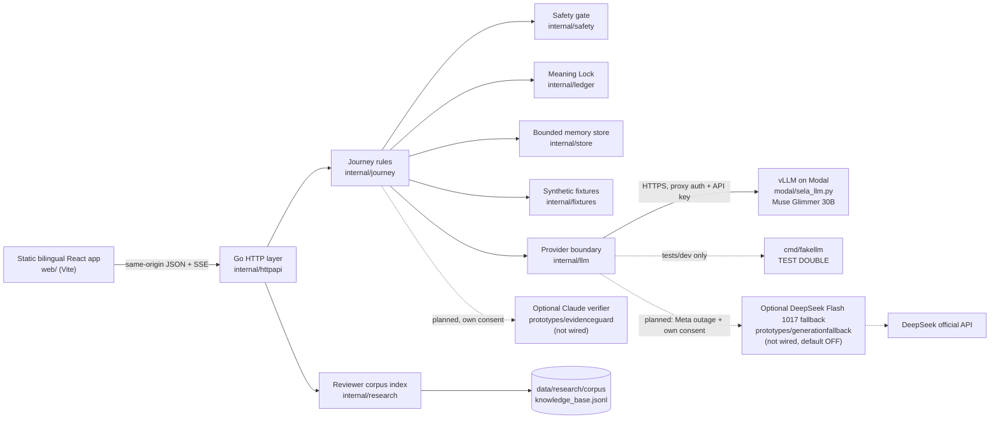

# Sela v2 architecture

Status: **implemented** on branch `feat/v2-go-meta-runtime` (Go API, static frontend, Modal serving code; PR #6, merged into main as `7fc6678`); live Modal inference not yet verified ([B-1](../status/BLOCKERS.md)). The v3 persistence and accounts foundation below is **implemented and verified locally, and its CI run on draft PR #9 passed**, on `feat/sela-v3-pilot` (commit `0ff3341`; [SPEC §G foundation status note](../../SPEC.md#foundation-status-note-2026-10-26); not deployed). Authority: [SPEC](../../SPEC.md) C1, C4–C8, C11, I.api/I.meta/I.data/I.research, V3–V25.

## Runtime

One Go binary (`cmd/sela`) serves `/api/v2` and the built frontend (`SELA_WEB_DIR`). There is no Node server, database or Redis. The model server is a separate Modal app; the Go app talks to it with an OpenAI-compatible client. The optional EvidenceGuard verifier (Claude Sonnet 5.5, C12) is a standalone Go prototype in `prototypes/evidenceguard` with its own module; it is not wired into the v2 runtime ([contract](CLAUDE_VERIFIER.md)). The optional fallback is described in [DeepSeek fallback](DEEPSEEK_FALLBACK.md) and has an isolated Go prototype, not integrated with Meta production routing. That prototype (DeepSeek-V4.1-Flash-1017, C13) calls the official DeepSeek API, lives in `prototypes/generationfallback` with its own module and is OFF by default; the v2 runtime has no DeepSeek route.

## Package boundaries

| Package | Owns | Does not |
| --- | --- | --- |
| `internal/httpapi` | Routing, same-origin guard (`X-Sela-Request`, `Origin`, Fetch Metadata), JSON strictness and size limits, cookies, rate limits (v2 LRU; the v3 auth buckets in their own bounded store that never forgets a bucket that has not refilled), SSE, static files, security headers, localized errors (`503 store_unavailable` when the database cannot be reached), metadata-only request logs | Product rules |
| `internal/journey` | Sessions, consent/retention, safety routing state, story segments, ledger versions and approval, Next Step, Opening Practice, share grants and recipient principals, handoff state machine, follow-up, AI operations and their commit rules, prompts | HTTP, model transport |
| `internal/safety` | Deterministic ID/EN/code-switched crisis lexicon (ported from Dengar.in) with clause-level denial, quotation and third-party handling | Logging, network |
| `internal/ledger` | Sentence segmentation, strict model-draft parsing, Meaning Lock (quote grounding, negation/subject/time/certainty, diagnosis/medication/number checks), opening-line validation and templates, practice coverage, JSON Schemas | Storage |
| `internal/llm` | Provider interface, OpenAI-compatible streaming client (retries before first token only, timeouts, cancellation, output bound, model-name check), admission semaphore, test-double handler | Any non-Meta provider, prompt content |
| `internal/store` | Per-session-locked memory store, share-token and recipient indexes (at most 3 principals per handoff), expiry, bounded eviction that spares recently active retained or shared sessions, a per-client live-session cap, and a purge hook that lets the journey cancel operations of purged sessions | Persistence |
| `internal/fixtures` | Embedded, validated synthetic catalogue (scenarios with gold annotations, fictional professionals/slots/plans, options, verified help resources, versioned policy texts) | Real data |
| `internal/research` | BM25 search over the exported research knowledge base | Session data, model calls |
| `internal/db` | v3: `pgxpool` setup (statement and idle-in-transaction timeouts, UTC, optional search_path), transaction helper, embedded migration runner (checksums of up and down files, schema-keyed advisory lock, status/up/dry-run/down-last, data-migration gates), unavailable-database classification and a bounded deadlock retry, `instance_meta` environment marker, background-job advisory lock, per-test schema helper `dbtest` | Product rules, content |
| `internal/vault` | v3: KEK keyring, per-user DEK create/unwrap/destroy (crypto-shredding), AES-256-GCM `Seal`/`Open` with AAD bound to user, record kind, record id and field, bounded DEK cache, KEK re-wrap | Logging key material or plaintext |
| `internal/account` | v3: users (guest/account), argon2id credentials, recovery codes, sessions, consents and history, guardian consent records, audit trail, login backoff (one persisted throttle per keyed username key, known or not; every password proof reserved in one statement before its argon2id work and finished by one failure statement, identical for both; row locks always credentials, then throttle, then sessions; unknown usernames verified with the stored argon2id parameter distribution, mapped by key fraction), guest purge and the live-guest cap, deletion, restore reconcile, exporter registry and JSON/HTML/Markdown export | HTTP, cookies |

When the verifier is wired in, it uses only allowed synthetic evidence and claim ids after its own consent; an LLM verdict never grants domain permissions or substitutes for missing Meta output.

DeepSeek is an optional, default-OFF provider switch for Meta availability failures only and requires additional provider-specific consent; unsafe Meta output never triggers a second model. Both outputs remain untrusted and require Go source validation. The fallback is not wired in yet (T5b): `internal/llm` has no DeepSeek client.

## Request path of an AI draft

1. `POST /api/v2/ledger/draft` with `expectedVersion`. The HTTP layer checks origin, content type, size and the per-address rate.
2. Journey checks the session version, the story exists, **no crisis interruption**, **AI consent granted**, the provider is enabled, no draft is running, and the per-session operation limit. It records an operation with the story version, ledger version and consent revision it was started from, and returns 202.
3. A goroutine waits for an admission slot, reports `warming` when the Modal model is probably cold, and streams the completion with a JSON-schema constraint. Each completed array element is parsed incrementally and validated; only validated claims are sent to the browser as `item` previews.
4. The full output is parsed strictly and validated (Meaning Lock). The commit happens only if the session still exists and the story version, ledger version and consent revision are unchanged and no crisis occurred; otherwise the result is discarded (`stale_result` or `canceled`). Items are stored unreviewed with `live_meta` (configured Modal provider and matching served model name) or `test_double` provenance.
5. Reasoning tokens produced by the model are never stored or shown.

## Sessions, sharing and isolation

- Owner session: 256-bit random id in an HttpOnly, SameSite=Strict cookie scoped to `/api/v2`. Optimistic concurrency on a per-session version. Idle expiry 30 minutes (2 hours maximum) without storage consent, 24 hours with it; a sweeper runs every minute.
- Share grant: 256-bit token (only its SHA-256 is indexed) plus an 8-character access code; the recipient principal is a separate cookie scoped to `/api/v2/recipient` and bound to one handoff. The projection is computed once from the approved snapshot and the selected fields; the preview endpoint returns the same projection.
- Revocation, expiry, lockout, supersession and owner deletion remove the token index entry and every recipient principal for that handoff.
- One visitor's operations, handoffs and recipient principals are unreachable from another visitor; tests cover the cross-session paths.

## Persistence and accounts (v3 foundation)

`/api/v3` stores real users' data in PostgreSQL 16 ([ADR-0002](../adr/ADR-0002-persistence-accounts-and-encryption.md), contract [API_SPEC_V3](../api/API_SPEC_V3.md)). The HTTP layer resolves the owner only from the `__Host-sela_auth` cookie (a 256-bit token of which only the SHA-256 is stored) and calls `internal/account`, whose owner-facing methods all take `(context.Context, account.UserID, …)` and scope every statement to that owner; another user's resource answers 404. Content fields are sealed with the user's DEK (`0x01 ‖ nonce ‖ ciphertext ‖ tag`, AAD binds the place); deleting an account destroys the wrapped DEK in the same transaction that deletes the user, so every owned row goes by `ON DELETE CASCADE` and copies in content backups become unreadable once the separately kept key backups expire. Every `/api/v3` mutation passes the same guard as v2 (`X-Sela-Request`, Origin, Fetch Metadata, JSON, body limit) plus per-route token buckets (client, keyed username hash, session, user). The server refuses a database whose schema does not match the binary or whose environment marker differs, and in staging and production one with pending migrations; operator commands are subcommands of `cmd/sela` (`migrate`, `keys`, `restore reconcile`, `backup check`, `ops canary`) and refuse another environment's database the same way, and `scripts/ops/` holds backup (daily pair plus hourly key-only dumps, private files, password only through a temporary `PGPASSFILE`), restore (content dump with the newest key dump; reconcile then removes deleted accounts, destroys keys without a user and revokes every restored session) and the restore drill ([runbook](../operations/RUNBOOK.md) §7–§9). The v2 in-memory journey store remains for development and test and is not served in staging or production.

## Migration and coexistence

The inherited v1 Next.js app (`apps/web`), its `packages/*`/`services/*`, Supabase tooling and the v1 `quality.yml` workflow were removed on 2026-10-29 (T9/S-272). The useful legacy content is embedded under `internal/fixtures/data/`, and the v1 crisis tests are frozen under `internal/safety/testdata/v1/`. The current runtime lives in `cmd/`, `internal/`, `web/`, `modal/`, `e2e/`, `eval/` and is tested by `v2.yml`.
