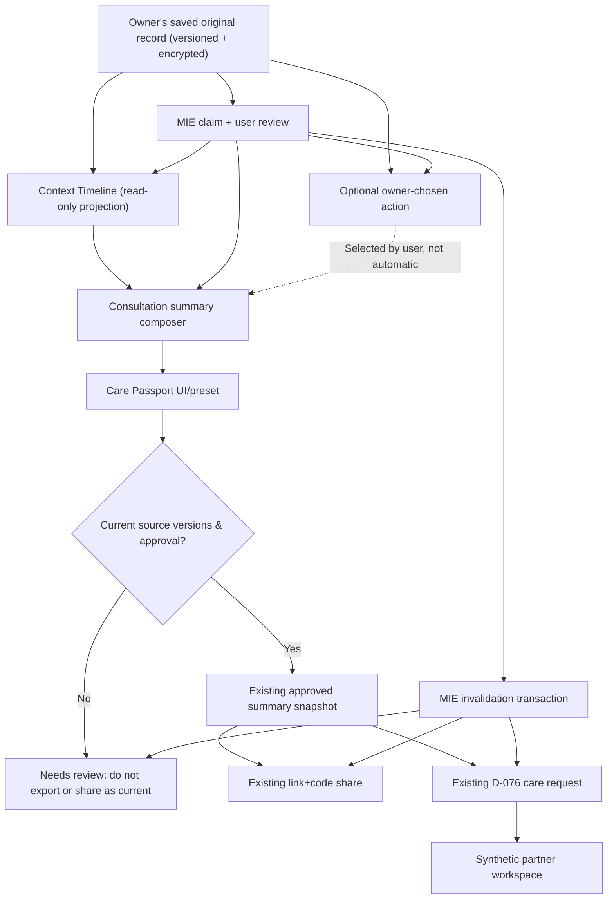

# Meaning Continuity Extension — integrated architecture design

**Status: proposed architecture**, not present in this documentation PR. Reuse the implemented D-078 MIE graph and D-076 Care Network. Related [BWYW roadmap](../roadmap/BUILD_FOR_YOUR_WORLD_2026.md), [Care Passport](../product/CARE_PASSPORT.md), [Life Context Timeline](../product/LIFE_CONTEXT_TIMELINE.md), [Action Bridge](../product/PERSONAL_ACTION_BRIDGE.md).

## 1. Trust boundaries and current building blocks

**Owner trust domain:** Go `internal/account`, PostgreSQL owner-scoped encrypted records, MIE `mie_edges` version graph, consent ledger, Meta-only AI routing. This domain holds user stories, source refs, memory, summary, user actions.

**Recipient / partner trust domain:** existing `shares` and D-076 `care_requests`; recipient sees only frozen approved projection and only while access is valid, with separate identity/roles and time limits.

**Operator trust domain:** password+TOTP and partner invitations; internal operators see service health, content moderation and public catalogues, *not* private owner notes. `partner_staff` cannot read summaries.

**Community domain:** adult-authored explicit posts, pre-publication Meta moderation and operator queue. Posts are never mirrored into owner-private records without a deliberate, separately authenticated user action and privacy design review.

**Public source domain:** public verified help entries and editorial reading. An external source can provide general background but is not evidence that a user has a medical condition.

Redis remains optional for public cache/acceleration only. **Never** store personalized timelines, private text, memory claims, action content, source-derived hashes or share credentials there.

## 2. Logical data flow

Notes: visual edges describe **targets**, not currently implemented edges for all proposed new entities. MIE source→summary→share→care_request is currently present. New action dependencies require engineering and tests. Timeline is a **read projection**; it must not store a second copy of the user's full history.

## 3. Minimal change strategy

| Target | Existing code reuse | New work | Avoid |
| --- | --- | --- | --- |
| Life Context Timeline | `internal/account/records.go`, `mie.go`, `web/src/v3/screens/Notes.tsx` | Owner-scoped query/view, version-aware display | Copying all user narratives into new table |
| Care Passport | `continuity.go`, `v3_summary_export.go`, `v3_shares.go`, `carerequests.go` | Audience-aware preview/preset, stronger status text, reusable presentation | Separate “medical passport DB”, parallel share tokens |
| Action Bridge | Current encrypted records and MIE reviews | Action status, owner edit, optional Meta proposal endpoint | Push notification loops, synthetic pretend outcomes |
| Evidence / Meaning Trace | `v3_meaning.go`, `web/src/v3/meaning.tsx` | UI entry points and source explanation | New untrusted model as judge |
| Demo orchestration | Existing E2E and synthetic flows | Fixture, local or isolated staging seed, build fingerprint, capture | Seeding real-user production or fake “live” output |

## 4. High-value invariants

1. **Source truth:** original user-authored text remains immutable as historical evidence; any change is a versioned edit.
2. **Owner authority:** every derived interpretation is provisional unless the owner approves it; correction/rejection takes precedence over model/verifier verdict.
3. **Read consistency:** every share/partner/export projection must revalidate current source/claim/summary versions and active consent. No new read after an invalidation commit may pass.
4. **Frozen recipient snapshot:** old recipient content is not silently rewritten; future access can be revoked, past copies cannot be recovered from recipients.
5. **Manual path:** a person can complete timeline/passport/action through authored notes with AI disabled. Models only augment, not gate autonomy.
6. **No hidden accumulation:** the timeline read does not create memory; the action proposal does not persist without explicit accept; a passport preview does not grant sharing permission.
7. **Least privilege:** owner tokens cannot act as partners/admin, and partners cannot read unselected sources; no cross-owner enumeration.
8. **Nonclinical semantics:** no condition scores, diagnoses, risk prediction, physician impersonation, treatment “success” or emergency contact automation.
9. **User privacy in public:** anonymous community content is never linked to private health chronology, even via alias/matching.
10. **Traceability:** each interpretation and approved included item can reveal its original source, version and model/manual provenance to its owner.
11. **Race safety:** consent changes, source edits, async Meta completions, action status edits, summary approval and share opening cannot produce contradictory authoritative state.
12. **Safety first:** deterministic safety gate precedes Meta; user-requested “Just listen” is not converted into advice under the Action Bridge.

## 5. Transactional mutation pattern

Reusing D-078:
1. Validate principal and current relevant purpose consent (storage, memory, AI and sharing separately).
2. Begin transaction; acquire owner-specific advisory lock used by MIE; load version snapshots.
3. Check all `expectedVersion`, `summaryApproved`, source quotes and freshness.
4. Persist owner-approved action / summary modification as a new version; append MIE edges only for explicitly linked sources.
5. If source version changed, traverse existing graph and mark downstream derived artifacts stale. Invalidate shares/care requests atomically where current relationships require.
6. Commit. On conflict, return existing `409 stale_version` and require UI refresh. Never silently choose a winning variant.
7. Upon read, enforce authoritative status and consent from PostgreSQL regardless of UI or caches.

Avoid adding a materialized “timeline interpretation” table until a measured need for caching exists. Use current MIE breadth/depth caps and negative tests for action nodes if schema grows.

## 6. Security and privacy threat model

| Threat | Defense / acceptance |
| --- | --- |
| Source exposes private names in external Meta call | Existing minimizer and explicit consent, only selected bounded excerpts |
| Care Passport includes unselected notes | Server-side source allowlist; snapshot diff tests |
| User's previous share still works after source correction | MIE stale/revoke in same transaction, recipient read-time guard |
| Community posts correlated to private diary | No cross-domain linkage, no auto-embedding / metadata join |
| Operator or unverified synthetic partner sees personal journal | Independent session/roles and per-org access checks |
| Late Meta output uses obsolete source or withdrawn consent | Revalidate before release/persist; discard |
| Low-frequency check-ins interpreted as improving/worsening health | Textual timeline + uncertainty; no clinical inference |
| A suggested action becomes treatment advice | Scope constrained to low-risk self-chosen user tasks; review/abstain |
| Deleted data revived on backup restore | Existing unresolved deletion journal gate remains a release blocker |
| Public demo displays real user content | Dedicated synthetic tenant/local run, screen-share only synthetic personas |

## 7. Operational and observability contract

- API uses same-origin JSON, strict decoding, v3 errors, CSRF/origin checks and `Cache-Control: no-store`.
- Metadata-only trace ids: build SHA, request ID, model ID, token cost estimate, latency, outcome code, source count, revision status, *not* private excerpts.
- The production build SHA must be obtained from the actual host, not assumed from GitHub's latest main. If unreproducible, label demo as local staging and identify exact commit.
- Model API: current D-065 Meta Spark generator + distinct Meta Wonder verifier when authorized; no Claude/DeepSeek fallback.
- MIE accuracy: current offline detection results are preliminary, not clinical validation or full live ablation.
- Release: flag off by default for new screens on production until P0 security/concurrency tests and owner review. Feature flags must not let older clients bypass server authority.

## 8. Architecture acceptance

- AC-01 Existing Summary and CareRequest schema remains single source of truth; no parallel identity/authorization domain.
- AC-02 Backend unit/integration tests cover source edit, stale graph and two simultaneous recipient/owner operations.
- AC-03 Proposed action state never enters user's long-term memory silently; opt-out path remains complete.
- AC-04 Summary share recipient sees precisely the approved snapshot, never account data or unrelated journal.
- AC-05 Owner-visible original story remains accessible as history within retention rules.
- AC-06 New routes are additive and do not break existing guest or mobile UI.
- AC-07 No user text in logs, Redis, public URLs or eval artifacts.
- AC-08 The demo can show one deliberate MIE correction and downstream invalidation in a single session with reproducible synthetic fixtures.

## 9. Proposed engineering sequence

- PR-1: Add timeline read projection + test + route.
- PR-2: Care Passport summary preset + exact preview + negative recipient/privacy tests.
- PR-3: Action Bridge domain + API + UI + MIE edge/state test, feature flag.
- PR-4: End-to-end synthetic demo run, benchmark and UX/a11y polish (may be merged when evidence exists and owner approves).
- **This PR:** design/acceptance/demo documents only. Don't represent it as the four implementation PRs.

Freeze functionality early; video assets need a stable implementation SHA. No “100/100” jury score or finalist probability is asserted.
