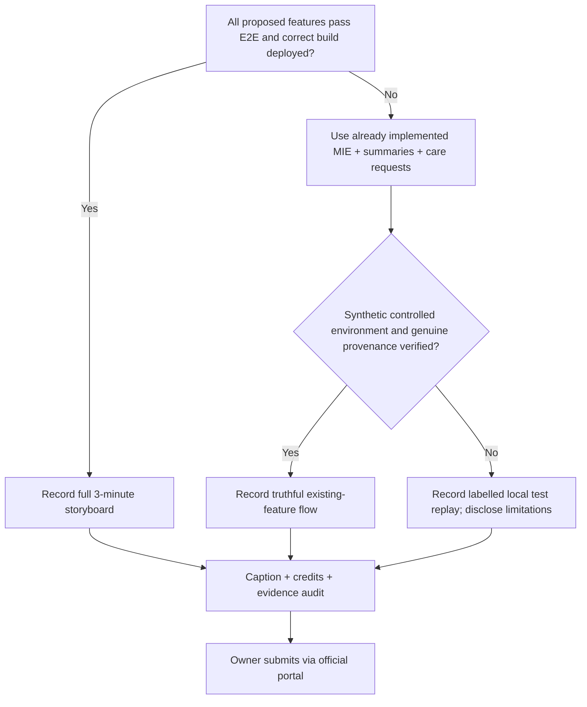
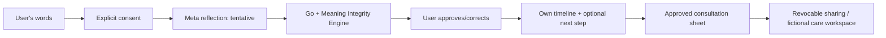

# Sela Meta Hackathon 2026 — recording and submission runbook

Status: **planned, NOT RECORDED, NOT SUBMITTED**. Purpose: reproduce video in [storyboard](META_HACKATHON_2026_STORYBOARD.md) without misleading the audience or exposing private data. Target reviewer: project owner, engineer, QA and video editor.

## 1. Build/run provenance preflight

- [ ] Repo: `YanIanZ/sela`, selected stable implementation SHA: `________`.
- [ ] Environment: isolated synthetic-only local/staging, not an existing real-user production database. URL (if public demo): `________`.
- [ ] App actually runs this SHA; compare build marker with git/docker digest. GitHub branch name alone is not proof.
- [ ] CI Go/PostgreSQL race tests, frontend build and E2E passed **on that SHA**; copy sanitized URLs into evidence index.
- [ ] Meta real provider, if shown, uses actual approved credentials/models/policy, capture **actual provenance** and a safe fictional prompt. No real user prompts.
- [ ] Synthetic identities/partner invites are demo-only. No actual physician, hospital, contact details, staff secret or TOTP key in recording.
- [ ] Sharing consent, AI consent, personal-memory consent and storage choice are clearly separate.
- [ ] Current production at `https://sela.vertalt.my.id` is a known owner-reported site, but don't imply it includes this unmerged PR or feature code.
- [ ] Recording environment screen hidden from browser extension, notifications, account profile, IDE tokens, terminal secrets.
- [ ] Captions, background audio licensing, resolution, format and official duration requirements confirmed in event portal.

## 2. Demo data generation discipline

Do **not** “seed” through production API. Use pre-existing repository integration/e2e fixture pattern in isolated Docker/PostgreSQL, or manually create the synthetic records through owner UI. Synthetic Nadia content is specified in [fixture](SYNTHETIC_NADIA_FIXTURE.md).

If the wrong-interpretation text is intentionally injected into a test database, it is **not** the result of a real Meta request. Use a conspicuous label in UI and narration. If the live Meta model doesn't naturally produce a mistake, do not retry until it does in order to misrepresent a normal response; the fixture demonstrates the guard honestly.

Have two clean browser contexts:
- **Owner session**: Nadia's personal story, review and approvals.
- **Recipient/partner session**: only fictional partner staff, read-only projection and offered time.
Don't show partner invitation token, password enrolment or TOTP setup on camera.

## 3. Browser route run sheet

| Scene | Route (current / proposal) | Action | Verify before shooting |
| --- | --- | --- | --- |
| Arrival | `/`, `/home` | Fictional adult guest, consent display | Banner and no unwanted IDs |
| Talk | `/talk` | Copy N3 or create harmless new dialogue | Provider provenance true |
| Interpret | Current reflection/memory screen `/notes/memory` | Show source quote + provisional interpretation | Test fixture clearly marked |
| Correction | Current MIE review and impact UI | Reject/correct F0; inspect impact and stale states | Actual backend event, correct counts |
| Timeline | Current `/notes` / **future** `/notes/context` | Show chronology with three records | Only use future route after implemented |
| Action | Current `/support/summaries/new` questions / **future** Action UI | User writes own next step | No unreviewed AI proposal saved |
| Passport | Current `/support/summaries` / **future** `/support/passport` | Select N1/N2, review, approve | Excluded N3 not shared |
| Professional | Current `/support/plan` | Owner sends synthetic approved summary | No real partner claim; correct org |
| Partner | Current `/operator` | Fictional partner proposes times | Credentials hidden, per-org permission |
| Revocation | Current `/support/shares`, then recipient | Owner revokes, recipient retries | Future read denied, prior copies caveat |
| End | Product/repo slide | Title and actual build provenance | No invented metrics or winner claim |

If some deep links differ at recording build time, navigate via current UI and update this run sheet with actual verified routes. Do not expose internal route names to participants if they are not public.

## 4. Recording workflow

**T-30 to T-10: verification:** run smoke tests, fixture reset (isolated environment only), record SHA, consent, live model status, outcome of one safe synthetic trial, and device/browser. Confirm private input/autofill is off.

**T-10 to T-0: rehearsals:** rehearse complete flow twice with a stopwatch, verify focus/keyboard and 320px legibility, inspect screenshot stage labels, and ensure event counts match captured values. Prepare fallback (existing features only) if future routes missing.

**Record primary:** capture product at natural reading speed, prioritize MIE correction and downstream invalidation. Record narration as separate track for clarity. If API has unpredictable latency, shoot cutaways of *actual* operations, not fake on-screen states. Show spinner rather than editing in success.

**Edit:** 180-second target, strong open, one source → correction → downstream effect → chosen task → approved sheet → synthetic care → revoke. Add subtitles ID/EN, readable warnings and an explicit 2–3 second “simulated wrong interpretation” overlay. Do not remove actual negative/error outputs if they contradict script; fix the feature or rewrite claim.

**QA before export:** another person watches without repo knowledge; ask them to state what Sela does, what was simulated and what remains optional. Fix misleading captions. Inspect every frame for passwords, TOTP QR codes, access tokens, valid share URLs and personal identifiers.

**Export names (examples, to be produced only after recording):** `sela-bwyw-demo-2026.mp4`, `sela-bwyw-demo-id.srt`, `sela-bwyw-demo-en.srt`, `sela-bwyw-transcript.md`, `sela-bwyw-evidence-index.md`. This PR does **not** contain video, audio or binary assets.

## 5. Video fallback decision tree

If **any** privacy breach/consent violation/revoked share read bypass arises, stop public-access recording until fixed and reverified. A local synthetic replay is preferred to an unsafe live demonstration.

## 6. Single-slide architecture explainer for video/readme

**Technical annotations:** Postgres encrypted owner records + versioned MIE graph; distinct Meta verifier where required; no hidden fallback; read-time stale checks; user chooses sharing. This diagram is a product/architecture *target* once new BW features land. Do not show as fully deployed unless verified.

## 7. Screenshot list / capture IDs

- V-01 original Nadia source and provider provenance.
- V-02 labelled simulated wrong AI interpretation with source quote.
- V-03 review decision and Meaning Diff.
- V-04 downstream impact/lineage and stale summary.
- V-05 owner timeline (current or future accurately labelled).
- V-06 manually chosen action or existing summary-question fallback.
- V-07 exact selected Care Passport/summary approval and source excerpts.
- V-08 fictional partner request and schedule (optional).
- V-09 revoked share and denied recipient reread.
- V-10 final build SHA + evidence summary / title card.

All captions should distinguish a **test fixture**, a **live Meta response**, a **recorded output**, and a **synthetic professional**; they are not interchangeable.

## 8. Submission packet

- Source repository link and exact commit/tag used.
- Working hosted demo URL or accurately described isolated local demo setup.
- Video (if permitted), captions/transcript, screenshot summary and demo steps.
- Benchmark report with actual n/held-out results and failures, including the **negative** examples.
- Consent/synthetic status, privacy boundaries, age handling and no-clinical-claim statement.
- Accurate Dengar.in team origins / third-party licensing, contributor attribution and rights review.
- Confirm official eligibility, submission format, time deadline and participation terms at the real portal.
- Owner verifies submission receipt. Opening a docs PR does **not** enter the hackathon.
