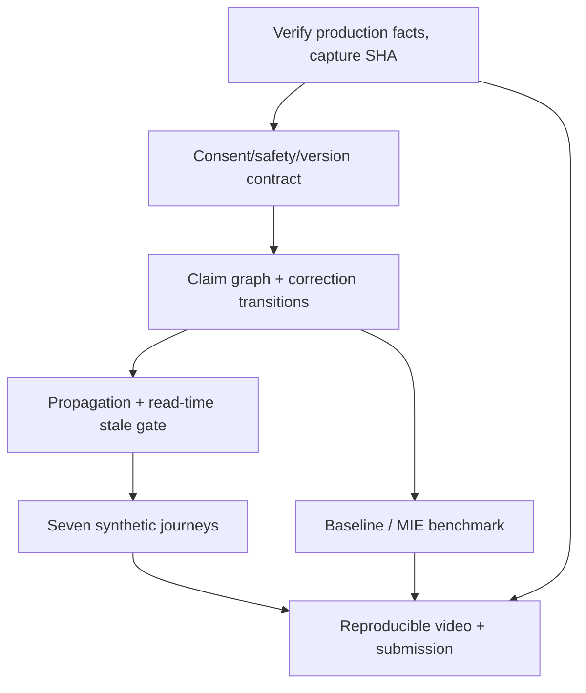

# Sela — Meta Global AI Developer Hackathon 2026: submission engineering package

Status: **proposal / implementation plan only**. Date: **2026-11-01 WIB**. Track: **Indie Developer**. Theme: **Build for Your World**. Owner: project maintainer. Base inspected: `main@45c02487283f321f9930475e7a6e9fa3e1454f1c`.

> This package does not implement MIE v1, deploy software, verify production, claim clinical outcomes or submit the project. Keep PR unmerged until the owner reviews it. If any fact conflicts with later source code or release evidence, code and verified checks win.

## 1. One-sentence product thesis

Sela is a privacy-first bilingual listening companion that preserves the user's own meaning across AI reflections, explicitly approved personal memory, and user-controlled consultation materials. **The differentiator is not another chatbot; it is a demonstrable, source-bound correction and invalidation workflow.**

The flagship narrative: *A person can tell a story, correct an AI interpretation, see exactly what changed, and decide which version—if any—is remembered or shared.*

The system is not psychotherapy, diagnosis, triage, telemedicine, an emergency response service or a verified clinical intervention. Professional recipient interactions in the hackathon are synthetic; no real partnership, verified practitioner identity, booking or contact is implied.

## 2. Event truth versus internal goals

Official event page: https://cerebralvalley.ai/e/meta-ai-developer-hackathon and Meta event page: https://dev.meta.ai/events/global-hackathon .

- Event: 26 Oct–4 Nov 2026, submission due **4 Nov 2026, 21:00 Eastern Time**, equivalent to **5 Nov 2026, 09:00 WIB** after the US DST transition. Organizers may change dates.
- Official published Indie positioning: individual builders/students; creativity, technical ambition and whether it works. Build for Your World: solve a personally understood domain problem using Meta's models.
- **Do not represent a 100-point grid or 30/25/20/25 weightings as verified official judging policy.** Our scorecards are internal readiness heuristics unless authenticated official rules specify otherwise.
- A “100/100” target is a *quality bar*, not an expected or guaranteed jury score. No probabilities of finalist/podium without competitor and judge data.

## 3. Current observed baseline (main, 2026-11-01)

| Surface | Observed in code / status | Open gate |
| --- | --- | --- |
| Go + PostgreSQL + React 19 frontend | Present, local database/browser checks recorded | Reconfirm on final SHA |
| Listening / reflection review | Local implementation; saves/holds, SSE heartbeats, no-AI path | Full semantic dependency graph; live reproducibility |
| Journal/check-ins/weekly notes | Local implementation | Complete source-to-derived trace |
| Manual memory + on-demand proposals | Local implementation with consent | Cross-surface rejection propagation |
| Consultation summary/export/follow-up | Local implementation with quote-backed items | Invalidate all stale descendants atomically |
| Share via token and access code | Local implementation; access history and revoke | Enforce graph revision on recipient read |
| Meta model routing | D-065: Spark generator in dev, different Meta Wonder verifier; no Claude/DeepSeek runtime | Live repeatable evaluation |
| Reading library | Editorial gate implemented; 0/38 approved at inspected checkpoint | Human approval, not auto-publish |
| Operator | Separate MFA, audit, cache and spend visibility | Human operations, role editing stretch |
| Accessibility | Automated checks recorded | Independent/manual user task checks |
| Security/compliance | Encryption, consent and safeguards designed/tested | No independent assessment or real-user pilot |
| **Production hosting** | **https://sela.vertalt.my.id** — owner-confirmed; read-only health/ready checks pass (`mode: production`, `ai: meta_api`, `database: ok`) | **Release SHA, model ID and region not yet verified; see PRODUCTION_VERIFICATION.md** |
| Listening modes and safety (D-066–D-068, D-070) | Two reply modes; danger lexicon, quick-help mode; anti-jailbreak, typo tolerance, 13 more languages | Moderation and multilingual evaluation sets |
| Condition map and demo professionals (D-071) | Opt-in, deterministic four-stage map from saved records; fictional practitioners | Hand-off to a simulated practitioner after H-008 |
| Sharing space (D-072) | Adults-only anonymous posts; safety router + Meta moderation before publish; reports, operator queue | Moderation evaluation (false positives) |

Hosting is **not** to be scoped as “build hosting from scratch”. Verify the deployed state instead. An existing production endpoint does **not** by itself imply permission for real-person wellbeing data or clinical readiness. Never use a production user's story, a real credential or a real consultation in evaluation.

Source-of-truth pointers: [implementation status](../status/IMPLEMENTATION_STATUS.md), [blockers](../status/BLOCKERS.md), [vision](../vision/README.md), [MIE 0.1](../vision/MEANING_INTEGRITY_ENGINE.md), [D-065](../decisions/DECISION_LOG.md#d-065), [provenance](../product/SELA_PROVENANCE.md).

## 4. Deliverable navigation and roles

| Document | Must answer | Owner role |
| --- | --- | --- |
| [SCORING_STRATEGY.md](SCORING_STRATEGY.md) | Why our approach is judge-relevant; honest scoring evidence | PM / submission |
| [MIE_IMPLEMENTATION.md](MIE_IMPLEMENTATION.md) | Domain contracts, SQL, state transitions, API, concurrency, migration | Backend + AI + frontend |
| [SCENARIOS.md](SCENARIOS.md) | Seven complete demonstrable synthetic journeys with expected behaviour | Product / QA |
| [EVALUATION.md](EVALUATION.md) | Baseline comparison, dataset split, scoring, statistical reporting | AI evaluation / reviewer |
| [QA_MATRIX.md](QA_MATRIX.md) | Automated, adversarial, accessibility and safety gates | QA / security |
| [PRODUCTION_VERIFICATION.md](PRODUCTION_VERIFICATION.md) | Verify owner-reported production without changing live data | SRE / owner |
| [DELIVERY_PLAN.md](DELIVERY_PLAN.md) | Sequencing, granular work items, stop/ship criteria | PM / engineering |
| [DEMO_AND_SUBMISSION.md](DEMO_AND_SUBMISSION.md) | 3-minute primary demo, backup demo, evidence, attribution | Owner / submission |
| [ROADMAP_ALIGNMENT.md](ROADMAP_ALIGNMENT.md) | How this plan maps to the 2026-11-01 owner direction and the repository TODO | PM / owner |

## 5. Scope and dependency order

1. **P0 correctness**: verify a harmless synthetic/non-personal hosted path; freeze exact source commit, provider identity, running configuration and consent behaviour.
2. **P0 flagship**: source-anchored claim review, claim supersession, descendant stale/invalidation, read-time gate for share/export.
3. **P0 measurable gain**: preregistered synthetic benchmark with the *same* Meta generator between baseline and Sela, human-reviewed ground truth and failures disclosed.
4. **P0 demonstrable story**: one coherent user journey (listen → tentative interpretation → correction → memory/summary invalidation → chosen share → revoke), clearly synthetic.
5. **P1 hardening**: low-end mobile, Indonesian/English, keyboard/screen reader walkthrough, no-AI and crisis fixture.
6. **Owner-added scope (2026-11-01, D-069)**: guardrails, condition map with simulated professionals, and the moderated sharing space are built on the main branch with their own tests; they consume only saved, user-approved material so MIE invalidation applies to them once it lands. See [ROADMAP_ALIGNMENT.md](ROADMAP_ALIGNMENT.md).
7. **P2 only if P0 green**: admin conveniences, directory breadth, additional content. No real hospital partner integrations, TTS/avatar, model shopping, unapproved research publication or broad refactors in the event window.

Dependency graph:

## 6. Definition of Done for this documentation PR

- Every proposed feature is explicitly separated from what exists; no test or deployment is falsely marked passed.
- Seven scenario journeys have initial state, inputs, transitions, denial paths and oracle.
- MIE spec has invariants, schema/migration, API, read/write access control, idempotency and rollback.
- Benchmark predefines splits, metrics, error bars, adversarial cases, and manual review rules.
- Production checklist treats hosting as owner-reported, verification pending.
- Submission instructions include Dengar.in lineage/third-party rights and zero clinical/partner claims.
- Cross-file links are coherent. Owner approves before merging. **This PR is documentation-only.**

## 7. Change-control rules

- Never rewrite SPEC or historical ADRs from a planning draft without a separate explicit architecture decision and engineering review.
- Never move/merge this PR automatically.
- Do not backfill benchmark numbers or screenshots; use `NOT MEASURED` until observed.
- No real private narratives, tokens, secrets, healthcare records, IPs or professional identities in tickets, fixtures or videos.
- CI passing on a prior commit is not proof for the submission SHA.
