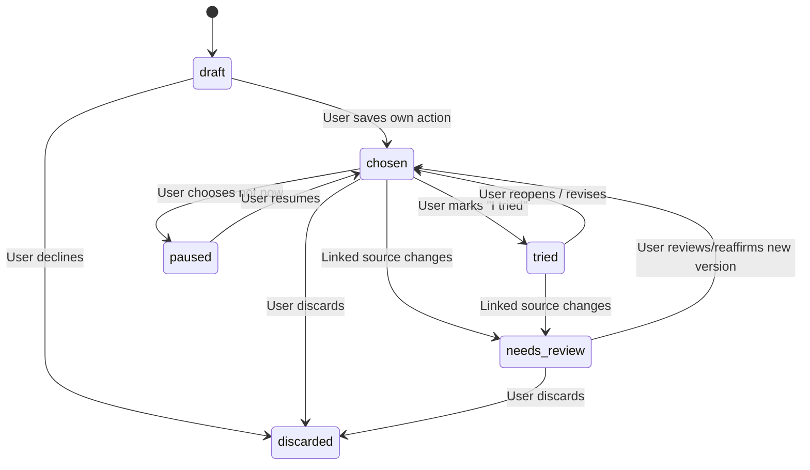

# Personal Action Bridge — one self-chosen next step

**Status: PROPOSAL / not implemented in this PR.** Task BW-007/BW-008/BW-009. Related [BWYW roadmap](../roadmap/BUILD_FOR_YOUR_WORLD_2026.md) and [MIE 1.0 concept](../vision/MEANING_INTEGRITY_ENGINE.md).

## 1. Why this is a useful product task

After being heard, some users want **one small, optional, feasible action that they choose**—for example preparing one question for a conversation, writing a short draft to a trusted friend, taking a pause, or locating accurate support information. Others want *only* to write and be heard. Both are valid.

An action is **not** treatment, a prescription, a clinical outcome, risk reduction, a compliance score, or proof that someone feels better. No growth hacking: no streaks, pressure, “you missed a day”, guilt notifications, punitive counters, badges or hidden background tracking. Do not presume the user wants advice. Respect the “Didengarkan saja / Just listen” mode.

## 2. User experience

- Feature name ID: **Satu langkah, pilihanku**. EN: **One step I choose**.
- Entry: at the end of **Ngobrol & cari solusi** or from notes/home; **never** force during Just listen.
- Starting choices: **Tulis sendiri / Write my own**, **Lihat usulan / See a suggestion**, **Lewati / Not now**.
- “See a suggestion” requires valid `ai_processing` consent. A Meta suggestion is explicitly tentative and source-bound; the user can **accept, rewrite or reject**. Rejection is not recorded as poor progress or mental-health severity.
- User can edit or discard their own action any time.
- One action card: own words, due date **optional** (default no due date), status, provenance (written by user vs Meta proposal accepted by user), origin source/version (only if user chose one), scope **private**, and a short “Why this?” reference if based on a source.
- Follow-up is **passive and optional**: user's own status update when they choose to reopen the card. No periodic notification or reminders. If external reminders are ever added post-event, new explicit opt-in and privacy review required.
- Suggested prompts must not overreach: no “call emergency line” as a routine productivity action, no compulsory referrals, no “take medication”, no coping exercises framed as treatment, no claims of guaranteed help.
- User can intentionally create a support-related task such as “Write two questions I want to ask a counselor”, without the app scheduling a medical appointment.

### Example fixture

Nadia (fictional adult) said: “Aku sering lupa apa yang mau kutanyakan saat konsultasi dan akhirnya bingung menjelaskan.”

Sela **offers, not creates**: “Mau menulis satu pertanyaan paling penting agar kamu bisa membawanya saat berbicara dengan orang lain?”

Nadia edits to: **“Tuliskan dua pertanyaan yang ingin kutanyakan saat konsultasi.”** State `chosen`, **source-bound** if she explicitly attaches the note; this is not framed as clinical guidance.

## 3. Lifecycle and transitions



Terms: `tried` is **self-reported** and never “success”, “clinically improved” or “completed therapy”. If a manually-authored action has no source dependency, later MIE corrections to unrelated notes do not change it.

A proposal is not a saved action; storing user-edited proposed actions requires a separate user acceptance. If approval consent revoked during model response, discard proposal before any storage or release.

## 4. Domain model and privacy

Prefer one new **small sealed personal record kind** (e.g. `action_step`) in existing encrypted-record machinery if migration/evolution permits; otherwise introduce a dedicated owner-scoped table with established envelope-key protection. Do not store private text as columns in audit tables and never cache it in Redis. Exactly one owner may read/edit each action.

Proposed model (illustrative, not a shipped API):

```json
{
  "id": "opaque-uuid",
  "version": 3,
  "text": "Tuliskan dua pertanyaan untuk konsultasi.",
  "status": "chosen",
  "sourceRefs": [{"recordId": "opaque-uuid", "version": 2}],
  "origin": {"kind": "user_correction", "suggestionModel": "muse-spark-1.3"},
  "review": {"userApproved": true, "stale": false},
  "createdAt": "2026-11-02T01:00:00Z",
  "updatedAt": "2026-11-02T02:00:00Z"
}
```

Store actual source ref only with user's intent; suggestions can't create a silent memory trail. Source referrals for a practical action require a narrowly scoped, owned and versioned record; never extract community messages into the user's private action list automatically. Deleting an action removes its encrypted content from normal reads/export and follows existing backup/delete-journal policies.

### Privacy and consent requirements
- Manual actions need whatever baseline storage consent current records require; no Meta consent.
- AI suggestions use current `ai_processing` purpose and D-065 Meta-only route; no separate provider fallback.
- If source not saved or no permission to use source for AI context, the model receives **no** personal excerpt. Offer manual entry instead.
- No analytics/logging of text, recipient sharing or operator inspection.
- If consent withdrawn, stop future AI proposals and context reuse immediately; user-owned manual actions remain accessible subject to storage policy.
- Existing data export and delete must include action records; account/guest retention and guardian gates must apply consistently.
- Age 15 is not eligible under current server decision; synthetic demo adult only.

## 5. API sketch / integrity controls

Use existing API naming and strict JSON/error conventions, with `expectedVersion` optimistic concurrency and default `no-store`. Proposed routes **are not implemented**:

| Method | Proposed path | Semantics |
| --- | --- | --- |
| POST | `/api/v3/action-steps` | Owner saves action explicitly; source refs version-checked |
| GET | `/api/v3/action-steps` | Owner-scoped paginated list; no inferred actions |
| GET | `/api/v3/action-steps/{id}` | Owner-only current version/status |
| PATCH | `/api/v3/action-steps/{id}` | Edit text/state, `expectedVersion` required |
| DELETE | `/api/v3/action-steps/{id}` | Owner delete, impacted derivatives preview if applicable |
| POST | `/api/v3/action-steps/suggest` | Optional Meta-only, consent and grounded quote checked, **proposal only**, no persistence |

If the existing generic record endpoints can safely handle `action_step` without breaking enum/migration/current client behavior, **reuse them instead of inventing duplicates**. Proposal output must pass deterministic source validation and model provenance verification. No external calls to task calendars, notifications, personal contacts or hospitals.

## 6. MIE integration and consistency

- AI-derived proposed action is **never authoritative** before explicit user acceptance.
- On source revision/deletion, action with pinned source becomes `needs_review`; it cannot be injected into AI memory or Care Passport as an approved fact.
- **Do not delete user-authored action text merely because its source changed**: preserve as owner history, mark source mismatch, let user reaffirm or detach.
- Current MIE `mie_edges` has a traversal limit (500 nodes, 6 levels); evaluate whether optional action descendants fit without exceeding bounds. Use same transaction/advisory lock and tests; do not invent a parallel event graph.
- Action-to-summary: only when user **explicitly chooses** to include an action in their passport and reviews wording. It is not a default summary source.
- No public sharing of actions on the Community page; no automatic relation from anonymous post alias to private user.
- Future revisions must discard late Meta proposals on version/consent mismatch; ensure client does not show “saved” if server refused.

## 7. Acceptance criteria and test cases

| ID | Scenario | Expected |
| --- | --- | --- |
| AB-T01 | User chooses “Just listen” | No forced action suggestion; manual navigation still possible |
| AB-T02 | No Meta consent; user creates action | Manual action works, 0 provider calls |
| AB-T03 | Meta suggests action | No persisted action until explicit acceptance |
| AB-T04 | User edits proposal before saving | Saved text exactly user-selected, provenance accurate |
| AB-T05 | User declines a suggestion | No follow-up reminder or implicit memory stored |
| AB-T06 | User updates status to “tried” | Self-reported status only, no score/recovery claim |
| AB-T07 | Source revised after action saved | Action becomes needs_review, remains in owner history |
| AB-T08 | Source deletion and late Meta response | No resurrection of deleted/stale action source |
| AB-T09 | Another account guesses id | Uniform 404 and no owner disclosure |
| AB-T10 | Export and account delete | Action included in owner export, then removed by deletion pathway |
| AB-T11 | Narrow screen/keyboard/large text | Full create/edit/decline/try flow accessible |
| AB-T12 | Crisis/safety content | Existing deterministic safety/help gates prevail, no productivity CTA |
| AB-T13 | Action declined in English | No Indonesian-only error or default pressure |

## 8. Implementation candidates (subsequent code PR)

- `internal/account/action_steps.go` or extensible record kind with sealed body/optimistic concurrency.
- `internal/httpapi/v3_action_steps.go` and integration tests.
- `web/src/v3/screens/ActionSteps.tsx` + `web/src/test/actionSteps.test.tsx`; accessible route from notes/home.
- `internal/account/mie.go` updated with a registered action-node kind and correct descendant handling if refs used.
- Existing owner export/deletion policy (including legacy client behavior) updated together, not later.
- Add in-app copy explicitly: “Only you choose what to try; there are no grades.”

**Definition of Done:** all required tests and current CI on implementation SHA are green; a synthetic no-AI task can be run end-to-end; no claim of benefit from a clinical intervention.
