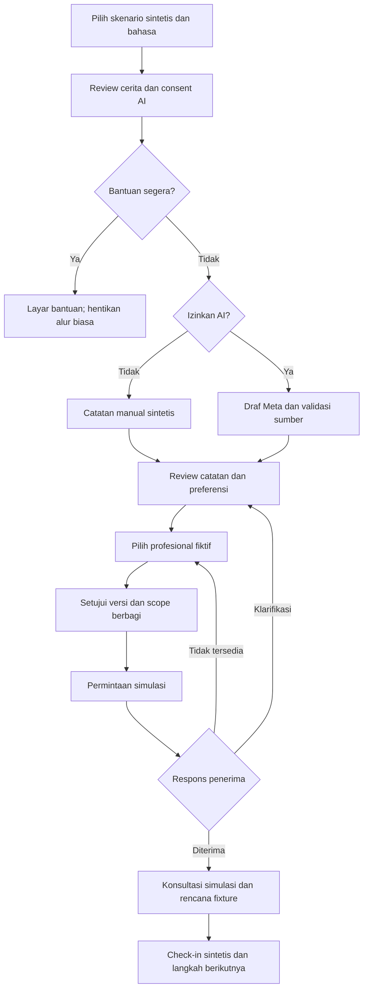

# Perjalanan dan frontend baru ID/EN

> Research/proposal reference. Authority: [SPEC.md](../../../SPEC.md); traceability: [package index](README.md#authority-and-spec-traceability). No runtime implementation or requirement change is implied.

Status: rancangan untuk demo sintetis; input bebas nyata tetap di luar scope SPEC.

## Alur utama

Klarifikasi yang mengubah catatan wajib menghasilkan versi dan persetujuan baru. Memilih penerima lain selalu membutuhkan consent berbagi baru. Jalur crisis tidak dianggap berhasil menyelesaikan handoff.

## Halaman minimum

| Halaman | Tujuan | CTA ID / EN | State wajib |
|---|---|---|---|
| Mulai / Start | Pahami Sela dan pilih fixture | Mulai pelan-pelan / Take a first step | Label demo; manual tersedia |
| Ceritaku / My story | Review sumber dan consent AI | Bantu susun catatan / Help draft my note | Declined, loading, unavailable, canceled |
| Catatanku / My brief | Periksa fakta, unknowns, tujuan dan kalimat pembuka | Tinjau catatan / Review my brief | Kutipan, negasi, edit, reapproval |
| Pilihan bantuan / Support options | Filter praktis | Lihat pilihan / Explore options | Empty, alternatif, semua profil fiktif |
| Tinjau berbagi / Review sharing | Pahami siapa menerima apa | Bagikan catatan ini / Share this brief | Recipient, field, versi, durasi akses |
| Perjalananku / My next steps | Tahu status sebenarnya | Lihat respons / View response | Requested, acknowledged, declined, expired, revoked |
| Perspektif profesional / Professional demo | Tampilkan manfaat bagi penerima | Buka catatan bersama / Open shared brief | Snapshot terbatas; role switch berlabel demo |
| Setelah sesi / After the session | Lihat rencana fixture dan langkah yang dipilih | Tinjau langkah berikutnya / Review next steps | Sumber rencana jelas, no treatment generation |

Navigasi utama cukup “Perjalananku”, “Catatanku”, dan pengaturan bahasa/privasi. Jangan tampilkan dashboard kosong penuh grafik sebelum pengguna punya tugas yang jelas.

## Arah visual

Usulan: editorial hangat, ruang putih luas, charcoal untuk teks, warna aksen sage atau biru lembut. Hindari warna hijau/merah sebagai satu-satunya indikator. Keputusan warna masih perlu pemeriksaan kontras. Tipografi berlisensi jelas dengan fallback lokal; UI harus tetap terbaca ketika font gagal.

Di mobile, satu tugas utama per layar. Pada review brief, kutipan dibuka sebagai panel yang tidak menghilangkan posisi pengguna. Tombol kembali tidak menghapus progres tanpa pemberitahuan. Navigasi keyboard, fokus yang terlihat, live announcement status dan reduced motion mencakup happy path maupun kegagalan.

Tidak ada streak, guilt notification, badge “mental health score”, animasi sedih saat pengguna keluar atau tekanan untuk berbagi. Progress menunjukkan langkah yang terselesaikan, bukan kesehatan pengguna.

## Copy yang membuat batas jelas

| Maksud | Indonesia | English |
|---|---|---|
| Demo | Semua orang, profil dan konsultasi pada demo ini fiktif. | All people, profiles and consultations in this demo are fictional. |
| Sumber | Ini draf dari cerita pada skenario. Periksa sebelum menyetujui. | This draft is based on the scenario story. Review it before approving. |
| Unknown | Belum disebutkan. Kamu boleh melewati bagian ini. | Not mentioned yet. You may skip this field. |
| AI gagal | Draf AI belum tersedia. Kamu dapat melanjutkan dengan catatan manual. | The AI draft is unavailable. You can continue with a manual note. |
| Terkirim | Permintaan simulasi terkirim. Penerima belum mengonfirmasi. | Simulated request sent. The recipient has not acknowledged it yet. |
| Dicabut | Akses berikutnya ke catatan ini sudah diblokir. Informasi yang telah dilihat atau disalin tidak dapat ditarik kembali. | Future access to this brief is blocked. Information already viewed or copied cannot be recalled. |

## Skenario demo

1. Dewasa muda berbahasa Indonesia: kewalahan kuliah, belum tahu cara memulai dan memiliki kendala biaya. Fixture berisi negasi eksplisit agar fidelity bisa diperlihatkan.
2. Dewasa berbahasa Inggris: kendala jadwal, menerima slot alternatif dan memilih informasi minimum.
3. Penolakan AI: alur manual sampai simulated handoff.
4. Penerima tidak tersedia: status jujur, pilih ulang, consent ulang.
5. Permintaan bantuan segera: ordinary flow berhenti sebelum inference.

Skenario crisis menunjukkan cabang aplikasi, bukan membuktikan deteksi akurat atas seluruh ekspresi distress. Kontak bantuan nyata hanya ditampilkan setelah verifikasi wilayah dan sumber; paket ini tidak mencantumkan nomor yang belum diverifikasi.
