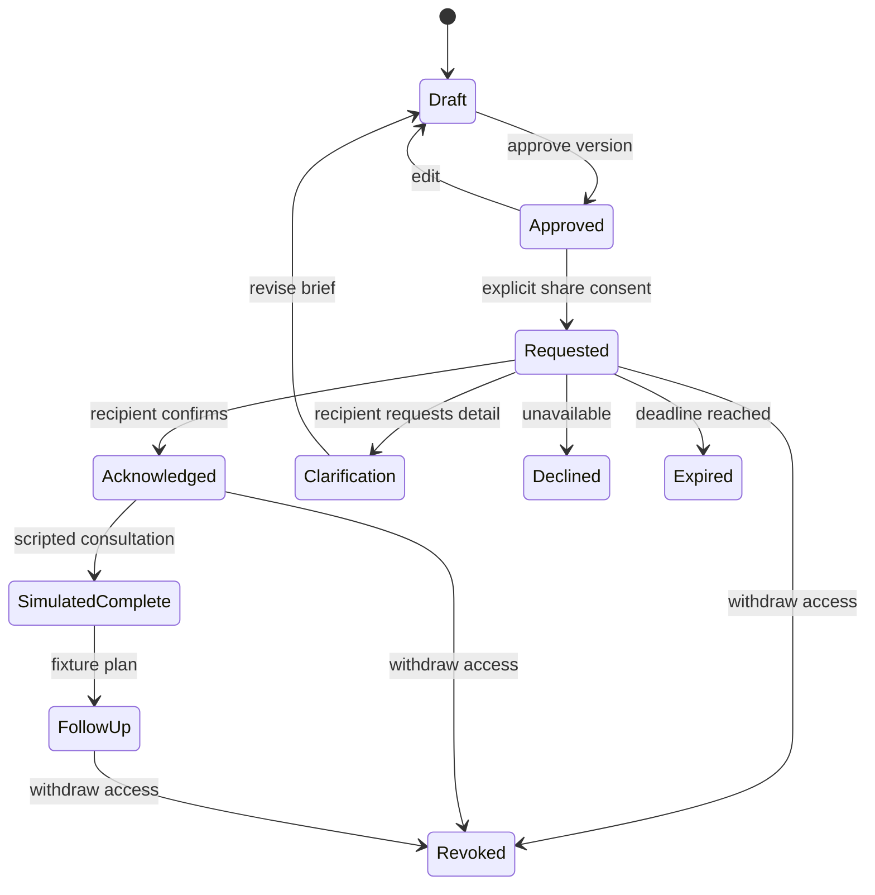

# Refaktor Go dan kontrak data

> Research/proposal reference. Authority: [SPEC.md](../../../SPEC.md); traceability: [package index](README.md#authority-and-spec-traceability). No runtime implementation or requirement change is implied.

Status: target engineering. Tidak ada kode, build baru atau live inference yang dihasilkan oleh paket ini.

## Runtime yang disarankan

Backend Go dengan HTTP API dan static serving; frontend React/TypeScript + Vite untuk interaksi browser. **Go dipakai untuk backend**; frontend browser tidak otomatis menjadi Go. Jika menginginkan frontend server-rendered Go, catat sebagai perubahan keputusan karena repo saat ini memilih React/Vite sebagai default.

Mulai dengan modular monolith: satu binary Go, satu adapter Meta, bounded session store, fixture catalog dan frontend statis. Jangan memecah ke banyak microservice untuk demo solo. PostgreSQL adalah opsi fase produksi untuk state yang perlu bertahan; Redis hanya ditambah bila ada kebutuhan lintas instance yang terukur. Keduanya tidak wajib bagi demo sesuai SPEC.

Versi Go, library dan model harus dipin setelah verifikasi toolchain dan akses. Dokumen ini tidak menebak versi terbaru. Jangan mengklaim Go lebih cepat atau lebih hemat tanpa perbandingan workload yang sebanding.

## Struktur usulan

`cmd/sela` untuk entrypoint; `internal/httpapi`, `journey`, `consent`, `brief`, `handoff`, `providers/meta`, `store` dan `fixtures` untuk batas modul; `web` untuk frontend baru. Ini path rencana, belum ada di baseline repo.

## Objek domain

| Objek | Field penting | Aturan |
|---|---|---|
| SourceSegment | id, scenario_id, original_language, text, temporal_context | Fixture immutable; teks sumber tidak diubah model |
| BriefVersion | version, claims, unknowns, goals, language, provenance | Immutable setelah approval; edit menghasilkan versi baru |
| Claim | source_ids, quote/offsets, paraphrase, subject, negation, uncertainty | Kutipan dan dukungan makna diperiksa; unknown tidak diisi tebakan |
| AIConsent | session_generation, operation, granted_at, revoked_at | Tidak memberi izin sharing |
| ShareGrant | recipient_id, brief_version, selected_fields, expiry, generation | Tidak memberi akses cerita privat |
| Handoff | idempotency_key, grant_id, status, acknowledgement | Request bukan acknowledgement atau completed consultation |
| FollowUp | fixture_plan_id, selected_checkin, consultation_state | Rencana hanya berasal dari fixture yang diperbolehkan |

Tidak perlu knowledge graph database untuk mengaitkan klaim dengan sumber. Relasi sederhana cukup. Jangan menyimpan chain-of-thought model; tampilkan sumber dan alasan berbasis data yang dapat diperiksa.

## State machine handoff

State machine ini menjelaskan inti perjalanan. Reset/expiry sesi dan crisis gate berlaku di luar semua transisi normal. Jangan menganggap satu enum menggantikan seluruh aturan consent.

## Usulan ekstensi API

Repo sudah memiliki API_SPEC untuk v2; endpoint berikut adalah usulan tambahan yang harus direkonsiliasi dengannya sebelum implementasi.

- `POST /api/v2/briefs/{id}/clarify`: satu pertanyaan/sumber sintetis; optimistic version.
- `POST /api/v2/briefs/{id}/opening`: draft kalimat pembuka dengan provenance.
- `POST /api/v2/handoffs/{id}/acknowledge`: hanya penerima yang diizinkan; idempotent.
- `POST /api/v2/handoffs/{id}/request-clarification`: alasan fixture terbatas.
- `POST /api/v2/handoffs/{id}/decline`: penolakan kapasitas yang eksplisit.
- `GET /api/v2/journey`: proyeksi state user tanpa materi log privat.

Semua ID hanyalah locator. Server memverifikasi session, role demo, generation, version, recipient dan scope. Pada produksi, role harus berasal dari identitas terautentikasi; role switch demo tidak boleh dibawa sebagai otorisasi.

## Inference dan concurrency

1. Validasi fixture, body, sesi dan admission budget.
2. Jalankan crisis gate dan consent sebelum model.
3. Snapshot input/version/generation yang dibutuhkan.
4. Kirim minimum konteks yang diizinkan, dengan deadline dan cancellation.
5. Validasi schema, sumber dan isi; model text diperlakukan sebagai untrusted data.
6. Atomic compare-and-swap: simpan hanya bila versi dan consent masih berlaku.
7. Catat model/mode, durasi dan hasil validasi tanpa cerita atau prompt.

Retry hanya untuk transient failure dalam operation budget. Tool calling dibatasi allowlist dan jumlah putaran. Tidak ada tool yang dapat otomatis menyetujui, membagikan atau menyelesaikan konsultasi. Output tool dari model tidak dipercaya sebagai keputusan server.

## Cutover

Bekukan baseline dan pertahankan rollback. Bangun satu vertical slice hingga professional view. Port perilaku penting ke Go. Setelah acceptance, ganti routing, environment, CI dan deployment sekaligus; hapus dependensi AMD dari runtime baru. Arsip, lisensi dan kredit kontribusi tetap dipertahankan.

## Perbedaan menuju produksi nyata

Demo memory-only sengaja tidak menyimpan riwayat layanan nyata. Produksi memerlukan identity boundary, credential verification, pemisahan data identitas dari catatan, enkripsi dan key management, audit akses, backup/restore, retensi, penghapusan, prosedur crisis dan governance klinis. Klaim E2EE tidak tepat untuk materi yang server/provider AI harus baca; nyatakan batas enkripsi secara spesifik.
