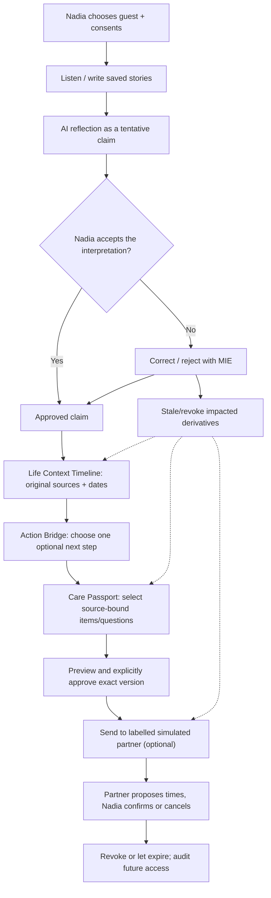

# SELA — Build for Your World expansion: Story → Meaning → Next Step

Status: **PROPOSED feature roadmap; implementation not included in this PR**. Date: **2026-11-02 (WIB)**. Target: Meta Global AI Developer Hackathon 2026, Indie / Build for Your World. Starting point inspected: `main@198b134002d7036da5057add8fdcde2d1539700c`. This roadmap is subordinate to existing shipped code, SPEC, D-065, D-076, D-078, D-079 and real safety/privacy gates. It **does not** replace the existing November roadmap or claim clinical efficacy.

## 0. Positioning and the user-world problem

> **SELA — Your Story. Your Meaning. Your Next Step.**
>
> A user-governed AI wellbeing continuity experience that helps someone turn their own words into an understandable personal timeline, a self-chosen next step and a shareable consultation-preparation document—without making the AI the authority on what the person feels.

Real-world friction: (1) finding words for a difficult experience; (2) recalling how a situation changed across days; (3) translating a long, messy narrative into a few useful questions before reaching out; (4) avoiding accidental misinterpretation as AI-derived summaries travel.

Current components (present on main; deployment version not established by this PR):
- Listening in two modes; journal/check-ins; manual weekly review; notes timeline; explicit save and AI consent.
- MIE 1.0 D-078: Meaning Diff, user approval, source version graph, transactional stale propagation, share revocation and care-request cancellation.
- User-approved consultation summaries with quote-backed items, HTML/Markdown export and follow-ups.
- Planned-care condition map, care directory, structured consented care requests, simulated professional workspace; moderator and operator console.
- The repo documents production hosting at https://sela.vertalt.my.id, but the *running commit SHA* and presence of any new feature are not independently established. Never show unreleased features as production-live.

## 1. Scope: three additive product layers

| ID | Feature | Core job | Reuse | Outcome artifact |
| --- | --- | --- | --- | --- |
| BW-1 | **Life Context Timeline** | “Show me what changed, using my words.” | Saved records, existing timeline, MIE graph and versions | Source-linked, owner-reviewable timeline of events and optional interpretations |
| BW-2 | **Care Passport** | “Help me explain what I choose to bring to someone.” | Approved consultation summary, source quotes, export, sharing, care requests | Version-bound, user-approved preparation document; not a medical passport/record |
| BW-3 | **Personal Action Bridge** | “Help me choose one small, doable next step.” | User notes, care preparation, consent, Meta generation and MIE | Optional, user-owned action with bounded state; not treatment adherence |
| BW-4 | **Meaning Trace / Evidence surface** | “Why does Sela say this?” | MIE impact/lineage endpoints; D-078 Meaning Diff | Inline source/uncertainty explainer; not a fourth AI engine |
| BW-5 | **Community-to-support boundary** (P2) | “Carry my own text into my private space, deliberately.” | Adults-only community and privacy boundaries | Explicit manual copy; **no** automatic linking of anonymous posts to private identity |

No autonomous diagnosis, prediction of deterioration, severity score, crisis outreach, real hospital booking, hidden tracking, social streaks, automatic behavioral nudges, caregiver monitoring, model substitutions, TTS or avatars. Real professional links are not a hackathon deliverable.

## 2. Priority / phased shipping

### Phase P0 — Demonstrable integrated vertical slice
1. BW-1: owner-controlled timeline of **saved source** records, with source revisions and a correction/stale indication; no inferred diagnoses and no score.
2. BW-2: one opt-in **Care Passport** from an approved summary, including purpose, chosen context, questions, provenance and audience-aware preview.
3. BW-3: create **one manual self-chosen next step**, optionally from a *tentative Meta proposal* that the user must accept; completion state is self-report only.
4. MIE tests connecting source edit → derived timeline stale marker → Care Passport reapproval/read denial → care request/share invalidation. Separate action references remain historical but non-authoritative until reviewed.
5. One continuous synthetic adult story in the demo from conversation to correction to timeline, action, approved passport, partner-simulation response and revoke.

### Phase P1 — Quality and evidence
- Genuine B0/B1/B2/T Meta baseline comparison on a frozen synthetic set and owner-reviewed outputs. Offline Meaning Diff recall is not the full live comparison.
- Screen-reader + keyboard + 320px + large text manual task run; Indonesian/English and code-switching.
- Failure paths: consent off, read-only/no-AI, source deleted, stale exported snapshot, partner permissions, no partner available.
- Privacy and legal assessment for anyone beyond owner-controlled/synthetic environment; no assumption that “production exists” implies public launch clearance.
- Add audio-free captions, reproducible fixture + runbook, UI demo cues that expose source versions and consent.

### Phase P2 — After hackathon only
- Curated educational reading cards after human editorial approval, longer longitudinal insights subject to evidence, additional assistive guidance, real provider verification/agreements and research.
- Additional automated risk or clinical interpretations require separate ethics/legal/safety planning and are *not* implied by this plan.

## 3. End-to-end reference journey

All story/AI/healthcare-like data in demonstration must be clearly synthetic. Care flow is optional: the person can finish at timeline or action bridge without selecting a professional.

## 4. Task decomposition and ownership

| Task | Priority | Owning surface | Prerequisites | Definition of Done |
| --- | --- | --- | --- | --- |
| BW-001 Audit entry/consent/data flow | P0 | PM, backend, UX | D-078, D-076, D-079 | Traceability baseline and no parallel record store |
| BW-002 Timeline read-only projection | P0 | Account + HTTP API | BW-001 | Correct owner scope, pagination, source/version, stale status; no external model call |
| BW-003 Timeline UI | P0 | React v3 | BW-002 | ID/EN, 320px, keyboard, source click, empty/error/retry |
| BW-004 Context interpretation (optional) | P1 | Meta + MIE | BW-002 | Source-bound provisional claims requiring user approval; never silent history edits |
| BW-005 Passport projection from summary | P0 | Account + HTTP API | D-078 summaries | Consented owner-scoped exact approved snapshot and version |
| BW-006 Passport preview/approve/export | P0 | React v3 + existing export | BW-005 | Exact view matches exported/shareable fields; no new recipient bypass |
| BW-007 Action Bridge domain/consent | P0 | PostgreSQL account / Go | D-078 | Owner approval, no diagnosis, clear private state, deletion/export |
| BW-008 Action Bridge UI | P0 | React v3 | BW-007 | Manual path works offline/no AI; opt-in proposals visibly tentative |
| BW-009 MIE cross-surface integration | P0 | Go/DB | BW-002/005/007 | Revisions force stale/reapprove, old share denied, idempotent |
| BW-010 Synthetic Nadia fixture | P0 | QA | BW-002/005/007 | Stable deterministic fixture with 3 dates and no personal data |
| BW-011 3-minute video + alt runbook | P0 | Demo/PM | P0 suite green | Shotlist matches real build; no fake provider/partner labels |
| BW-012 Baseline vs MIE live evaluation | P1 | AI/QA | BW-010 | Counts/CI/ablation with pinned provider IDs and SHA |
| BW-013 Safety/privacy/a11y stress tests | P0 | QA | BW-009 | Strict no-go conditions covered, manual WCAG evidence |
| BW-014 Production build fingerprint | P0 | SRE/owner | Release SHA | /api/v2/health matches commit and image; demo tenant isolated |
| BW-015 Final submission evidence | P0 | Owner | BW-011–014 | Code, screenshots, eval results, acknowledgments, license, receipt |

## 5. Required product decisions (before engineering)

1. **Timeline scope:** default only saved user-authored records; AI-based descriptions are opt-in provisional and never override originals. Avoid presenting a “progression of disease”.
2. **Action consent:** actions entered manually are user-authored private records; external Meta proposals only use consented excerpts, and an action is never auto-created/scheduled. No cross-purpose implicit consent.
3. **Action language:** “sudah dicoba / belum ingin / tidak cocok”, never therapy adherence, success streaks, risk risk classes, or “recovered”.
4. **Passport identity:** “care preparation sheet / ringkasan persiapan konsultasi”, *not* a certified medical passport. No forced real name/medical ID; audience preview is exact.
5. **Recency and stale:** if an included source is corrected, revised or deleted, a passport that relies on it becomes stale; read-time checks block onward sharing until reapproval. Immutable previous copies cannot be clawed back.
6. **Provider choice:** current D-065 Meta-only generation/verifier, no hidden fallback; deterministic Go checks remain authoritative.
7. **Ages:** current production is owner-controlled and has safeguards for minors; hackathon story uses fictional 18+ only. Do not claim support for 15-year-olds when current server refuses them.
8. **Real humans:** no real patient information, clinician identity, hospital account or appointment in demo. No auto-contact.

## 6. Evidence-based value proposition

The app should be able to demonstrate **task completion**, not emotional/clinical outcomes:
- User can find the exact source of an interpretation.
- User can correct it and see downstream artifacts stop using stale wording.
- User can review a multi-date story in a readable timeline.
- User can create an own-words Care Passport without sharing an entire journal.
- User can choose one small next step or decline suggestions.
- User can revoke/expire a simulated share and see the access state.

Measurable product task metrics: completion count, incorrect field disclosures (target 0 in synthetic test), source trace recall, time-to-prepare a summary (descriptive), mismatched versions (target 0), action opt-in/decline correctness, accessibility task completion. **Not** improvement in depression, clinical safety, or health outcomes.

## 7. Non-negotiable release gates

- Gate A: no unconsented Meta calls / unapproved memory / unowned record reads.
- Gate B: source corrections invalidate *every* dependent artifact atomically and recipient reads deny after commit.
- Gate C: manual no-AI path remains useful; Meta failure does not lose the owner's words.
- Gate D: one E2E synthetic journey verified on a pinned commit; screenshot/video reflect that code.
- Gate E: legal, DPIA, age, operator, backup and medical-disclaimer gates still apply for any real-user launch.
- Gate F: docs PR and implementation PR(s) remain reviewable; no merge/deploy without explicit owner approval.

## 8. Navigation

- [Life Context Timeline contract](../product/LIFE_CONTEXT_TIMELINE.md)
- [Care Passport contract](../product/CARE_PASSPORT.md)
- [Personal Action Bridge contract](../product/PERSONAL_ACTION_BRIDGE.md)
- [Cross-surface architecture](../architecture/MEANING_CONTINUITY_EXTENSION.md)
- [Acceptance and testing](../validation/BWYW_ACCEPTANCE.md)
- [Video storyboard](../demo/META_HACKATHON_2026_STORYBOARD.md)
- [Reproducible demo runbook](../demo/META_HACKATHON_2026_RUNBOOK.md)
- [Synthetic story content](../demo/SYNTHETIC_NADIA_FIXTURE.md)
- [Existing technical roadmap](SAFE_FLOW_AND_TODO.md)
- [Existing MIE](../vision/MEANING_INTEGRITY_ENGINE.md)
- [Implemented care network API](../api/API_SPEC_CARE_NETWORK.md)

This PR is an **implementation-ready specification + video-production package**, not a substitute for implementation or a claim that video is already recorded.
