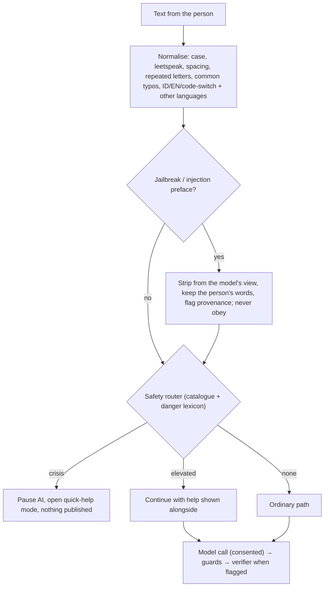
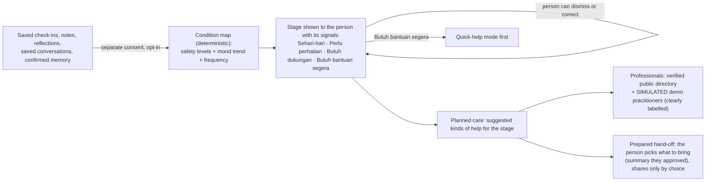
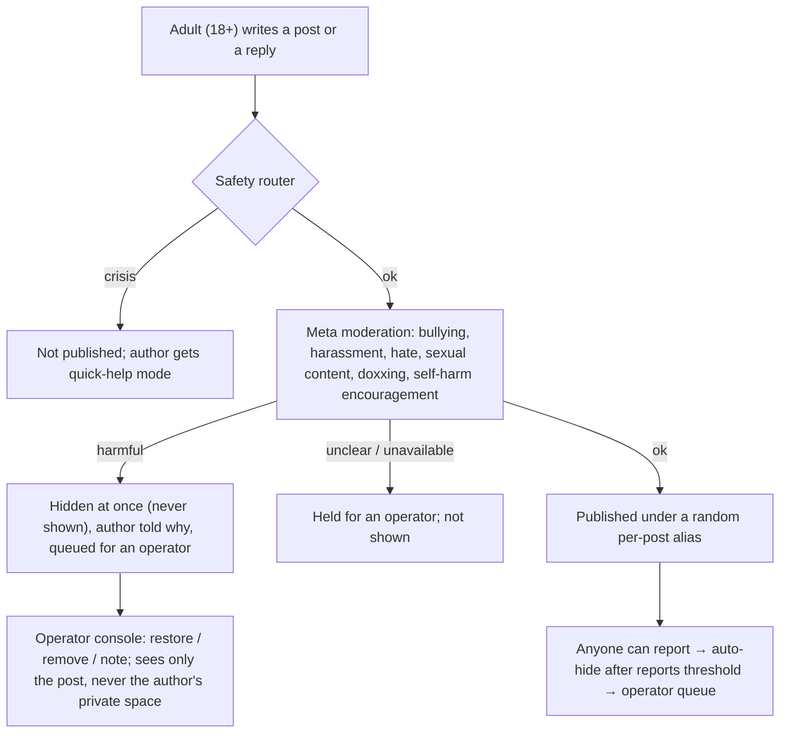

# Safer flow and TODO — November 2026

Status: **owner-directed plan, in progress**. Date: 2026-11-01 (WIB). This is the working plan that the owner asked for on 2026-11-01. It reconciles the open draft PR #28 (`docs/hackathon/*`, Meta Hackathon 2026 package) with the direction taken in this repository since then. Where this plan and PR #28 differ, the decision records named below win; every status word follows [SPEC §G](../../SPEC.md#g-goal).

Production: **https://sela.vertalt.my.id** (owner-confirmed). A read-only check on 2026-11-01 returned `200`, `/api/v2/health` → `mode: production`, `/api/v2/ready` → `ai: meta_api`, `database: ok`, `schema: current`, with a strict CSP, HSTS and `X-Frame-Options: DENY`. The deployed commit is not exposed (`version: prod`), so the build that production runs is still **unverified** (PR #28 H-001).

## 1. What changed since PR #28 was written

| Area | PR #28 assumption (base `45c0248`) | Now (this branch) | Record |
| --- | --- | --- | --- |
| Production | Owner-reported, unverified URL | URL known and answering; build SHA still unknown | §3 S-001 |
| Listening replies | One reply style, four intents | Two modes: "Ngobrol & cari solusi" (default) and "Didengarkan saja"; natural, solution-oriented | D-066, D-067 |
| Safety router | v1-derived catalogue | Danger lexicon: threats to others, the speaker in danger (`in_danger`), prepared means, farewells; quick-help mode opens by itself | D-073 (was a duplicate D-068), D-075 |
| Demo edition | Present | Retired; production runs the real configuration | `b8fe618` |
| Scope during the event | MIE only; no new large features | Owner adds: anti-jailbreak and multilingual guardrails, condition map, simulated professionals, anonymous peer sharing with Meta moderation, operator upgrades | D-074 (this plan; first recorded as a duplicate D-069) |

The flagship of PR #28 — source-bound correction and invalidation (Meaning Integrity Engine, H-003–H-009) — is **kept** and not displaced: the new features are built so that they consume only user-approved, versioned material and therefore inherit MIE's invalidation once it lands.

## 2. Weaknesses found (review of PR #28 and the code)

| ID | Finding | Severity | Action |
| --- | --- | --- | --- |
| W-01 | The safety catalogue had no rule for threats to others (`acute_violence` was empty), the speaker being hurt or threatened, prepared means or written farewells (probe of 52 phrases) | P0 | Fixed in D-068 |
| W-02 | Guards and the crisis router read Indonesian and English only; misspellings such as "bnuh dri", "gantug diri", "kil myself" and phrases in other languages ("quiero morir", "我想死") were missed, and a jailbreak preface ("ignore previous instructions", "you are now DAN") was not handled as such | P0 | Fixed in D-070 (S-010–S-013) |
| W-03 | The production build SHA is not exposed, so no evidence can be tied to the deployed commit (PR #28 H-001) | P0 | S-001 |
| W-04 | Production answers with two `Strict-Transport-Security` and two `X-Content-Type-Options` headers (proxy and app both set them) | P2 | S-002 (proxy owner) |
| W-05 | PR #28 plans MIE but no step makes later features consume only approved versions | P1 | S-020 rule: the condition map reads approved/saved records only |
| W-06 | Planned care shows a public directory but has no path from the person's own material to a prepared, consented hand-off | P1 | Condition map and demo professionals in D-071; hand-off S-023 open |
| W-07 | No community feature, so the old Dengar.in peer space has no safe successor; a naive port would expose minors and crisis posts | P1 | Built moderated and adults-only in D-072; evaluation S-036 open |
| W-08 | Repository hygiene: no Code of Conduct, credits and security policy describe retired branches | P2 | Fixed (S-040–S-046) |

## 3. Safer flow

### 3.1 Every message (chat, note, post, reply)

### 3.2 Planned care with a condition map

Rules: not a diagnosis, triage or risk score; no number is shown; nothing is computed from unsaved conversations; the stage is recomputed on demand and never sent to a model or a professional unless the person chooses to include it; demo practitioners are fictional and can never receive real data.

### 3.3 Anonymous peer sharing

Rules: posts hold no profile link; aliases are random per thread; contact details and names are masked before publishing; a person can delete their own post; operators see posts only through the moderation queue.

## 4. TODO

Status legend: `.` planned · `~` in progress · `x` done with evidence · `!` blocked externally. PR #28 task IDs are named where they overlap.

### Repository and release hygiene
- [x] S-040 LICENSE: "Copyright (c) 2026 Sela — YanIanZ", Dengar.in copyright kept below as the forked origin (MIT requires it)
- [x] S-041 CONTRIBUTING rewritten for the current runtime
- [x] S-042 SECURITY rewritten (supported versions, reporting, controls, production)
- [x] S-043 CODE_OF_CONDUCT (Contributor Covenant 2.1, adapted)
- [x] S-044 README: product link https://sela.vertalt.my.id, credits, fork note
- [x] S-045 Favicon and app icons refreshed (SVG + PNG + manifest)
- [x] S-046 In-app credit: "© 2026 Sela — YanIanZ", forked from Dengar.in, in the footer and About
- [x] S-001 Expose the build SHA on `/api/v2/health` — `scripts/compose-up.sh` (production must deploy with it)
- [ ] S-002 Remove the duplicated HSTS / nosniff headers at the proxy (owner, hosting)

### Guardrails
- [x] S-010 Anti-jailbreak: injection/jailbreak prefaces detected and neutralised before every model call; guard for echoed persona switches
- [x] S-011 Typo tolerance: deliberate misspellings, spacing and repeated letters of risk words read by the safety router
- [x] S-012 Multilingual: crisis and danger phrases in Malay, Javanese, Sundanese, Spanish, Portuguese, French, Tagalog, Vietnamese, Chinese and Arabic, plus English and Indonesian
- [x] S-013 Tests pinning both sides (risk caught, everyday phrases ordinary)

### Planned care
- [x] S-020 Condition map (opt-in consent `condition_map`): deterministic stage from saved material, with the signals that produced it
- [x] S-021 Planned-care page shows the stage, what it means, and suggested kinds of help
- [x] S-022 Simulated professional directory for the product demo (clearly fictional, cannot receive real data)
- [x] S-023 Hand-off from an approved summary to a simulated practitioner — care requests (D-076), protected by the MIE read-time gate (D-078)
- [ ] S-024 Evaluation of stage stability on synthetic journeys (PR #28 H-010/H-011)

### Anonymous peer sharing
- [x] S-030 Data model and migration (posts, replies, reports, moderation decisions)
- [x] S-031 Publishing pipeline: safety router → Meta moderation → publish / hide / hold
- [x] S-032 Reports and auto-hide threshold
- [x] S-033 Operator moderation queue (restore / remove)
- [x] S-034 Web: community list, thread, compose, report, own-post delete
- [x] S-035 Rate limits per author (5 posts, 30 replies per hour) with PostgreSQL counters; a Redis fast path stays optional
- [ ] S-036 Moderation evaluation set (bullying, banter, quotes, reclaimed words) with false-positive review

### Meaning Integrity Engine (unchanged from PR #28)
- [x] H-003–H-009 claim graph, corrections, invalidation, read-time gate, review UI — MIE 1.0 (D-078): backend `a19b876`, review/impact/stale UI; scenario B passes in `TestMeaningCorrectionPropagates` and in one browser run against a local server
- [~] H-010–H-013 scenarios, evaluation, end-to-end evidence, video and submission — synthetic MIE set (128 cases) and offline B1 evaluation done; live Meta B0/B2/T comparison, video and submission open

## 5. Evidence (2026-11-01, branch `feat/sela-roadmap-nov`)

- `go test ./...` with `SELA_REQUIRE_DB_TESTS=1` against PostgreSQL 16: pass (community store, condition map, migration 1000, safety 2,600 vectors + new danger, typo and language tests, jailbreak tests).
- Web: typecheck and 64 tests pass (condition map stage, crisis in the sharing space, under-18 gate).
- Local Docker with live Meta: a supportive reply was published by Meta moderation, "dasar cengeng, gitu aja lebay" was hidden by the rules, a reply reading as crisis returned `422 crisis` and opened quick-help mode, a "very heavy" check-in showed "Perlu perhatian" with its reason; axe found no serious violations on planned care and the sharing space.
- Not done: production deploy of this branch, Redis rate limits, moderation evaluation set (S-036), hand-off to a simulated practitioner (S-023), MIE (H-003–H-013).

## 6. Decision

D-074 (2026-11-01, owner; first recorded as a duplicate D-069): adopt this plan. The new features stay inside Sela's boundaries — not diagnosis, triage, therapy or emergency service; demo professionals are fictional; community is adults-only and moderated before anything is shown.
